# Desk

<p align="center">
  
</p>

<p align="center">
  
  
  
</p>

A calm graphical shell for MS-DOS from Liminal HQ: windows, files, programs and a few small apps on a 486, with any DOS program a double-click away. A DOS program gets the whole machine, and the Desk comes back when it exits. Rust for everything above the hardware, C for the hardware, DJGPP and CWSDPMI underneath.

It is the spiritual successor to [Lieutenant Fizz for DOS](https://github.com/ScottMorris/lieutenant-fizz-dos), which proved that Rust can drive a real DOS machine. This project starts from scratch with what that port taught us, and its toolchain is written fresh for this project rather than copied.

> **Status:** design and spikes. Nothing runs yet. [`docs/SPEC.md`](docs/SPEC.md) is the working design, written before any code, so its numbers and formats are targets until a spike confirms them. "Desk" is a working name; [`docs/NAMING.md`](docs/NAMING.md) has the candidates.

## What it will be

- **A richer place than the prompt.** Move between files and programs with a mouse or the keyboard, run several small apps side by side, and come back to where you were.
- **Small core, everything else optional.** The shell, Files, Programs and Settings are the core; every other app installs and removes on its own.
- **Runs every DOS program.** Desk apps run in windows. Any `.COM`, `.EXE` or `.BAT` runs full-screen with the whole machine, then returns to the Desk ([`docs/HANDOFF.md`](docs/HANDOFF.md)).
- **An SDK for apps.** Independent modules that talk to the Desk through one C ABI ([`docs/SDK.md`](docs/SDK.md)).
- **Calm.** Nothing badgers you: no unread counts, no alarm red, quiet toasts that time out.

## First milestones

1. **Spikes** that decide the architecture ([`spikes/`](spikes/)): a Rust module loaded into the core; VBE 2.0 and VGA mode 12h from Rust; the mouse; the handoff with a tiny real-mode program.
2. **Shell:** compositor, windows, launcher bar, cursor, keyboard focus.
3. **Handoff:** run a DOS program and come back.
4. **Core apps:** Files, Programs, Settings.

The full list is in [`docs/SPEC.md`](docs/SPEC.md#milestones), and [`docs/OPEN-QUESTIONS.md`](docs/OPEN-QUESTIONS.md) says what is decided and what is not.

## Repository

| Folder | What it holds |
|---|---|
| `docs` | The working design: spec, SDK, file formats, handoff, palette, app guidelines, open questions, naming |
| `design` | Boards and prototypes from the design brainstorm, kept as reference only |
| `core` | The shell in Rust (`no_std`) and the DOS target specification; today the walking skeleton's one function |
| `c` | The hardware layer in C for DJGPP; today `main`, result output and the panic exit |
| `launcher` | `DESK.COM`, the real-mode launcher (empty until the handoff spike) |
| `sdk` | The app interface (empty until the first spike settles how apps load) |
| `spikes` | Experiments that decide the architecture |
| `tests/dos` | Test programs of our own for the headless DOS runs |
| `fonts` | The four bitmap faces as pixel grids, the modern outline faces (Desk Sans, Mono and Serif), the emoji, and their build into OTF, TTF, `.DFN` and `.DEM` files ([`docs/FONTS.md`](docs/FONTS.md), [`docs/EMOJI.md`](docs/EMOJI.md)); the fonts are under the SIL Open Font License 1.1 |
| `tools` | Repository checks, the DOS build pipeline (setup, fetch, build, object converter, headless DOSBox runner) and the banner builder |

## Working on it

```bash
tools/setup.sh    # once: the pinned Rust pieces, then DJGPP, DOSBox Staging and CWSDPMI into vendor/
tools/check.sh    # everything the CI runs: checks, then build dist/DESK.EXE and run it in headless DOSBox
python3 -I tools/build-hero.py > assets/hero.svg    # rebuild the banner
```

[`docs/TOOLCHAIN.md`](docs/TOOLCHAIN.md) explains the build pipeline and what it was checked against. [`AGENTS.md`](AGENTS.md) has the conventions: Canadian English, unwrapped markdown, Conventional Commits, merge commits only.

## Licence

Apache-2.0 OR MIT (`LICENSE-APACHE`, `LICENSE-MIT`). CWSDPMI and JEMMEX will ship beside the Desk as separate programs under their own licences; see `NOTICE`.
