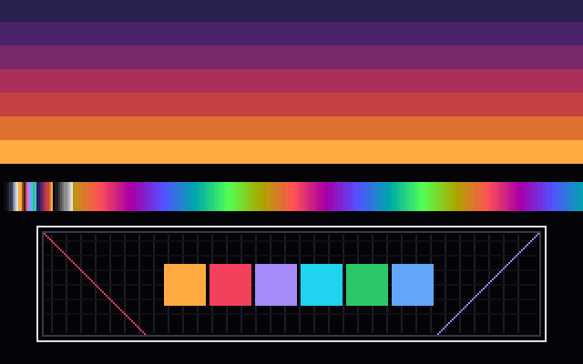
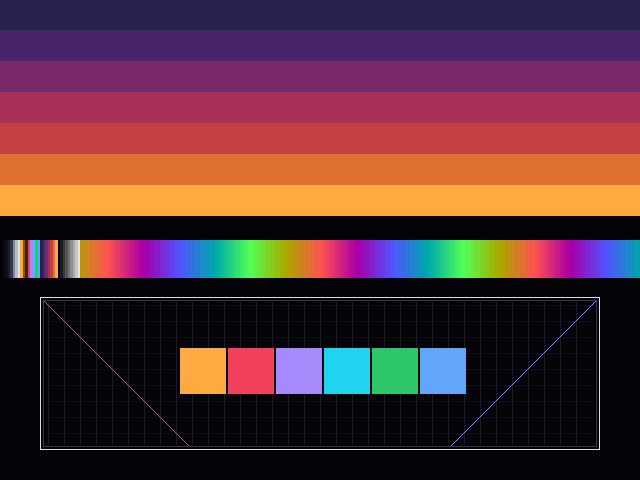
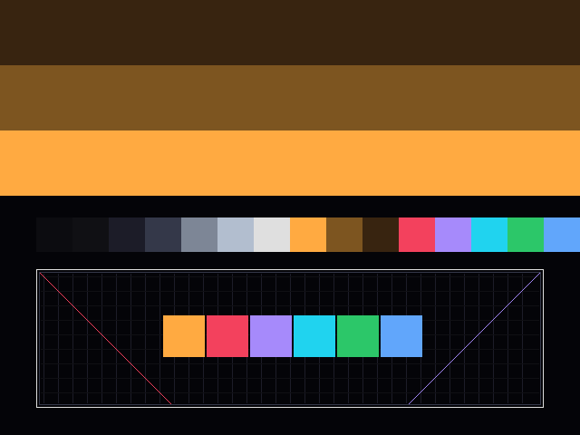

# A: VGA modes 13h and 12h and VBE 2.0 from Rust

Spike A (`s2-vbe` in the older numbering): one driver, `desk-vga` in `hal/drivers/vga`, that programs VGA mode 13h and mode 12h directly through the ports, loads and fades the DAC palette, draws into an 8-bit linear or a planar frame buffer, and speaks VBE 2.0 through a `Bios` trait, plus the DOS platform that implements that trait and a hosted program (`spikes/a-vga-vbe`) that proves each piece in headless DOSBox Staging. The design it follows is [`HAL.md`](HAL.md) ("Video" and "Contract for spike A"); the runtime is [`D0-RUST-DOS.md`](D0-RUST-DOS.md).

> **Status.** *Built and verified:* the driver and its 80 host tests (the whole `hal/` workspace) against the register-file model and a scripted BIOS; `VGAVBE.EXE` running every stage in DOSBox Staging 0.83 on a `svga_s3` machine, with checksums, a palette round trip, a fade, and the negative runs. *Not verified:* real hardware, 86Box, QEMU or Bochs, other VBE BIOSes, DPMI hosts other than CWSDPMI, the native kernel, banked VBE modes. Nothing here has run on a machine with an actual VGA chip.

## Contents

- [What was built](#what-was-built)
- [Method](#method)
- [Register tables](#register-tables)
- [Results](#results)
- [Screenshots](#screenshots)
- [What DOSBox does and does not model](#what-dosbox-does-and-does-not-model)
- [Expected differences on other hardware](#expected-differences-on-other-hardware)
- [What the native platform must implement](#what-the-native-platform-must-implement)
- [HAL feedback](#hal-feedback)
- [Commands](#commands)
- [What was and was not verified](#what-was-and-was-not-verified)

## What was built

| Piece | Where | What it is |
|---|---|---|
| Video types | `hal/hal/src/video.rs` | `Rgb6` (the DAC's six-bit colour, with 8-bit conversion and scaling), `PixelLayout`, `ModeInfo`, `FrameBuffer`, the `Display` trait |
| `Bios` trait | `hal/hal/src/bios.rs` | One real-mode software interrupt with an optional buffer in low memory, and `read_low` for the far pointers a VBE block holds |
| `desk-vga` | `hal/drivers/vga` | `regs` (mode 13h and 12h tables and the programming sequence), `dac` (palette, bounded retrace wait, fades), `canvas` / `linear` / `planar` (drawing, read-back, Adler-32), `vbe` (information and mode blocks, calls 4F00h to 4F03h and 4F05h) |
| Mock models | `hal/platform/mock` | `VgaModel`, the register file at `0x3C0..=0x3DF`; `MockBios`, scripted replies |
| DOS platform | `spikes/d0-rust-dos/rt/src/hal.rs` | `DosBios` (DPMI 0300h, a 512-byte conventional-memory buffer), `DosDisplay: Display` (mode list, mode set, linear frame buffer mapped with DPMI 0800h, clean-up list) |
| Program | `spikes/a-vga-vbe` | `VGAVBE.EXE`, its build and its check |
| Converter | `tools/raw2png.py` | A frame buffer dump and a DAC dump to an indexed PNG |

`desk-vga` has no `unsafe`, makes no INT 10h or DOS call, and is generic over `PortIo` (no trait objects). The DOS-specific parts are in `rt`: the port bus is `RawPorts` (the one `unsafe` step, in `DosDisplay::new` and `main`), mode setting by INT 10h and VBE 4F02h, and the DPMI mapping. The native kernel can reuse every line of `desk-vga`.

## Method

The picture is drawn by one function written against the `Canvas` trait (`spikes/a-vga-vbe/prog/src/scene.rs`): the Afterglow horizon as stepped bands (seven in 256 colours, slots 10, 9 and 8 in 16, as [`PALETTE.md`](PALETTE.md) says), a ramp that shows every palette slot, and a box of 1-pixel lines with a grid, diagonals and six accent swatches. The same function draws into a `Vec` in memory, and the Adler-32 of that reference is what the frame buffer's read-back must equal. In mode 12h the read-back goes through the read map select, one plane at a time, so the checksum is of what the planes hold, not of what was written. A stage passes when its checksum matches; a deliberately corrupted pixel must make it fail (`corrupt`).

Each mode is set two ways where both exist: by registers from text mode (`desk_vga::regs::set_mode_13h` and `set_mode_12h`, no BIOS), and by INT 10h through `DosDisplay`. After each, the registers are read back through the ports and compared with the table, which shows what the BIOS programs differently.

The order matters and follows the IBM VGA technical reference as FreeVGA documents it: video off (attribute index 0), sequencer in synchronous reset while the miscellaneous output register changes, sequencer registers, CRTC register 0x11 written with bit 7 clear (bit 7 write-protects CRTC registers 0 to 7), CRTC, graphics controller, attribute controller after a read of `0x3DA` resets its index/data flip-flop, then `0x20` to `0x3C0` to turn video on. The host tests assert the exact 128 writes for mode 13h and the model refuses protected CRTC writes, so skipping the unlock fails a test.

## Register tables

The values are the standard ones for these modes. They are written from the FreeVGA register references and from the tables the Linux console and SVGALIB use; they were not copied from one source, and they were checked in one way only: DOSBox Staging's BIOS gives the same registers for the same modes, apart from two differences listed below. A real VGA, with real monitor timing, has not seen them.

**Miscellaneous output (`0x3C2`) and sequencer (`0x3C4`/`0x3C5`)**

| | Mode 13h | Mode 12h | Meaning |
|---|---|---|---|
| Misc | `63h` | `E3h` | Clock 25.175 MHz, I/O at `3Dx`, RAM enabled; `E3h` is 480-line polarity |
| SR0 reset | `03h` | `03h` | Released |
| SR1 clocking | `01h` | `01h` | 8-dot characters |
| SR2 map mask | `0Fh` | `0Fh` | All four planes writable |
| SR3 character map | `00h` | `00h` | |
| SR4 memory mode | `0Eh` | `06h` | Mode 13h: chain-4 (one byte per pixel at consecutive addresses), no odd/even. Mode 12h: planar, no odd/even |

**CRTC (`0x3D4`/`0x3D5`), registers 0 to 24**

| Mode | Values |
|---|---|
| 13h | `5F 4F 50 82 54 80 BF 1F 00 41 00 00 00 00 00 00 9C 8E 8F 28 40 96 B9 A3 FF` |
| 12h | `5F 4F 50 82 54 80 0B 3E 00 40 00 00 00 00 00 00 EA 8C DF 28 00 E7 04 E3 FF` |

Registers 0 to 7 are the horizontal totals and the start of vertical timing, 9 the maximum scan line (mode 13h doubles scan lines: `41h`), 10h and 11h the vertical retrace start and end (bit 7 of 11h is the protect bit), 12h the vertical display end (`8Fh` is line 399 for 13h, `DFh` is line 479 for 12h), 13h the offset (pitch in words: 40 for 320 bytes, 40 for 80 bytes of planar row), 14h underline and doubleword mode (`40h` in 13h), and 17h the mode control (`A3h` byte mode for 13h, `E3h` for 12h).

**Graphics controller (`0x3CE`/`0x3CF`), registers 0 to 8**

| Mode | Values | Notes |
|---|---|---|
| 13h | `00 00 00 00 00 40 05 0F FF` | Register 5 `40h`: 256-colour shift register. Register 6 `05h`: graphics, 64 KiB at `A0000h` |
| 12h | `00 00 00 00 00 00 05 0F FF` | Register 5 `00h`: write mode 0, read mode 0 |

**Attribute controller (`0x3C0`), registers 0 to 20**

| Mode | Palette 0 to 15 | 10h mode control | 11h overscan | 12h plane enable | 13h pan | 14h colour select |
|---|---|---|---|---|---|---|
| 13h | `00`–`0F` | `41h` | `00h` | `0Fh` | `00h` | `00h` |
| 12h | `00`–`0F` | `01h` | `00h` | `0Fh` | `00h` | `00h` |

The attribute palette for mode 12h is the **identity** here. A BIOS leaves the EGA-compatible mapping (colour 6 selects DAC entry `14h`, colours 8 to 15 select `38h` to `3Fh`); the Desk loads DAC entries 0 to 15 itself, so it wants colour n to be entry n. `DosDisplay::set_mode` calls `attribute_palette_identity` after the BIOS sets mode 12h.

**Differences from DOSBox's BIOS** (read back after INT 10h, compared with the table): sequencer register 0 reads `00h` where the table's read-back is `03h`, in both modes (DOSBox's BIOS leaves it reading 0; the cause was not investigated, and it does not change the picture); and the BIOS leaves bit 7 of CRTC register 11h set in mode 13h, which the table does too (`8Eh`). Nothing else differs, which is evidence for the tables and not proof, because DOSBox's VGA does not model every register's effect.

**The DAC.** An index to `0x3C8` (write) or `0x3C7` (read), then red, green and blue in turn through `0x3C9`, six bits each; the index advances after each triple, so the 768 values of a whole palette follow one index write. `0x3C6` is the pixel mask, set to `FFh` so every entry is reachable. The fade scales each channel by `(16 − i) / 16` over 16 frames, one wait for vertical retrace (`0x3DA` bit 3) before each palette write, and the last frame is exactly black (or, fading in, exactly the palette).

**Mode 12h writes.** A pixel's four bits live in the four planes at the same address. The driver writes in write mode 0 with enable set/reset `0Fh`: the colour goes into the set/reset register, the bit mask selects the pixels of the byte that change, and the latches (loaded by a read of that address) keep the rest; a whole byte (`bit mask FFh`) needs no read. Reading uses read mode 0 with the read map select (GC register 4) naming the plane. `Planar16` sets this state when created and puts enable set/reset and the bit mask back when dropped.

## Results

Run in DOSBox Staging 0.83 (`machine = svga_s3`, `cputype = 486`, `core = normal`), in the CI image:

| Stage | Result |
|---|---|
| DAC through the ports from ring 3 | all 256 entries read through `3C7`/`3C9`, a test palette written through `3C8`/`3C9` and read back equal, the original restored; this is the first port I/O from a DPMI client under CWSDPMI in the hosted runtime, and it works without a fault |
| Mode 13h by registers | registers read back equal the table; frame buffer checksum `0x5c0f1f16`, equal to the picture in memory; fade out ends black and fade in restores the palette, all 32 frames synchronised to retrace |
| Mode 13h by INT 10h | same checksum `0x5c0f1f16`; registers differ from the table only in SR0 |
| Mode 12h by registers | registers read back equal; planes read back through the read map select: checksum `0xfaf8b758`, equal to the picture in memory |
| Mode 12h by INT 10h | same checksum `0xfaf8b758`, after the identity attribute palette |
| VBE 2.0 | information block parsed (version 2.0, 4,096 KiB, OEM "S3 Incorporated. Trio64", 59 modes); mode `0x101` (640 × 480 × 8) found with a linear frame buffer at physical `0xC0000000`, pitch 640; an unknown mode is refused with status 1 and text mode stays; the mode is set with the `0x4000` bit, the frame buffer mapped with DPMI 0800h, the picture drawn and read back: checksum `0x5bc65936`, equal to the picture in memory; fade; text mode restored and the mapping released |

The negative runs: a pixel flipped after drawing gives `checksums match: false` and exit status 1; `DOS_MACHINE=vgaonly` has no VBE (4F00h returns without AL = 4Fh), the run says so, text mode is back and the status is 2; a panic in mode 13h and an exit in mode 13h both end with the video mode `0x03` (the program registers a report first, so it runs after the runtime's clean-up list); a wrong expected transcript fails the check.

## Screenshots

These are not DOSBox renderings: they are the frame buffer read back by the program (and the DAC read back through the ports), converted by `tools/raw2png.py`, so they show what the hardware model held.

| Mode 13h, 320 × 200 (shown at 2×) | VBE 640 × 480 × 8 linear | Mode 12h, 640 × 480 × 16 colours |
|---|---|---|
|  |  |  |

The horizon values in 256 colours are illustrative: `PALETTE.md` names the ramp steps (purple-800, red-700, orange-300) without giving their values.

## What DOSBox does and does not model

What DOSBox Staging 0.83 offered, as measured:

- **`machine = svga_s3`** (an S3 Trio64): a VBE 2.0 BIOS with 4 MiB of video memory and 59 modes in the list. Of the 8-bit and 4-bit ones, 640 × 400, 640 × 480, 800 × 600 and 1024 × 768 at 8 bits report a linear frame buffer; 1280 × 1024, 1600 × 1200 and some others at 8 bits report banked only; the 4-bit modes are banked planar.
- **The linear frame buffer** is at physical `0xC0000000`. CWSDPMI's function 0800h mapped it and the program read and wrote through it.
- **`machine = vgaonly`** has no VBE; the BIOS call returns with AX unchanged.
- It models the VGA register file and the DAC well enough that direct register programming from text mode produces the right mode, the CRTC protect bit (the driver unlocks first, and the DOSBox run proves the order works), the attribute flip-flop, retrace timing (the retrace bit toggled in every one of the 64 waits), and the four planes with set/reset, bit mask and read map select.
- It does **not** model: monitor timing (the CRTC values could be wrong in many ways and still produce the same picture), I/O delays, snow or tearing, DAC read-back quirks of real chips, behaviour with the DAC in 8-bit mode, a chip that does not honour a register, or a card with no retrace bit.

## Expected differences on other hardware

These are expectations, not measurements.

- **Real VGA chips** accept the standard tables, but some need the CRTC and sequencer in the exact order used here, and a few clone chips want a short delay between DAC accesses; the driver does none (`PortIo::io_wait` exists for that). A monitor shows the timing, so a wrong CRTC value that DOSBox hides can give a rolling or offset picture.
- **The retrace bound** (`VRETRACE_POLLS`, a million reads per phase) is in polls, not time: about a second on a 486 with ISA reads, less on a faster bus. The fade does not fail when it times out; it writes anyway and counts it.
- **Other emulators**: QEMU's VGA (a Bochs VBE card; VBE through the Bochs BIOS, with the linear frame buffer on PCI) and 86Box (several S3, Cirrus and ATI cards) have their own VBE BIOSes. The mode list, the frame buffer address and which modes are linear will differ; the driver reads all three from the BIOS and finds the mode, so it should work, but it has not run there.
- **Other BIOSes** may not accept the "VBE2" signature request, return the strings inside the buffer rather than in ROM, or leave the mode list in the buffer; `read_low` handles both. A VBE 1.2 BIOS has no linear frame buffer, so the Desk falls back to mode 12h or banked modes, which this spike does not implement (4F05h is wrapped and unit-tested only).
- **Other DPMI hosts**: CWSDPMI only. Windows 9x's DOS box and HDPMI may trap or restrict port I/O and 0800h.

## What the native platform must implement

To reuse `desk-vga` in the kernel:

1. `PortIo` — `RawPorts` already works in ring 0.
2. An `MmioRegion` over `A0000h` (identity mapped; a 64 KiB window), and for VBE an `MmioRegion` over the linear frame buffer's physical address, identity mapped or mapped uncached once there is paging. The platform's `phys` goes into `FrameBuffer`.
3. Mode 13h and 12h: `desk_vga::set_mode_13h` and `set_mode_12h` need nothing else (no BIOS), load a palette and clear the screen afterwards.
4. VBE: a `Bios` implementation, which in protected mode means a V86 monitor or a real-mode trampoline (and a buffer below 1 MiB), or no VBE and a register-level driver per card. The `Vbe` type is unchanged either way.
5. Returning to text mode: there is no BIOS, so the kernel must reprogram the text registers and reload a font into plane 2 (or keep a real-mode call for it); this spike did not need it, because `rt` uses INT 10h.

## HAL feedback

What changed, and what is recommended:

- **Added `Bios` and `BiosRegs` to `desk-hal`** (not in the sketch). VBE needs a real-mode call with a buffer the BIOS reads and writes (4F00h wants "VBE2" in it first) and a way to read low memory (the mode list and OEM string are far pointers, often into ROM). Putting that behind a trait is what lets the native platform implement VBE differently. The DOS side is 60 lines.
- **`Display::set_palette` and `palette` return `Result`** (the sketch returned nothing): a range past entry 255 is the caller's error and should not silently wrap.
- **`PhysMem` was not added.** Only the mapping half (`map_physical`, `free_mapping`) is needed here, and the sketch's DMA half belongs to the sound spike; adding half a trait would conflict. `DosDisplay` does the DPMI 0800h and 0801h calls itself; when `PhysMem` lands it should be the thing `DosDisplay` calls.
- **`FrameBuffer` owns its `MmioRegion`**, so `restore_text_mode` can run while a region over memory that has been unmapped still exists. It is not sound in the Rust sense: a region used after the mode is restored writes to the VGA window or, for a linear frame buffer, to unmapped memory and faults. Recommendation: have `Display::set_mode` borrow, or have `FrameBuffer` carry a generation the display checks. Not changed.
- **`PixelLayout::Planar4`** works with the same `FrameBuffer`: the region is the 64 KiB window and `pitch` is bytes per row of one plane (80). The `Canvas` trait is what hides the difference from the core, and it is generic (static dispatch), not a trait object, as the HAL rules ask.
- **The bounded retrace wait should be in time, not polls**, when `Delay` is available: a poll count means different seconds on different buses. Left as a constant, documented.
- **Mode identifiers** share one `u16` namespace without trouble: BIOS `0x13` and `0x12`, VBE `0x100` and up.

## Commands

```bash
tools/setup.sh                          # once
spikes/a-vga-vbe/build.sh               # dist/a/VGAVBE.EXE and CWSDPMI.EXE
tools/dosrun.sh dist/a VGAVBE.EXE       # every stage; add `dump` to write the .RAW and .PAL files
tools/dosrun.sh dist/a VGAVBE.EXE vbe   # one stage: ports, 13, bios13, 12, bios12, vbe
DOS_MACHINE=vgaonly tools/dosrun.sh dist/a VGAVBE.EXE vbe    # a machine with no VBE: status 2
python3 -I tools/raw2png.py dist/a/VBE.RAW dist/a/VBE.PAL 640 480 vbe.png
spikes/a-vga-vbe/check.sh               # the whole check (also part of tools/check.sh)
(cd hal && cargo test)                  # the driver's host tests
```

`tools/dosrun.sh` takes `DOS_MACHINE` (default `svga_s3`) so one program can ask for another card without changing the shared default.

## What was and was not verified

- **Run:** `cargo test` and `cargo clippy` in `hal/` (80 tests in all, 45 of them new for `desk-vga`, the video types and the models: the write sequences, palette, fades, planar sequences, mode and information block parsing from byte blobs); `cargo clippy` for the kernel target and `cargo check` for the DOS target in `hal/`; `spikes/a-vga-vbe/check.sh` and `spikes/d0-rust-dos/check.sh` in the CI image; the PNGs above by eye.
- **Not run:** anything on real hardware, 86Box, QEMU or Bochs; VBE on a BIOS other than DOSBox's; banked VBE modes; the 8-bit DAC (4F08h); DPMI hosts other than CWSDPMI; the native kernel; the full `tools/check.sh` was not run locally (its QEMU step needs tools outside the CI image's DOS toolchain), so its result is CI's.
- **Known gaps:** the planar write path is checked by DOSBox and by sequence tests, not by a model of the planes in the mock, because the mock's `MmioRegion` is plain memory; the register tables are the standard ones, confirmed against DOSBox's BIOS and not against a monitor.
