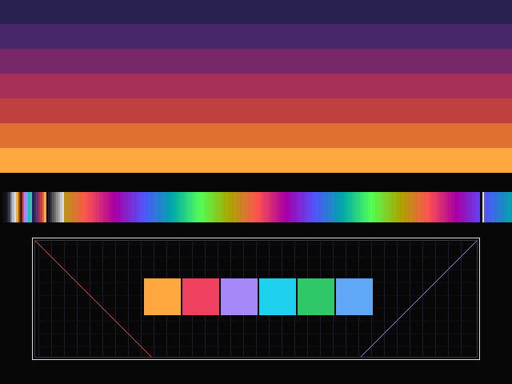
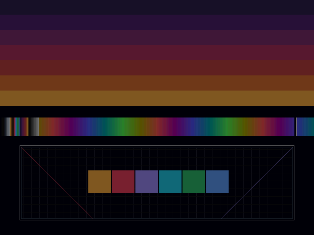
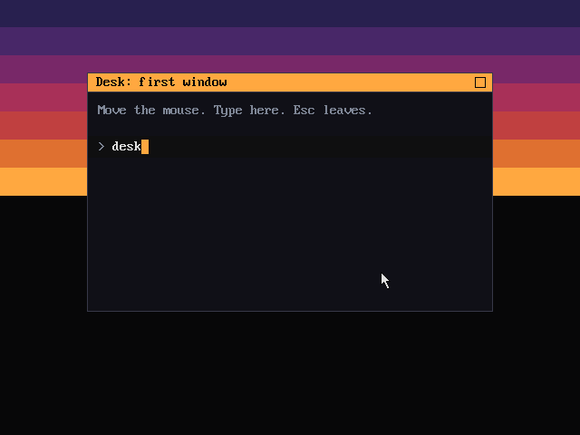
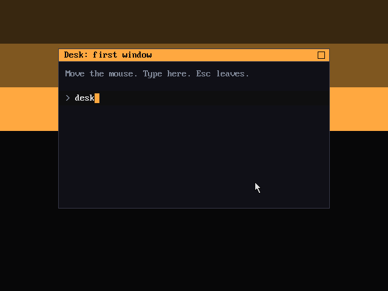
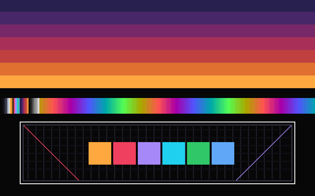
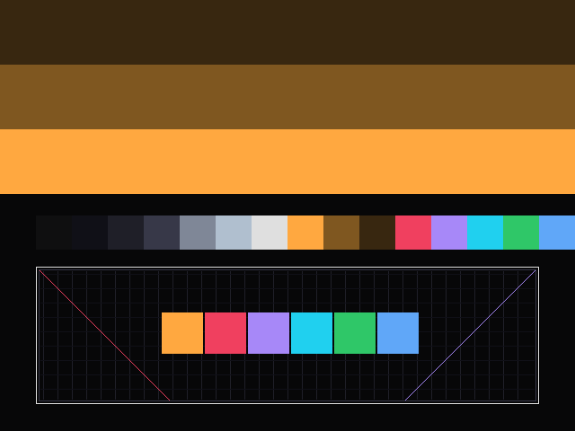
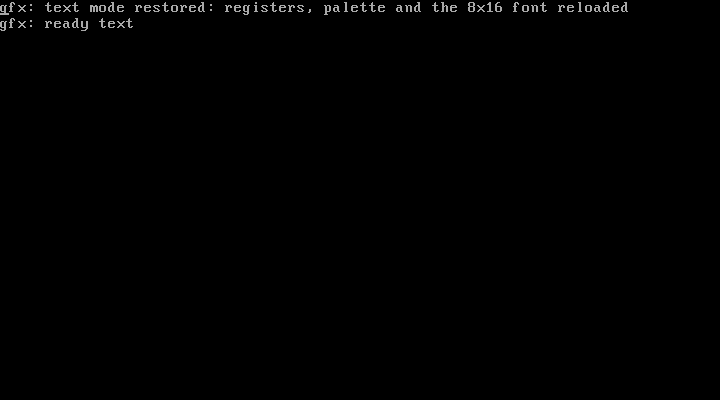
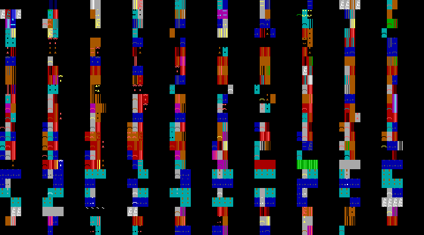

# Spike D: native graphics in the Rust kernel

Spike D (n2) puts pixels on the screen from the bare-metal kernel, with no BIOS after the loader: VGA modes 13h and 12h by register programming, a VBE linear frame buffer that the loader sets up while it still can, the DAC palette and a fade, a software cursor moved by the PS/2 mouse, a first window, and the way back to text mode. All of the drawing and register work is the shared `desk-vga` driver from spike A ([`A-VGA-VBE.md`](A-VGA-VBE.md)); the mouse and keyboard are spike C's ([`C-INPUT.md`](C-INPUT.md)). It is the native counterpart of the hosted VGA spike and the step before the "First Window" milestone ([`DIRECTION.md`](DIRECTION.md)). The code is `boot/stage2.asm` (the VBE step), `kernel/src/video.rs` and `kernel/src/gfx.rs`, the text-restore and fill additions to `hal/`, and the checks in `tools/native-test.sh`.

## Contents

- [Result](#result)
- [Method](#method)
- [The loader: VBE before protected mode](#the-loader-vbe-before-protected-mode)
- [The boot information block](#the-boot-information-block)
- [The frame buffer and the memory map](#the-frame-buffer-and-the-memory-map)
- [Modes without the BIOS](#modes-without-the-bios)
- [The palette and the fade](#the-palette-and-the-fade)
- [The cursor and the first window](#the-cursor-and-the-first-window)
- [Back to text mode](#back-to-text-mode)
- [Speed](#speed)
- [How it is tested](#how-it-is-tested)
- [Screenshots](#screenshots)
- [QEMU against real cards](#qemu-against-real-cards)
- [HAL feedback](#hal-feedback)
- [Commands](#commands)
- [What was and was not verified](#what-was-and-was-not-verified)

## Result

Pixels work, in all three ways the Desk needs, from a kernel that has no BIOS:

- **VBE linear frame buffer.** Stage 2 asks the BIOS (VBE 2.0 functions 4F00h, 4F01h and 4F02h) for a 640×480×8 linear mode before the switch to protected mode, sets it, and passes the mode, pitch and physical address to the kernel. On QEMU's `-vga std` that is mode `0x0101`, VBE 3.0, a 16 MiB card, frame buffer at `0xFD000000`; on `-vga cirrus` it is the same mode at `0xFC000000`. The kernel checks the frame buffer against the E820 map, the heap, the frame allocator and its own image, and draws into it through `Linear8`. The picture reads back with the same Adler-32 as spike A's DOSBox run (`0x5bc65936`).
- **Register-programmed modes.** Mode 13h and mode 12h are set from protected mode with `desk_vga::set_mode_13h` and `set_mode_12h` and nothing else. Their pictures read back with exactly spike A's DOSBox checksums (`0x5c0f1f16` and `0xfaf8b758`), so the same driver and the same scene give the same bytes on two different machines' models.
- **A way back.** Without the BIOS the kernel reprograms the text registers, the 16 text colours and the 8×16 font in plane 2 (the loader keeps a copy of the BIOS's), and the text console is readable again. On QEMU's std VGA, and with VBE not in use on every card tried, that works. **Leaving a VBE mode without the BIOS is card-specific**: on QEMU's std card it takes one write to the Bochs VBE enable register, and on `-vga cirrus` the same register programming leaves a garbled screen ([the screenshot](#qemu-against-real-cards)). That is the most important thing this spike found. **Resolved by spike n3** ([`N3-BIOS-PATH.md`](N3-BIOS-PATH.md)): the kernel can now call the BIOS from protected mode, and the tour leaves VBE on a card without the Bochs registers by `INT 10h` AX=0003h; on Cirrus all seven screenshots of the VBE tour then match the std ones.

The window with the cursor works in both: an Afterglow-orange title bar and a plain body, an arrow sprite with save-under that follows the PS/2 mouse and is clamped to the screen, and the spike C key echo drawn in the window with the BIOS font. The QEMU tests take real screenshots through the monitor, check them against reference checksums, show the cursor moved by comparing two of them, and have seven negative checks (below).

Speed under QEMU's TCG: a 640×480×8 full-screen fill runs at about 8,300 per second with the driver's word-store fill (it was 650 with one volatile byte store per pixel), the cursor moves 250,000 times per second, and mode 12h's planar fill runs at about 190 per second. Those are emulated-speed numbers on the development machine, not 486 numbers; see [Speed](#speed).

## Method

The kernel's `gfx` test mode (`kernel/src/gfx.rs`, selected by a byte in the loader image) runs a fixed tour and prints a `gfx:` line for each step. At each picture that is stable it prints `gfx: ready NAME` and waits for a key, so the run script can take a screenshot first and send the key after; no timing is involved.

With a VBE frame buffer from the loader the tour is: the scene on 640×480×8, a fade with a screenshot at the half-way step, the speed tests, the window with the cursor (mouse motion and typing from the script, Escape to leave), then leave VBE and show mode 13h, then restore text mode. Without one (the loader was not asked, or VBE failed) it is: mode 13h, mode 12h, the window in mode 12h, then text mode.

The scene is spike A's (`spikes/a-vga-vbe/prog/src/scene.rs`, included by path so it is the same code): the Afterglow horizon as stepped bands, a ramp of every palette slot, and a box of 1-pixel lines with a grid, diagonals and six accent swatches. It is drawn on the surface, read back through `checksum`, and compared both with the same picture drawn into a `Vec` and with spike A's recorded DOSBox checksum. A mismatch is a panic, not a message.

The screenshots come from QEMU's human monitor: `screendump FILE.ppm` writes the guest's current display as a binary PPM even with `-display none`. `tools/native-inject.py` (spike C's harness) gained a `{out}` substitution so one script names the directory, and `tools/native-shot.py` converts to PNG, checksums, compares two pictures and recognises a text-mode screen.

## The loader: VBE before protected mode

Protected mode has no BIOS, and a kernel with flat segments and no V86 monitor cannot call INT 10h, so VBE can only be asked in real mode. `video_setup` in `boot/stage2.asm` runs after the memory map and before the switch, and it never fails the boot: every outcome is recorded and printed.

1. **The font.** INT 10h AX=1130h BH=06h returns a far pointer to the BIOS's 8×16 font in ES:BP (and the bytes per character in CX, which must be 16). The 4096 bytes are copied to `0x2000`. This is the one thing the kernel cannot recover once text mode has been left, so it is taken first and always.
2. **Whether to try.** A byte in the image (`video_mode`, stage 2 offset 4, patched by `tools/native-image.sh --video text|vbe`) says whether to touch the display at all. A plain boot keeps the BIOS text screen, so the kernel's console stays visible; the graphics tests ask for `vbe`.
3. **The controller.** AX=4F00h with the signature `VBE2` in the buffer at `0x3000` asks for the 512-byte VBE 2.0 layout. AX must come back `004Fh` (AL: supported, AH: success), the signature `VESA`, and the version at least `0200h`; the linear frame buffer arrived with VBE 2.0. Otherwise the reason is recorded (no VBE, or too old).
4. **The mode list.** The far pointer at offset 14 may point into ROM or into the buffer, so the list is read through FS, up to 256 entries (a list with no `FFFFh` terminator must not hang the boot). Each mode is queried with AX=4F01h into `0x3200`. A mode qualifies when its attributes have bit 0 (supported), bit 4 (graphics) and bit 7 (linear frame buffer), its memory model is 4 (packed pixel), it has 8 bits per pixel and a non-zero physical base. A 640×480 mode wins at once; otherwise the largest area up to 1280 wide (the width `desk_vga::checksum` can read back).
5. **Setting it.** AX=4F02h with the mode number ORed with `4000h` (the linear bit; bit 15, "keep memory", stays clear so the BIOS clears the screen). If the BIOS answers anything but `004Fh`, the reason is recorded and the geometry fields are cleared.
6. **The transcript.** Each step prints a line, for example `stage2: vbe 3.0: mode 0x0101 640x480x8, pitch 640, frame buffer at 0xFD000000`, then `stage2: vbe: mode set with the linear frame buffer`, or, on failure, a line that says which step failed and `stage2: vbe: not used, the kernel falls back to the VGA register modes`.

The build flag `-DVBE_FAIL=1` makes step 5 report failure after the whole search has run, which is how the fallback path is tested without a BIOS that refuses.

The offsets used are those of the VBE 2.0 mode information block as I know them from the specification: attributes at 0, bytes per scan line at 16 (for VBE 3.0 and later the loader uses the linear bytes per scan line at 50 instead when it is non-zero, as the specification says for a linear mode), X and Y resolution at 18 and 20, bits per pixel at 25, memory model at 27 and the physical base pointer at 40. They were not checked against the specification text in this spike; they were checked in the way that matters here, by the values QEMU's BIOS returns (640, 480, 8, pitch 640 and a base that is the PCI BAR of the card). QEMU reports the same pitch in both fields, so the linear-pitch path is not exercised by any test.

## The boot information block

The block at physical `0x500` already carried the magic, boot drive, test mode and the E820-style memory map (spike C and the native skeleton). Spike D extends it compatibly: the three words that were reserved at offsets 20, 24 and 28 become a version and two pointers, and the memory map stays where it was.

| Offset | Size | Field | Notes |
|---|---|---|---|
| 0 | u32 | magic | `DESK` (`0x4B534544`) |
| 4 | u32 | boot drive | |
| 8 | u32 | test mode | patched into the image |
| 12 | u32 | map source | 1 E820, 2 E801 |
| 16 | u32 | map entries | |
| **20** | u32 | **version** | **1 now; 0 (or garbage, since the loader did not write it) before.** A kernel reads the next two fields only when this is at least 1 |
| **24** | u32 | **video block address** | `0x820`; 0 for none |
| **28** | u32 | **font address** | `0x2000`; 0 for none (4096 bytes, 256 glyphs of 16 rows) |
| 32 | 24 × n | memory map | up to 32 entries, so up to `0x820` |

The video block at `0x820` is 32 bytes:

| Offset | Size | Field | Notes |
|---|---|---|---|
| 0 | u32 | state | 0 not tried, 1 a linear 8-bit mode is set, 2 VBE tried and not usable |
| 4 | u16 | VBE version | BCD, `0300h` for 3.0; with state 2, whatever the BIOS reported (0 if no VBE) |
| 6 | u16 | reason | with state 2: 1 no VBE BIOS, 2 older than 2.0, 3 no 8-bit linear mode, 4 the BIOS refused to set it; 0 otherwise |
| 8 | u16 | mode | VBE mode number |
| 10 | u16 | width | pixels |
| 12 | u16 | height | |
| 14 | u16 | pitch | bytes per scan line |
| 16 | u8 | bits per pixel | 8 |
| 17 | u8 | memory model | 4 is packed pixel |
| 18 | u16 | attributes | the mode attributes word |
| 20 | u32 | physical base | the linear frame buffer |
| 24 | u32 | video memory | KiB on the card |
| 28 | u32 | reserved | 0 |

Low memory the loader uses for this, all below the kernel's 1 MiB and never given out by the frame allocator: `0x820` the video block, `0x2000` the font, `0x3000` the VBE controller block, `0x3200` the mode block. The protected-mode stack the loader sets (`0x7000`) grows down from above them.

A fixed address and a version, rather than a pointer chain, is the simplest thing that is also safe to extend: a version 2 adds fields at the end of the video block (the obvious ones are the VBE OEM string and a copy of the whole 256-byte mode block, which would let the kernel parse it with `desk_vga::vbe::VbeMode::parse` instead of reading fields the loader copied) or a new pointer in a block that version 2 defines.

## The frame buffer and the memory map

The kernel maps nothing: segments are flat 4 GiB, there is no paging, and a physical address is a pointer. A linear frame buffer from a PCI card sits near the top of the 32-bit address space (`0xFD000000` on QEMU's std VGA, `0xFC000000` on Cirrus), far above the 16 MiB of RAM the tests give the guest.

`video::init` checks the frame buffer before anything draws:

- It does not overlap the first megabyte, the kernel image (`__kernel_start` to `__kernel_end`) or any usable E820 region. The heap and every frame the allocator hands out come from usable regions, so this is the heap and allocator check too. On QEMU with 16 MiB the frame buffer `0xfd000000-0xfd04b000` overlaps none, and the transcript says so.
- If it did overlap, the kernel refuses the mode and says so; a frame buffer the loader already switched to is then abandoned for the register modes.
- Frames of the frame buffer that fall inside the allocator's bitmap (the bitmap covers the first 256 MiB) are marked in use, so a machine whose frame buffer is in the bitmap's range cannot have it allocated as RAM. Beyond that range nothing is ever allocated.

This is a check against the map the BIOS gives, which lists RAM and reserved ranges but does not always list a PCI card's BARs: QEMU's does not. A machine with more RAM than fits below the PCI hole could have RAM at an address the frame buffer also claims; the E820 map would show it as usable and the check would refuse the frame buffer, which is the correct, conservative outcome.

## Modes without the BIOS

`desk_vga::regs` sets mode 13h and mode 12h by writing the miscellaneous output, sequencer, CRTC, graphics controller and attribute registers in the order [`A-VGA-VBE.md`](A-VGA-VBE.md#method) describes (video off, sequencer reset, unlock CRTC 0x11, graphics controller, attribute controller after resetting its flip-flop, video on, DAC mask). The kernel does nothing else: it reads the registers back and compares them with the tables (both modes read back equal), loads the palette, clears the screen (a direct set leaves whatever the last mode had in the planes) and draws.

The tables are spike A's, which are the standard IBM VGA ones as FreeVGA and the Linux console document them. What this spike adds is the third, for text:

| | Mode 03h |
|---|---|
| Misc | `67h` |
| Sequencer 0 to 4 | `03h 00h 03h 00h 02h` (9-dot characters, planes 0 and 1, odd/even) |
| CRTC 0 to 24 | `5Fh 4Fh 50h 82h 55h 81h BFh 1Fh 00h 4Fh 0Dh 0Eh 00h 00h 00h 00h 9Ch 8Eh 8Fh 28h 1Fh 96h B9h A3h FFh` |
| Graphics controller 0 to 8 | `00h 00h 00h 00h 00h 10h 0Eh 00h FFh` (odd/even, memory map B8000h) |
| Attribute 0 to 20 | `00h 01h 02h 03h 04h 05h 14h 07h 38h 39h 3Ah 3Bh 3Ch 3Dh 3Eh 3Fh 0Ch 00h 0Fh 08h 00h` |

These are the commonly published values for 80×25 text (720×400 on the monitor); they are not copied from one source, and the check that they are right is that QEMU's display shows readable text with the right size and colours after the kernel sets them (the screenshot below), not a monitor. The host tests check the table's own consistency (80 columns, 16-line cells, 9-dot clock, the B8000h memory map bits) and that the write sequence reads back.

## The palette and the fade

The Desk owns the palette ([`PALETTE.md`](PALETTE.md)). In 256 colours the kernel loads spike A's illustrative palette (slots 0 to 15 the Desk's 16, 16 to 22 the seven-step horizon, then greys and a hue sweep) plus the cursor in the reserved slots (240 the void, 241 the text colour); in mode 12h it loads the 16-colour set into DAC entries 0 to 15 and uses the identity attribute palette that `MODE_12H` programs, so colour *n* is DAC entry *n*. The horizon's seven 256-colour ramp values are an illustration, as spike A says: `PALETTE.md` names the steps without their values.

A fade is 16 steps through the DAC, never through the frame buffer. The driver's `fade_out` and `fade_in` wait for vertical retrace before each step, and on QEMU that wait is meaningless: the driver reports all 16 frames "synchronised" and the whole fade takes **0 ticks**, which fits QEMU's VGA toggling the retrace bit on each read instead of timing it (as I understand its source; not checked here). The kernel therefore also runs a fade paced by its own PIT: 16 steps of two ticks (20 ms, a third of a second in all), each a `set_palette_scaled` of the base palette, read back at the end (all black after the out, the original palette after the in). A screenshot is taken at the half-way step, where every colour is at half intensity ([the picture](#screenshots)). Both fades are reported in the transcript; the driver's is kept because on a real VGA it is the better one (no tearing), and its report would show the difference.

## The cursor and the first window

A VGA has no hardware cursor, and the Desk draws its own ([`SPEC.md`](SPEC.md)). `Cursor` in `gfx.rs` is a 12×19 arrow (outline and fill, transparent elsewhere) drawn with `pixel` after the pixels under it are saved with `get_pixel`, and erased by writing them back before it moves. It works on both `Linear8` and `Planar16` because it is written against `Canvas`.

The window is three fills and a rectangle: an orange (slot 8, the accent) title bar with the title and a close box in the void colour, a plain body (slot 2), a 1-pixel border (slot 4), over the horizon (a third of the screen) and the void. Text is the BIOS 8×16 font the loader copied, drawn pixel by pixel; the key echo is a line in the body with a caret in the accent colour. The loop drains `MouseEvent`s (`dx`, `dy` accumulated and clamped to the screen), then key events (printed as spike C does, and the characters echoed; Backspace removes one), redraws the echo line with the cursor hidden, and sleeps with `hlt` until the next interrupt. Each move prints `gfx: cursor X,Y buttons B`, each change to the echo prints `gfx: echo "..."`.

The proof is a proof, not the compositor: there is no window object, no clipping against other windows and no dirty-rectangle tracking. Each redraw draws the echo line in full.

## Back to text mode

Without the BIOS there is no `INT 10h AX=0003h`. What leaving graphics takes, in the order `restore_text` does it:

1. **Leave the VBE mode, if one is set.** On QEMU's std card (and `-vga vmware`) that is the Bochs VBE enable register (index `4` at port `1CEh`, data at `1CFh`), which the kernel finds by reading the ID register (`B0C0h` to `B0CFh`). On a real card it would be that chip's own extended registers, or nothing generic at all: this is the one part of the way back that is not in `desk-vga` and cannot be. **Since spike n3** the fallback is the BIOS: with no Bochs registers the tour calls `INT 10h` AX=0003h through the real-mode trampoline (`bios::call`), which knows its own chip, and the register steps below then run on a card that is back in a plain VGA state ([`N3-BIOS-PATH.md`](N3-BIOS-PATH.md)).
2. **The registers.** `set_mode_03h`: the 80×25 register image above.
3. **The DAC.** `set_text_palette` writes the 16 text colours to the entries the attribute palette points at (`00h` to `05h`, `14h`, `07h`, `38h` to `3Fh`). A graphics mode has overwritten them.
4. **The font.** `load_font` writes the 4096-byte 8×16 font into plane 2 in 32-byte glyph slots (16 bytes of bitmap and 16 of padding), after setting the sequencer map mask to plane 2, the memory mode to sequential, and the graphics controller's read map, mode and memory map so the CPU can reach plane 2 at `A0000h`, and puts those registers back to the text values afterwards. The font has to come from somewhere: the loader copies the BIOS's (`0x2000`); a kernel could instead embed one (`fonts/` has the Desk's own bitmap faces).
5. **The screen.** The text buffer at `B8000h` is cleared and the console's cursor position reset.

If the font is missing the kernel restores the registers and says the characters will not be readable; the other choice was to halt. QEMU's std VGA text after this is identical, pixel for pixel, to the text it showed before graphics ([the checksum is the same](#how-it-is-tested)).

## Speed

Measured by the kernel for one second of its 100 Hz timer each, under QEMU 11.1.2 with TCG on the development machine. These are **emulated-speed numbers, not real hardware**: they show the relative cost of ways of drawing, not what a 486 does. The ISA or VLB bus of a real card is far slower per access than QEMU's RAM-backed frame buffer.

| Operation (640×480×8) | Per second |
|---|---|
| Full-screen fill, one `pixel` call per pixel | 636 |
| Full-screen fill, before `fill8` (one bounds-checked byte store per pixel through `fill_rect`) | 650 |
| Full-screen fill, `fill_rect` now (`MmioRegion::fill8`, word stores) | about 8,300 |
| Full-screen fill, `core::ptr::write_bytes` (the library's memset) | about 5,650 |
| Cursor move (restore 100 pixels, save 100, draw 100) | about 250,000 |
| Mode 12h planar full-screen fill (`Planar16`, one bit-mask write and one store per 8 pixels) | about 190 |
| Mode 12h planar cursor move | about 5,300 |

The obvious next steps are known and small. `fill8` is one: it checks once and stores a word at a time, which is a quarter of the bus cycles, and `rep stosd` would be the same traffic with fewer instructions. A blit should do the same (`write_bytes` copies a byte at a time; a word-aligned `rep movsd` is the equivalent). The cursor and the window should repaint only the rectangles that changed (dirty rectangles), and the compositor should draw into a back buffer in RAM and copy to the frame buffer once per frame, because reads from VGA memory are the slow direction on real hardware and the cursor's save-under reads. On mode 12h the planar fill could set a whole row's bit mask once and write whole bytes, which `Planar16` already does for the middle of a span; the cost there is port writes per row.

## How it is tested

`tools/native-test.sh` has a new section that boots the `gfx` image headless with `-display none` and drives it through the monitor (`tools/native-run.sh --inject`, `--vga`, `--shots`). Three runs:

| Run | Card | Loader | What it shows |
|---|---|---|---|
| `gfx-vbe` | `-vga std` | VBE requested | the VBE picture, the half-faded picture, the window before and after the mouse moves and after typing `desk`, mode 13h after leaving VBE, text mode restored |
| `gfx-text` | `-vga cirrus` | VBE not requested | mode 13h, mode 12h, the window in 12h (the same sequence), text mode restored |
| `gfx-vbefail` | `-vga std` | VBE requested, built with `-DVBE_FAIL=1` | the loader says the BIOS refused, the kernel says it fell back, and the screens are the same as `gfx-text`'s |

Each run is checked three ways: the serial transcript against `tests/native/expected-gfx-*.txt` (the numbers and addresses that vary are ranges), every screenshot against a reference checksum in `tests/native/gfx-*.sums` (CRC-32 of the RGB bytes of the PPM, with its size), and the last screenshot for being a text-mode screen (720×400 with at most 16 colours). Screenshots of `gfx-text` and `gfx-vbefail` have the same checksums, so the register-programmed path gives the same picture after a refused VBE mode as when it was never tried; `gfx-text` ran on a different card from `gfx-vbe`.

The cursor is checked by comparison of two screenshots: `vbe-window-a` (cursor at 320,240) and `vbe-window-b` (after `mouse_move 100 60`, so 420,300) must differ, and only inside the rectangle that the old and new 12×19 sprites occupy (`x 320..431, y 240..318`); the typing step must change only the echo line. The same check runs in mode 12h.

The negative checks, each of which must fail and does:

- a wrong reference checksum for one screenshot;
- a screenshot set checked against another run's references;
- two identical screenshots offered as a cursor movement;
- a real cursor movement offered with a rectangle that is too small;
- a graphics screenshot offered as a text-mode screen;
- the VBE run's transcript against the failed-VBE expectation, and the failed-VBE run's against the normal one, which proves the transcript comparison tells a refused mode set from a working one.

The host tests are in `hal/`: `hal/drivers/vga/tests/text.rs` (mode 03h's table and write sequence, the font layout and the registers left behind, the refusals, the palette entries) and the new `MmioRegion::fill8` test.

## Screenshots

QEMU 11.1.2, `-vga std` unless noted, converted from the monitor's `screendump` by `tools/native-shot.py`. Each is deterministic and its checksum is in `tests/native/gfx-*.sums`.

| | |
|---|---|
|  |  |
| The scene in the VBE linear frame buffer (the loader set mode `0x0101`; checksum equals spike A's DOSBox run). | The fade at its half-way step, through the DAC. |
|  |  |
| The window in the VBE frame buffer: title bar in the accent orange, the cursor after `mouse_move 100 60`, the key echo. | The same window in mode 12h's 16 colours (the three-band horizon), drawn through `Planar16`. |
|  |  |
| Mode 13h by registers (QEMU shows the 320×200 picture as 640×400). | Mode 12h by registers. |
|  |  |
| Text mode after the kernel reprogrammed the registers, the palette and the font. | The same step on `-vga cirrus` after VBE: not restored. |

## QEMU against real cards

What QEMU's `-vga std` is: a Bochs VBE card. It implements the standard VGA register file in front of a linear frame buffer and the VBE_DISPI registers (`1CEh`, `1CFh`) that switch it between VGA and "VBE" operation; its BIOS (SeaBIOS's `vgabios`) answers VBE 3.0. It has a 16 MiB frame buffer at a PCI BAR near the top of the address space, an 8-bit DAC mode it does not use unless asked, and it ignores a lot that a real chip does not: no bank switching, no monitor timing, no wait states, no lost writes. The things it differs on, that matter for this work:

- **Leaving VBE.** Here it is one write. On `-vga cirrus` (a Cirrus Logic GD5446 model) the card has the same VBE BIOS interface in front of its own extended registers, and the kernel's plain VGA register programming does not undo them: the mode-13h screenshot is the wrong size and the text screenshot is garbage. On real S3, ET4000, Trident and Cirrus cards the extended registers are chip-specific, so a kernel that sets VBE has to know each chip to leave it, or it has to ask the BIOS (V86 or a real-mode trampoline), or it has to reboot. That is why the loader sets VBE and the kernel's fallback for text is the BIOS-free register path only when VBE was not used. Spike D shipped the loader-only version and said so; **spike n3 added the trampoline, and the Cirrus run of the tour now ends in a correct text screen** (the mode-13h and text screenshots equal the std references), so the kernel asks the BIOS when the card has no Bochs registers.
- **The retrace bit.** QEMU appears to toggle it on every read, so a retrace-synchronised fade finishes at once and `wait_vretrace` always "succeeds". A real card needs the wait, and a card with a broken retrace bit would hit the bounded timeout.
- **Banked modes and old cards.** Everything here assumes a linear frame buffer. Many 1990s cards, and every VBE 1.2 BIOS (the LFB bit arrived in 2.0), offer only banked access through a 64 KiB window at `A0000h` and function 4F05h, which a 486-class machine with an ISA card will often be. The loader says "older than 2.0" and the kernel falls back to mode 12h by registers (640×480, 16 colours); a banked 8-bit mode would need a `Linear8` over a bank-switching region, which `desk-vga` does not have (4F05h is wrapped and unit-tested, not used).
- **BIOS differences.** Some BIOSes return the mode list inside the buffer and some in ROM (the loader reads through a far pointer, so both work), some ignore the `VBE2` signature, some return a physical base of 0 for modes they do not offer linearly (the loader skips those), and some leave registers changed across INT 10h (the loader saves BX and FS around the per-mode call).
- **The 8×16 font pointer.** AX=1130h is a VGA BIOS function; an EGA-only or non-standard BIOS may not have it. The loader copies nothing in that case and the kernel says text mode cannot be restored.
- **Timing.** The register tables in `desk-vga` give 640×480 at about 60 Hz and 320×200 at 70 Hz on a standard monitor; QEMU does not check the timing, and the CRTC values were not seen by a monitor.

QEMU's PS/2 mouse is also generous: it sends exactly the deltas asked for.

## HAL feedback

Changes made to `hal/` in this spike, each with tests:

- **`regs::MODE_03H`, `set_mode_03h`, `text::load_font`, `text::set_text_palette`, `text::TEXT_DAC`** — the way back to text. This was the one thing [`A-VGA-VBE.md`](A-VGA-VBE.md#what-the-native-platform-must-implement) said the native platform had to add. Four tests.
- **`MmioRegion::fill8`**, used by `Linear8`'s spans — one bounds check, word stores for the aligned middle, volatile throughout. A full-screen fill went from 650 to about 8,300 per second under TCG, faster than `write_bytes`, and it helps the hosted DOS program equally (the same `Linear8`). A test covers every offset and length combination around the alignment.

Recommendations, not done:

- **`fade_out` and `fade_in` should not assume retrace is real.** They report "synchronised" when the bit toggled, which QEMU does on every read. Take a `Clock` or a pacing callback so the caller (the kernel, with its PIT; the DOS runtime, with its IRQ 0) can say how long a frame is; keep retrace as the preferred sync where it is trustworthy.
- **`MmioRegion::write_bytes` should copy words too**, for `blit`. It is the same shape as `fill8`.
- **`Display::set_mode` cannot return to text on the native side after VBE** (spike n3 changed that: it can, through `NativeBios` and `INT 10h` AX=0003h, see [`N3-BIOS-PATH.md`](N3-BIOS-PATH.md#hal-feedback)). The trait's `restore_text_mode` is a fine name for the DOS runtime (INT 10h) but the native implementation needs a card-specific leave. The honest native contract is that VBE is a one-way trip unless the platform has a `Bios` that can call back into real mode; the `Bios` trait is there for exactly that, and the kernel has no implementation of it. Either give the kernel a real-mode trampoline (a few hundred bytes of 16-bit code, a copy of the BIOS data area and the IVT, and the mode switch in both directions), or accept it and say so in `HAL.md`.
- **Pass the raw VBE mode block from the loader** and let the kernel parse it with `desk_vga::vbe::VbeMode::parse` (already tested on byte blobs), so there is one parser. The loader would copy the 256-byte block to a fixed address and the video block would carry its address.
- **The palette tables want a home.** `DESK16` and the other palette values are in `spikes/a-vga-vbe/prog/src/scene.rs`; the kernel includes that file by path. They belong in a shared crate (with the Afterglow ramp values once `PALETTE.md` gives them).
- **`Canvas::blit` per pixel and `Canvas::fill_rect` through `fill_span`** are the two calls a compositor will make; both should be fast by default on `Linear8` (`fill_rect` now is).

## Commands

```bash
tools/native-build.sh                                                  # the loader and the kernel
tools/native-image.sh --test-mode gfx --video vbe --out dist/gfx.img   # a VBE linear frame buffer; --video text for the register modes
tools/native-run.sh --vga std --inject tests/native/gfx-vbe.inject --shots dist/shots dist/gfx.img     # screenshots in dist/shots/*.ppm
python3 -I tools/native-shot.py png dist/shots/vbe-window-c.ppm window.png                              # to PNG
python3 -I tools/native-shot.py check tests/native/gfx-vbe.sums dist/shots                              # against the references
tools/native-build.sh --nasm-flags "-DVBE_FAIL=1"                      # a loader whose VBE mode set fails
tools/native-test.sh                                                   # the whole native check, graphics included
```

To record new references after a deliberate change to the drawing: run the script as above, look at the PNGs, then `python3 -I tools/native-shot.py record dist/shots NAME...` and put the lines in the `.sums` file.

## What was and was not verified

**Run:**

- `cargo test` and `cargo clippy` in `hal/` (the host, the kernel target and the DOS target) for the new text restore and `fill8`; `tools/native-test.sh` end to end on QEMU 11.1.2 and NASM 3.02 (the whole native check including the three graphics runs and their negative checks).
- The three tours on QEMU with `-vga std`, `-vga cirrus` and `-vga vmware` (the register path on all three produced the same six screenshots; VBE on std, cirrus and vmware drew the same picture, and std and vmware left it and restored text).
- Pictures by eye, from the PNGs above.

**Not run or not verified:**

- **Real hardware**, any real VGA or VBE card, any monitor. All register values were checked against QEMU's model of a VGA only; QEMU does not check CRTC timing.
- **86Box and Bochs.** Neither was tried. 86Box models S3, Cirrus, ATI and others with their own VBE BIOSes and banked modes, which would exercise exactly what QEMU hides.
- **VBE 1.2 BIOSes, banked modes, cards with no linear frame buffer**: not implemented. The loader's "older than 2.0" path is reached only in a unit sense (the code is there; no BIOS in the test returned it).
- **BIOSes other than SeaBIOS's VGA BIOS** (the Bochs and Cirrus variants).
- **Leaving VBE on any card but the Bochs one without the BIOS**; on Cirrus it fails, as shown, and spike n3 fixes it by calling the BIOS (verified on QEMU's Cirrus model only, not on a real card).
- **Frames per second and cursor rates on real hardware.** The numbers above are emulated speed.
- **A frame buffer that overlaps RAM**: the check exists and prints its reasoning, but no test boots a machine where it fires.
- **The reference checksums on other QEMU versions.** They depend on how QEMU converts the 6-bit DAC to 8 bits and renders text, which has been stable for years; CI's QEMU (Ubuntu's) decides. If it differs, the `.sums` need regenerating there.
- **The DOS program** (`spikes/a-vga-vbe`) after the `fill8` change: CI runs it; locally only the host tests and the cross-checks of the `no_std` builds ran.
