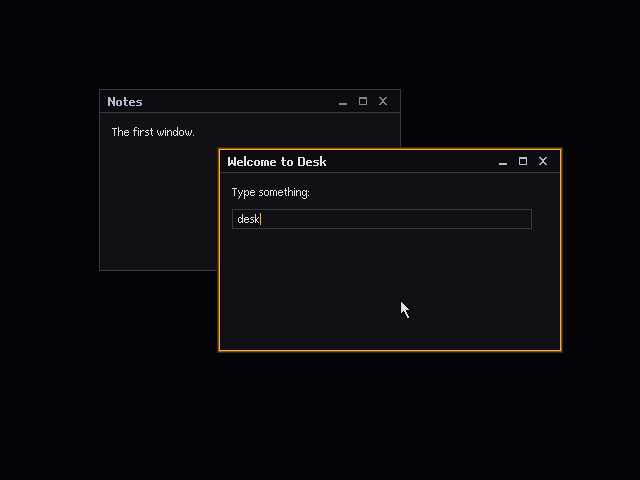
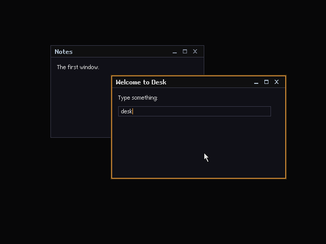

# First Window: the shared core's first frame on both tracks

The design for the first piece of the OS-independent Desk core: a `shell/` workspace of `no_std` crates that draws a desktop, two windows with the stepped halo, text from the `.DFN` faces and a software cursor into an 8-bit back buffer, presents only what changed, and produces **the same pixels** on the hosted track (DOS in DOSBox) and the native track (the kernel in QEMU). It is milestone 5 of the hosted track and milestone 3 of the native track in [`DIRECTION.md`](DIRECTION.md), built once. The task-by-task build plan is [`FIRST-WINDOW-PLAN.md`](FIRST-WINDOW-PLAN.md).

> **Status.** A design, written on 2026-10-23 against `main` at `c4a897c`. The `shell/` crates, the scenario runner, the goldens and the kernel's `shell` test mode are built (the sections below say "As built" where they record it); the hosted `shell/dos` program and the comparison of the two tracks are ([Result](#result)). It rests on what spikes A, B, C, D and n3 measured ([`A-VGA-VBE.md`](A-VGA-VBE.md), [`B-DOS-INPUT.md`](B-DOS-INPUT.md), [`C-INPUT.md`](C-INPUT.md), [`D-NATIVE-VGA.md`](D-NATIVE-VGA.md), [`N3-BIOS-PATH.md`](N3-BIOS-PATH.md)) and on the `.DFN` files the font build already writes ([`FONTS.md`](FONTS.md)). When the code disagrees with this document, the code wins and this document is corrected in the same branch.

## Contents

- [What the first window is](#what-the-first-window-is)
- [Decisions](#decisions)
- [Where it sits](#where-it-sits)
- [Crate layout](#crate-layout)
- [The pixel model](#the-pixel-model)
- [desk-gfx: surfaces, damage and presenting](#desk-gfx-surfaces-damage-and-presenting)
- [desk-present: the linear and planar presenters](#desk-present-the-linear-and-planar-presenters)
- [desk-font: reading .DFN](#desk-font-reading-dfn)
- [desk-ui: theme roles, text and window chrome](#desk-ui-theme-roles-text-and-window-chrome)
- [desk-wm: windows, focus and damage](#desk-wm-windows-focus-and-damage)
- [desk-shell: events, frames and scenarios](#desk-shell-events-frames-and-scenarios)
- [The scenario format](#the-scenario-format)
- [Goldens and frame digests](#goldens-and-frame-digests)
- [Host tests](#host-tests)
- [The platform wirings](#the-platform-wirings)
- [Rules carried over](#rules-carried-over)
- [Questions for the owner](#questions-for-the-owner)
- [Risks](#risks)
- [What changes in other documents](#what-changes-in-other-documents)
- [Result](#result)

## What the first window is

One scripted scene, the same on every platform, at 640 × 480 in two depths: **8** (256 colours, a VBE linear frame buffer) and **4** (16 colours, VGA mode 12h, the fallback `SPEC.md` keeps for plain VGA).

- **The desktop**: the Void wallpaper (`#050507`). The Horizon wallpaper is the default in `DESK.INI`, but `PALETTE.md` names its ramp steps without their values, so it waits until the ramps have values.
- **Two windows**, overlapping, each with the Desk's chrome ([below](#window-chrome)): a 22-pixel title bar with the title in Desk Title, three 18 × 18 control boxes, a 1-pixel rule, and a content area. The focused window wears the **stepped halo** (three rings: `#ffaa40`, `#7d5422`, `#372612`); the other a 1-pixel hairline (`#262a37`).
- **Content**: a line of text in Desk UI (a label) and a one-line text field that echoes typed keys with a caret, so text drawing and keyboard focus are both exercised.
- **The cursor**: the 12 × 19 arrow spike D drew, composited by the Desk, never by the mouse driver.
- **Interaction**: the pointer moves; a click on a window focuses and raises it; dragging a title bar moves the window; the close box closes it; typed keys go to the focused window's text field.

The scene is driven by a **scenario** (a short text file of steps), and at each `frame` step the picture is captured. The host renders the scenario into memory and keeps **golden PNGs**; the DOS program and the kernel run the same scenario on real (emulated) display hardware, and their captures must equal the goldens pixel for pixel.

Out of scope: the launcher bar, menus, Alt+Tab, resizing, minimise and maximise (the boxes are drawn but inert), the 1993 look, wallpapers other than Void, fades (the DAC fade exists in `desk-vga` and is untouched), apps and the SDK, and any change to the HAL's traits.

## Decisions

1. **One core, two thin wirings.** Everything that decides a pixel is in `shell/`, a Cargo workspace of `no_std` + `alloc` crates that build for the host, `kernel/i486-desk-none.json` and `spikes/d0-rust-dos/dos-elf.json`. The DOS program and the kernel's test mode only set a mode, load the palette, make a presenter over the frame buffer, feed events in and capture frames.
2. **An 8-bit back buffer in RAM, always.** The core draws palette indices into a `Vec<u8>` of `width × height`, whatever the display's depth. Reading video memory is the slow direction on real hardware ([`D-NATIVE-VGA.md`](D-NATIVE-VGA.md#speed)), so nothing ever reads the frame buffer back except the test captures.
3. **Dirty rectangles in two layers.** *Scene damage* is what must be repainted into the back buffer and presented; *overlay damage* (the cursor) is only presented. A cursor move repaints nothing.
4. **The cursor is composited at present time**, row by row, over the back buffer, so there is no save-under and no read of video memory, and the back buffer never contains the cursor.
5. **`Present` is a span writer.** The compositor hands it rows of palette indices; the linear presenter copies them, the planar one splits them into four planes. A presenter declares an alignment (1 or 8 pixels) and the compositor widens damage to it.
6. **The presenters are platform-side code shared by both tracks.** They live in `shell/present` (`desk-present`), the only `shell/` crate that may call `desk-vga`'s register-level API, which [`HAL.md`](HAL.md#the-four-kinds-of-code) forbids to the core. The core crates (`desk-gfx`, `desk-font`, `desk-ui`, `desk-wm`, `desk-shell`) see only the `Present` trait and the HAL's upper-edge types (`Rgb6`, `HalError`, `KeyEvent`, `MouseEvent`).
7. **Colour roles, resolved per depth.** Drawing code names a role (`Chrome`, `Text`, `Halo2`, …); a `Theme` maps it to a palette slot for the depth in use, from [`PALETTE.md`](PALETTE.md). The 8-bit theme uses the look's surfaces in slots 97–127 and the cursor slots 240–241; the 4-bit theme uses the 16-colour set.
8. **"Identical pixels" means identical colours.** Two captures are equal when every pixel has the same six-bit DAC colour. Index equality is checked too wherever a capture has indices (host, DOS), but QEMU's screendump has only RGB, and the DAC is what the eye sees.
9. **One scenario file, embedded everywhere.** The host test, the DOS program and the kernel all `include_str!` the same `tests/shell/first-window.scn` and parse it with the same parser, and run with scripted input, so the platforms cannot drift from the goldens through input timing. Live input (real keys and mouse) is an extra, later check.
10. **The fonts are embedded for the first window** (`include_bytes!` of `fonts/generated/*.dfn`), because the native kernel has no filesystem yet. The DOS program also loads them from files as a second path that must give the same digests.
11. **No float, no `unsafe`, no compare-and-swap, no external crates** in `shell/`, enforced by lints ([below](#rules-carried-over)).

Alternatives considered and rejected:

- **Draw straight into the frame buffer through `desk_vga::Canvas`**, as spike D's window did. No back buffer to allocate, but every overlap redraws on the bus, the cursor needs save-under reads, and mode 12h pays port writes for every primitive. Rejected for the compositor; `Canvas` stays the drivers' and the spikes' API.
- **A `Canvas`-like trait for the core with per-primitive presenters** (fill a rectangle on the frame buffer directly). Faster for big flat fills, but then each primitive has two implementations whose pixels must agree, which is the drift this design exists to stop.
- **The cursor drawn into the back buffer.** Simpler compositing, but a cursor move then damages the scene and repaints windows under it.
- **Goldens as checksums only.** Cheap, but a failure says nothing about what changed; a PNG can be looked at and diffed.
- **Comparing QEMU screendumps as 8-bit RGB**, as `tools/native-shot.py` does for spike D. That bakes QEMU's 6-to-8-bit expansion into the goldens; the six-bit comparison does not care how a display expands the DAC.

## Where it sits

| Layer ([`DIRECTION.md`](DIRECTION.md#how-they-share-a-core)) | Built here | Not built here |
|---|---|---|
| Desk core | `desk-gfx`, `desk-font`, `desk-ui`, `desk-wm`, `desk-shell` | Launcher bar, menus, apps, the SDK, the `Platform` trait |
| Shared platform-side code | `desk-present` (linear and planar presenters) | `rep movsd` fast paths |
| HAL and drivers | Nothing new; uses `desk-hal`'s video and input types, `desk-vga`'s registers and read-back, `desk-kbd`'s key map | Trait changes |
| Hosted platform | `shell/dos`: a program on `rt` that runs the shell | Promoting `rt` to the top level (HAL migration step 2) |
| Native platform | A `shell` test mode in the kernel | A native spec, a filesystem |

**Why not `fn run<P: Platform>` yet.** [`HAL.md`](HAL.md#a-platform-as-one-value-sketch) sketches the core's entry as one generic function over a `Platform`. The first window needs only a display and input, and both platforms already have those (`DosDisplay` and `DosInput`; the kernel's `Lfb`, `desk-vga` registers and `Ps2Input`). The seam here is narrower: the platform owns the loop and calls `Shell::handle` and `Shell::frame`. Folding that into `Platform` is a later step once a second consumer (timers, storage) needs it, and nothing here prevents it.

**`shell/` and `core/`.** `core/` is the hosted skeleton's Rust half, linked by DJGPP through the C layer; it stays as it is until the owner decides to retire the C layer ([`HAL.md`](HAL.md#migration-plan), step 3). `shell/` is where the shared core grows; its DOS program uses the pure-Rust runtime (`rt`) and the ELF target, as spikes A and B do.

## Crate layout

```
shell/                          one Cargo workspace; no default target, so `cargo test` is a host build
├── Cargo.toml, Cargo.lock, clippy.toml, rustfmt.toml
├── gfx/        desk-gfx        Rect, Surface (the back buffer), Sprite, Damage, Present, MemoryPresent, Compositor, digests
├── font/       desk-font       .DFN parsing, glyph lookup, measuring
├── present/    desk-present    LinearPresent (MmioRegion), PlanarPresent (desk-vga's registers), read-back for captures
├── ui/         desk-ui         Role, Theme, palettes, text drawing, window chrome geometry and painting, icons, Label, TextLine
├── wm/         desk-wm         windows, z-order, focus, hit testing, dragging, the damage each change makes
├── shell/      desk-shell      Shell (events, cursor, frame loop), the scenario parser and runner
└── dos/        (own workspace, excluded) the hosted program SHELL.EXE on rt and dos-elf.json
kernel/src/shell.rs             the native wiring, a `shell` test mode
tests/shell/                    first-window.scn, first-window.sums, golden/first-window/*.png, README.md, expected DOS transcripts
tools/frames.py                 PNG writing and reading, digests, checks and diffs for captures
```

Dependencies, all by path, no external crates:

| Crate | Kind ([`HAL.md`](HAL.md#the-four-kinds-of-code)) | Depends on |
|---|---|---|
| `desk-gfx` | Core | `desk-hal` (`Rgb6`, `HalError`) |
| `desk-font` | Core | nothing |
| `desk-ui` | Core | `desk-gfx`, `desk-font`, `desk-hal`, `desk-kbd` (`char_for`, the pure key map the core already uses to decode keys) |
| `desk-wm` | Core | `desk-gfx`, `desk-font`, `desk-ui`, `desk-hal` |
| `desk-shell` | Core | all of the above (so far `desk-hal`, `desk-gfx`, `desk-ui` for `Depth`, and `desk-kbd` for `char_for`) |
| `desk-present` | Platform-side, shared | `desk-gfx`, `desk-hal`, `desk-vga` |

The core crates never depend on `desk-present`; the platforms and the host tests do.

## The pixel model

- **The back buffer** is `width × height` bytes of palette indices, `width` at most 1280 (the row buffer the compositor keeps on the stack, as `desk_vga::canvas::MAX_ROW`). 640 × 480 is 300 KiB, which the kernel's 4 MiB heap and the DOS heap (which grows in blocks of at least the request, `rt::heap`) both hold.
- **Depth 8**: one byte per pixel on screen, the index as is. **Depth 4**: the low four bits are written to the planes; the 4-bit theme only ever produces indices 0–15, and a test checks that no frame at depth 4 holds an index above 15.
- **The palette** is loaded by the platform from `desk_ui::palette(depth)` before the first frame, and the platform's DAC read-back is part of a DOS capture.
- **Colours** are computed from the hex values in `PALETTE.md` with `Rgb6::from_rgb8`, as spikes A and D did. That is not quite what `PALETTE.md` says ("rounded to the nearest multiple of 4"): for 16 of the 19 colours involved the two rules differ by one step in some channel (`#e0e0e0` is 55 by `from_rgb8` and 56 by the multiple-of-4 rule). The code wins; the palette task corrects the sentence in `PALETTE.md`, and the choice is listed under [questions](#questions-for-the-owner).

## desk-gfx: surfaces, damage and presenting

### Types

```rust
/// A rectangle, half-open: [x0, x1) × [y0, y1). Empty when x1 <= x0 or y1 <= y0.
#[derive(Clone, Copy, Debug, PartialEq, Eq, Default)]
pub struct Rect { pub x0: i32, pub y0: i32, pub x1: i32, pub y1: i32 }
impl Rect {
    pub const fn new(x: i32, y: i32, w: u32, h: u32) -> Rect;     // saturating
    pub fn width(&self) -> u32; pub fn height(&self) -> u32; pub fn area(&self) -> u32; pub fn is_empty(&self) -> bool;
    pub fn intersect(&self, o: &Rect) -> Rect; pub fn union(&self, o: &Rect) -> Rect;   // bounding box
    pub fn overlaps(&self, o: &Rect) -> bool; pub fn contains(&self, x: i32, y: i32) -> bool;
    pub fn inflate(&self, by: i32) -> Rect; pub fn offset(&self, dx: i32, dy: i32) -> Rect;
    pub fn align_x(&self, a: u32) -> Rect;                       // x0 down and x1 up to multiples of a
}

/// The back buffer: palette indices, row-major, pitch = width. Every drawing call is clipped to `clip()`.
pub struct Surface { /* width, height, pixels: Vec<u8>, clip: Rect */ }
impl Surface {
    pub fn new(width: u32, height: u32, fill: u8) -> Surface;
    pub fn width(&self) -> u32; pub fn height(&self) -> u32; pub fn bounds(&self) -> Rect;
    pub fn pixels(&self) -> &[u8]; pub fn row(&self, y: u32) -> &[u8];
    pub fn set_clip(&mut self, r: Rect);                         // intersected with bounds
    pub fn clip(&self) -> Rect;
    pub fn fill(&mut self, r: Rect, colour: u8);
    pub fn hline(&mut self, x: i32, y: i32, len: u32, colour: u8);
    pub fn vline(&mut self, x: i32, y: i32, len: u32, colour: u8);
    pub fn outline(&mut self, r: Rect, colour: u8);              // 1-pixel ring just inside r
    pub fn blit(&mut self, x: i32, y: i32, w: u32, h: u32, src: &[u8], src_pitch: usize);
    /// A 1-bit bitmap, leftmost pixel in the highest bit (the .DFN row form): set bits in `colour`, clear bits untouched.
    pub fn mono(&mut self, x: i32, y: i32, w: u32, h: u32, bits: &[u8], stride: usize, colour: u8);
    pub fn get(&self, x: i32, y: i32) -> Option<u8>;
}

/// A two-ink sprite as string art: b'X' outline, b'o' fill, b'.' transparent (the form of desk_vga::cursor's arrow).
pub struct Sprite { pub width: u8, pub height: u8, pub rows: &'static [&'static [u8]], pub hot_x: u8, pub hot_y: u8 }
pub const ARROW: Sprite;                                         // 12 × 19, hot spot (0, 0)
```

### Damage

```rust
pub const MAX_RECTS: usize = 16;
pub struct Damage { /* rects: [Rect; MAX_RECTS], len: u8, bounds: Rect */ }
impl Damage {
    pub const fn new(bounds: Rect) -> Damage;
    pub fn add(&mut self, r: Rect);          // clipped to bounds; merged as below
    pub fn add_all(&mut self, o: &Damage);
    pub fn align_x(&mut self, a: u32);       // widen every rect, then merge again
    pub fn rects(&self) -> &[Rect];
    pub fn area(&self) -> u32;               // sum of rect areas = pixels a present will write
    pub fn is_empty(&self) -> bool; pub fn clear(&mut self);
}
```

The invariants, each with a test: every rect is inside `bounds` and not empty; the rects are **pairwise disjoint**, so a present writes each pixel at most once; there are at most `MAX_RECTS`; the union of the rects covers every rect ever added since the last `clear`. The policy that keeps them: a rect that overlaps or touches an existing one is merged with it into their bounding box, repeatedly, until nothing overlaps; a rect that overlaps nothing is appended; when the list is full, the pair whose bounding box adds the least area is merged. Bounding-box merging overdraws a little and never splits, which keeps the code short and the accounting predictable.

### Present and the compositor

```rust
/// Where finished pixels go: a frame buffer, or memory in tests.
pub trait Present {
    fn width(&self) -> u32;
    fn height(&self) -> u32;
    /// Spans start and end on multiples of this: 1 for a linear frame buffer, 8 for mode 12h's planes.
    fn align(&self) -> u32 { 1 }
    /// Before the first span of a frame (the planar presenter sets the graphics controller here).
    fn begin(&mut self) -> Result<(), HalError> { Ok(()) }
    /// Palette indices for row `y` from column `x`. The caller keeps the span on the screen and aligned.
    fn span(&mut self, x: u32, y: u32, pixels: &[u8]) -> Result<(), HalError>;
    fn end(&mut self) -> Result<(), HalError> { Ok(()) }
}

/// A frame buffer in RAM that counts what it is given: the host's display, and the damage accounting's meter.
pub struct MemoryPresent { pub pixels: Vec<u8>, /* width, height, align */ pub stats: PresentStats }
#[derive(Clone, Copy, Debug, Default, PartialEq, Eq)]
pub struct PresentStats { pub frames: u32, pub spans: u32, pub pixels: u32 }

pub struct CursorLayer { pub x: i32, pub y: i32, pub visible: bool, pub sprite: &'static Sprite, pub inks: [u8; 2] }

pub struct Compositor { /* back: Surface, scene: Damage, overlay: Damage, cursor: CursorLayer, shown: Option<Rect> */ }
impl Compositor {
    pub fn new(width: u32, height: u32, background: u8) -> Result<Compositor, HalError>;   // refuses zero or a width above MAX_WIDTH (1280); the first frame damages the whole screen
    pub fn damage(&mut self, r: Rect);                                   // scene damage
    pub fn move_cursor(&mut self, x: i32, y: i32);                       // records the position; the next frame damages `shown` and the new sprite rect, however many moves came between
    pub fn set_cursor_inks(&mut self, inks: [u8; 2]);
    pub fn set_cursor_visible(&mut self, visible: bool);                 // the next frame damages where the sprite was drawn (hiding) or is now (showing)
    pub fn is_dirty(&self) -> bool;                                      // scene or overlay damage pending, or the cursor is not where it was last presented
    pub fn cursor(&self) -> &CursorLayer;
    /// Repaints every scene-damage rect through `paint` (with the surface clipped to it), then presents the union of the
    /// scene and overlay damage, aligned to the presenter, compositing the cursor into each row on the way.
    pub fn frame<P: Present>(&mut self, out: &mut P, paint: impl FnMut(&mut Surface, Rect)) -> Result<FrameStats, HalError>;
    pub fn back(&self) -> &Surface;
    /// The digests of what is on the screen now (back buffer plus cursor), without a second buffer.
    pub fn digest(&self, palette: &[Rgb6]) -> FrameDigest;
}
pub struct FrameStats { pub repainted: u32, pub presented: u32, pub rects: u8 }
```

`frame` in order: take the scene damage; for each rect, `set_clip(rect)` and call `paint`; add the overlay damage; align to `out.align()`; `out.begin()`; for each rect and each row, copy the back buffer's span into a stack row buffer, overlay the cursor's pixels that fall in it, and call `out.span`; `out.end()`; clear both damages. An idle frame (no damage, and the cursor where it was last presented) calls nothing and returns zeros. `frame` refuses a presenter whose size differs from the compositor's, or whose alignment does not divide the width, with `InvalidArgument` before painting anything; if the presenter fails part-way, the damage being presented goes back into the scene damage for the next frame. `MemoryPresent::new(width, height, align)` counts `begin` calls as `frames`; `Surface::mono` takes eight arguments (as sketched) and carries an `allow(clippy::too_many_arguments)`. `desk-gfx` has a dev-dependency on `desk-vga` for the arrow test only; the library does not use it.

### Digests

```rust
pub fn crc32(bytes: &[u8]) -> u32;                // IEEE, as zlib's crc32, bitwise or with a const table
pub struct Crc32 { /* new, update, finish: the same sum in pieces */ }
pub struct FrameDigest { pub width: u32, pub height: u32, pub index: u32, pub colour: u32 }
impl FrameDigest {
    pub fn of(surface: &Surface, palette: &[Rgb6]) -> FrameDigest;
    pub fn from_rows(width: u32, height: u32, palette: &[Rgb6], row: impl FnMut(u32, &mut [u8])) -> FrameDigest;
}
```

`index` is the CRC-32 of the indices row by row; `colour` is the CRC-32 of each pixel's `Rgb6` as three bytes `r g b` (each 0–63), row by row. See [Goldens and frame digests](#goldens-and-frame-digests).

## desk-present: the linear and planar presenters

```rust
/// An 8-bit linear frame buffer: VBE 640 × 480 × 8 or mode 13h. Each span is one MmioRegion::write_bytes.
pub struct LinearPresent<'a> { /* region: &'a mut MmioRegion, width, height, pitch */ }
impl<'a> LinearPresent<'a> {
    pub fn new(region: &'a mut MmioRegion, width: u32, height: u32, pitch: u32) -> Result<Self, HalError>; // as Linear8::new
}

/// VGA mode 12h through any PlaneSink. Spans are 8-pixel aligned, so every byte written is whole and nothing is read.
pub struct PlanarPresent<S: PlaneSink> { /* sink, width, height, pitch, planes: [[u8; 160]; 4] */ }
impl<'a, P: PortIo> PlanarPresent<VgaPlanes<'a, P>> {
    pub fn new(ports: &'a P, region: &'a mut MmioRegion, width: u32, height: u32, pitch: u32) -> Result<Self, HalError>; // pitch = bytes per plane row
}
impl<S: PlaneSink> PlanarPresent<S> {
    pub fn with_sink(sink: S, width: u32, height: u32, pitch: u32) -> Result<Self, HalError>; // width a multiple of 8, at most 1280
    pub fn sink(&self) -> &S;
}

/// Splits 8-pixel groups of indices into plane bytes: bit p of pixel i goes to bit (7 - i) of plane p. Returns the bytes written
/// per plane (pixels.len() / 8). Pure; the heart of the planar presenter, tested on its own.
pub fn planarise(pixels: &[u8], planes: &mut [[u8; MAX_PLANE_BYTES]; 4]) -> usize; // MAX_PLANE_BYTES = 160

/// Where plane bytes go: the VGA (VgaPlanes: map mask, then the region), or four Vecs in a test. begin and end default to Ok.
pub trait PlaneSink {
    fn begin(&mut self) -> Result<(), HalError> { Ok(()) }
    fn select(&mut self, plane: u8) -> Result<(), HalError>;
    fn write(&mut self, offset: usize, bytes: &[u8]) -> Result<(), HalError>;
    fn end(&mut self) -> Result<(), HalError> { Ok(()) }
}

/// Capture: the frame buffer read back as indices, through desk-vga's Linear8 or Planar16 read_row, for the DOS dumps.
pub fn read_back_linear(region: &mut MmioRegion, width: u32, height: u32, pitch: u32, out: &mut [u8]) -> Result<(), HalError>;
pub fn read_back_planar<P: PortIo>(ports: &P, region: &mut MmioRegion, width: u32, height: u32, pitch: u32, out: &mut [u8]) -> Result<(), HalError>;
```

- **Planar `begin`** (`PlaneSink::begin`, which `VgaPlanes` implements, so a test sink can observe the frame) sets, every frame, everything the spans rely on: graphics controller mode (write mode 0), data rotate 0 with replace, enable set/reset 0 (so the CPU byte is written), bit mask `FFh`. It must not trust earlier state: `desk_vga::Planar16` (used by the read-back) turns set/reset on while it lives. Each span then does, for each plane, one sequencer map-mask write (`1 << p`) and one `write_bytes` of `width / 8` bytes; `end` restores the map mask to `0Fh`.
- **Cost of a full mode 12h frame**: 4 × 38,400 byte writes and 4 × 480 map-mask writes; a cursor move is two 24 × 19 areas at most.
- **Linear spans** use `MmioRegion::write_bytes` (one volatile byte store each). Spike D's recommendation to copy words ([`D-NATIVE-VGA.md`](D-NATIVE-VGA.md#hal-feedback)) is a later `hal/` change that speeds this up without changing a pixel.

## desk-font: reading .DFN

The byte layout is in [`FORMATS.md`](FORMATS.md#dfn-a-bitmap-font). The four committed files (`fonts/generated/ui.dfn`, `title.dfn`, `fixed.dfn`, `small.dfn`) have cells of 14, 14, 16 and 8 rows, baselines (rows above the baseline) of 11, 12, 13 and 7, and 289 to 332 glyphs in ascending code-point order; all have `?`, `…` (U+2026) and `×` (U+00D7), and none has U+FFFD.

```rust
pub struct Font<'a> { /* bytes: &'a [u8], height: u8, baseline: u8, index: Vec<(u32, u32)> code point → glyph offset */ }
#[derive(Clone, Copy, Debug, PartialEq, Eq)]
pub enum FontError { BadMagic, Truncated { offset: usize }, ZeroHeight, BaselineOutOfCell, OutOfOrder { glyph: u16 }, TrailingBytes { offset: usize } }

impl<'a> Font<'a> {
    pub fn parse(bytes: &'a [u8]) -> Result<Font<'a>, FontError>;   // validates every glyph's length once
    pub fn height(&self) -> u32;
    pub fn baseline(&self) -> u32;
    pub fn glyph_count(&self) -> usize;
    pub fn glyph(&self, c: char) -> Option<Glyph<'a>>;              // binary search of the index
    pub fn glyph_or_fallback(&self, c: char) -> Glyph<'a>;         // '?' when the face lacks c
    pub fn advance(&self, s: &str) -> u32;                         // sum of advances, fallbacks included
}
#[derive(Clone, Copy, Debug)]
pub struct Glyph<'a> { pub code: u32, pub advance: u8, pub height: u8, pub stride: u8, pub rows: &'a [u8] }
impl Glyph<'_> { pub fn bit(&self, x: u32, y: u32) -> bool; }
```

A face loaded at run time (`Vec<u8>` from a file on DOS) becomes `'static` with `Vec::leak`; the faces live as long as the shell. `FontError::Truncated` carries offset 0 when the file ends inside the 8-byte header and the glyph's starting offset when it ends inside a glyph; `glyph_or_fallback` returns an empty glyph of advance 0 for a face that has neither the character nor `?`. `desk-font` has no drawing code: `desk-ui` draws glyph rows with `Surface::mono`.

## desk-ui: theme roles, text and window chrome

### Roles, slots and palettes

```rust
#[derive(Clone, Copy, Debug, PartialEq, Eq)]
pub enum Depth { Bits8, Bits4 }

#[derive(Clone, Copy, Debug, PartialEq, Eq)]
pub enum Role { Desktop, Chrome, Content, Raised, Line, Border, TextMuted, TextSecondary, Text, Accent, Halo2, Halo3, Selection, CursorOutline, CursorFill }

pub struct Theme { /* depth, slots: [u8; Role::COUNT] */ }
impl Theme { pub const fn afterglow(depth: Depth) -> Theme; pub fn slot(&self, r: Role) -> u8; pub fn depth(&self) -> Depth; }
impl Role { pub const COUNT: usize = 15; pub const ALL: [Role; 15]; }   // in the table's order

pub fn palette(depth: Depth) -> [Rgb6; 256];   // entries the depth does not use are black
pub const DESK16: [Rgb6; 16];                  // PALETTE.md's 16-colour set, the home spike D asked for
pub const AFTERGLOW_SURFACES: [Rgb6; 8];       // slots 97..=104
```

| Role | Used for | Colour | Slot at depth 8 | Slot at depth 4 |
|---|---|---|---|---|
| `Desktop` | The Void wallpaper | `#050507` | 97 | 0 |
| `Chrome` | Title bars | `#0c0c10` | 98 | 1 |
| `Content` | Window content | `#111116` | 99 | 2 |
| `Raised` | Hovered control boxes (later) | `#1b1e28` | 102 | 3 |
| `Line` | The rule under a title bar, the unfocused hairline | `#262a37` | 103 | 4 (`#333847`) |
| `Border` | Field outlines | `#333847` | 104 | 4 |
| `TextMuted` | Unfocused control icons | `#7c8796` | 5 | 5 |
| `TextSecondary` | Unfocused titles, focused control icons | `#b4bfce` | 6 | 6 |
| `Text` | Focused titles, body text | `#e0e0e0` | 7 | 7 |
| `Accent` | Halo ring 1, the caret | `#ffaa40` | 8 | 8 |
| `Halo2` | Halo ring 2 | `#7d5422` | 9 | 9 |
| `Halo3` | Halo ring 3 | `#372612` | 10 | 10 |
| `Selection` | (later) | `#372612` | 10 | 10 |
| `CursorOutline` | The arrow's outline | `#050507` | 240 | 0 |
| `CursorFill` | The arrow's fill | `#e0e0e0` | 241 | 7 |

At depth 8 the DAC holds the 16-colour set in 0–15 (always, as `PALETTE.md` says), the eight Afterglow surfaces in 97–104 and the cursor in 240–241; everything else is black until `PALETTE.md` gives the ramps values. At depth 4 entries 0–15 are the 16-colour set and the attribute palette is the identity (`desk_vga::regs::MODE_12H`; `DosDisplay` sets it after the BIOS mode set). The two depths therefore differ where `PALETTE.md` says they do (`#262a37` becomes `#333847`), and their goldens are separate.

The prototype draws a focused title in white; white is in no slot yet (the neutral ramp has no values), and the 16-colour rule is "headings use slot 7, not white", so both depths use `Text` until the ramps arrive.

### Text

```rust
pub fn draw_text(s: &mut Surface, font: &Font, x: i32, top: i32, text: &str, colour: u8) -> i32;   // returns the x after the text
pub fn fit_with_ellipsis<'t>(font: &Font, text: &'t str, max: u32) -> (&'t str, bool);          // prefix that fits with "…" after it
```

Glyphs are drawn at `top` (the top of the cell), advancing by each glyph's width, with no kerning; characters a face lacks draw as `?`.

### Window chrome

All measurements are from the window's **outer box** `(x, y, w, h)`, which excludes the halo; the halo is drawn outside it. They follow board 3a and the v4 prototype's "Stepped halo" border (`design/`, reference only).

| Part | Rectangle | Role |
|---|---|---|
| Halo ring 1, focused | the 1-pixel ring just outside the box, `inflate(1)` minus the box | `Accent` |
| Halo ring 2, focused | `inflate(2)` minus `inflate(1)` | `Halo2` |
| Halo ring 3, focused | `inflate(3)` minus `inflate(2)` | `Halo3` |
| Hairline, unfocused | `inflate(1)` minus the box; rings 2 and 3 are not painted, so whatever is beneath (the desktop or a lower window) shows | `Line` |
| Title bar | `(x, y, w, 22)` | `Chrome` |
| Title text | Desk Title, cell top at `y + 4`, from `x + 8`, cut with `…` to end 8 pixels before the first control box | `Text` focused, `TextSecondary` unfocused |
| Control boxes | three 18 × 18 at `y + 2`, the close box's right edge at `x + w - 8`, 2 pixels apart: minimise, maximise, close | box: `Chrome` |
| Control icons | 10 × 10 one-bit bitmaps of our own, centred in each box | `TextSecondary` focused, `TextMuted` unfocused |
| Rule | `(x, y + 22, w, 1)` | `Line` |
| Content | `(x, y + 23, w, h - 23)` | `Content` |

```rust
pub const TITLE_HEIGHT: u32 = 22; pub const HALO: i32 = 3; pub const BOX: u32 = 18;
pub struct ChromeLayout { pub outer: Rect, pub extent: Rect /* outer.inflate(HALO) */, pub title_bar: Rect, pub title_text: Rect,
                          pub buttons: [Rect; 3], pub rule: Rect, pub content: Rect }
impl ChromeLayout { pub fn new(outer: Rect) -> ChromeLayout; pub fn button(&self, c: Control) -> Rect; }
pub const MIN_WIDTH: u32 = 120; pub const MIN_HEIGHT: u32 = 40;
pub enum Control { Minimise, Maximise, Close }
pub fn paint_chrome(s: &mut Surface, t: &Theme, title_font: &Font, l: &ChromeLayout, title: &str, focused: bool);
```

The minimum outer size is 120 × 40 (`MIN_WIDTH`, `MIN_HEIGHT`): `ChromeLayout::new` widens a smaller box to it, so a layout is never degenerate, and `title_text` is the room for the title, 14 rows high (the cell of Desk Title) from `x + 8` to 8 pixels before the minimise box. The icons are `Icon`s (`MINIMISE`, `MAXIMISE`, `CLOSE`: ten rows of two bytes in the `.DFN` row form, drawn with `Surface::mono`). `extent` is what a window owns on screen in either focus state, so a focus change never has to know what the other state looked like.

### Widgets

```rust
pub enum Widget { Label(Label), TextLine(TextLine) }
pub struct Label { pub at: (i32, i32), pub text: String, pub role: Role }
pub struct TextLine { pub at: (i32, i32), pub width: u32, pub text: String, pub max_chars: u16 }
impl TextLine { pub fn new(at: (i32, i32), width: u32, max_chars: u16) -> TextLine; pub fn bounds(&self) -> Rect; }
pub const FIELD_HEIGHT: u32 = 20; pub const CARET_HEIGHT: u32 = 12;
impl Widget {
    pub fn bounds(&self, font: &Font) -> Rect;                       // relative to the content area
    pub fn paint(&self, s: &mut Surface, t: &Theme, font: &Font, origin: (i32, i32), focused: bool);
    /// A key for the focused widget; Some(rect relative to the content area) when it changed.
    pub fn key(&mut self, e: KeyEvent, font: &Font) -> Option<Rect>;
}
```

`TextLine` is a field: a `Border` outline, `Content` inside, its text in `Text`, and a 1 × 12 caret in `Accent` after the text, drawn only while it is the focused widget of the focused window (`Widget::paint`'s `focused` says so). Printable keys append (`desk_kbd::char_for`), Backspace removes one character; a field is `FIELD_HEIGHT` (20) high with the text's cell 3 pixels below its top and 6 in from its left, and the caret starts 4 pixels below the top, directly after the text; `key` returns the union of the old and new text cells and carets, inside the field. Only key presses count, and chords with Control, Alt or the Windows key, characters outside printable ASCII and keys at `max_chars` (or where the text and caret would no longer fit inside the outline) change nothing. The caret does not blink (blinking needs time, and the first window's frames must not depend on it).

## desk-wm: windows, focus and damage

```rust
#[derive(Clone, Copy, Debug, PartialEq, Eq)] pub struct WindowId(pub u16);
pub struct WindowSpec<'s> { pub name: &'s str, pub outer: Rect, pub title: &'s str }
pub struct Window { pub id: WindowId, pub name: String, pub outer: Rect, pub title: String, pub widgets: Vec<Widget>, pub focus_widget: Option<usize> }
impl Window { pub fn layout(&self) -> ChromeLayout; pub fn extent(&self) -> Rect; }
pub enum Hit { Title, Control(Control), Content, Ring }

pub struct Wm { /* windows: Vec<Window> bottom to top (the last is the focused one), drag: Option<Drag>, armed: Option<WindowId>, screen: Rect, buttons: u8, next_id: u16 */ }
impl Wm {
    pub fn new(screen: Rect) -> Wm;
    pub fn windows(&self) -> &[Window];                                          // bottom to top
    pub fn focused(&self) -> Option<WindowId>;                                   // always the top window
    pub fn open(&mut self, spec: WindowSpec, damage: &mut Damage) -> WindowId;   // on top, focused; a box under the minimum size is widened
    pub fn close(&mut self, id: WindowId, damage: &mut Damage);
    pub fn focus(&mut self, id: WindowId, damage: &mut Damage);                  // focus and raise
    pub fn by_name(&self, name: &str) -> Option<WindowId>;
    pub fn window_mut(&mut self, id: WindowId) -> Option<&mut Window>;
    pub fn hit(&self, x: i32, y: i32) -> Option<(WindowId, Hit)>;               // topmost first
    /// The pointer is now at (x, y) with `buttons`; changes of button state drive focus, drags and the close box.
    pub fn pointer(&mut self, x: i32, y: i32, buttons: u8, damage: &mut Damage);
    /// Alt+Tab, Shift+Alt+Tab, Alt+F4 and Tab are the window manager's (the table in `LIVE-INPUT.md`); every other key is the focused widget's.
    pub fn key(&mut self, e: KeyEvent, fonts: &Fonts, damage: &mut Damage);
    pub fn cycling(&self) -> Option<WindowId>;                                   // the window releasing Alt would focus, during an Alt+Tab
    /// Paints the desktop and every window that meets `clip`, bottom to top, onto a surface already clipped to it.
    pub fn paint(&self, s: &mut Surface, clip: Rect, t: &Theme, fonts: &Fonts);
}
pub struct Fonts<'a> { pub ui: Font<'a>, pub title: Font<'a> }
```

Behaviour and the damage each change reports (the rows are the damage-accounting tests):

| Change | Damage |
|---|---|
| Open | the new window's `extent`, and the extent of the window that loses focus (its rings and title bar change; none when it is the first window) |
| Close | the closed window's `extent`, and, when it was the focused one, the extent of the window that becomes the top (its focus appearance changes; none when it was the last window) |
| Focus of the window already on top | none: focus always raises, so the top window is already the focused one |
| Focus that raises | the raised window's `extent`, and the previously focused window's title bar and rings (the title bar and the four rings are added as the previous window's whole `extent`, which `Damage` would merge them into) |
| Drag by (dx, dy) | old `extent` ∪ new `extent`, merged by `Damage` |
| A key into a text field | the rectangle `Widget::key` returns (the old and new text and caret, inside the field), offset to the screen and cut to the content area |
| Pointer motion with no drag | none (the cursor is overlay damage, added by the shell) |
| A step of an Alt+Tab cycle | none: nothing is drawn while Alt is held |
| Alt released after a cycle | as a focus that raises, for the window the cycle reached (none when that is the top window) |
| Alt+F4 | as a close of the focused window |
| Tab or Shift+Tab to another field | the two fields' carets |

- **Hit testing** goes through the windows from the top: a control box first, then the rest of the title bar (`Title`), then the rule and the content (`Content`), then the ring. The ring is the three pixels around a focused window and only the one-pixel hairline around an unfocused one, since that is all an unfocused window paints; the rest belongs to what lies beneath.
- **Press** (left button goes down) on a window: focus and raise; on `Title`, start a drag; on `Control(Close)`, arm the close box. **Release**: end the drag; close the window if the close box was armed and the pointer is still over it. Minimise and maximise are inert.
- **Dragging** keeps the point of the title bar that was pressed under the pointer (so a window held at a clamp follows the pointer back), clamped so the title bar stays reachable: `y >= 0`, `y <= screen height - 22`, and at least 24 pixels of the title bar on screen horizontally.
- **Focus** goes to the window that was opened, raised or clicked; closing the focused window focuses the new top window. Focus always raises, so the focused window is the top one. Whoever adds a widget through `window_mut` sets `focus_widget` (`Wm::key` sends keys only to the focused window's `focus_widget`, and Tab moves it between the fields) and adds the damage for the widget. Alt+Tab keeps `cycle`, how far down the stacking order the target is, and Alt's release focuses it; anything that opens, closes or focuses a window, and any press of the left button, ends the cycle so no stale index survives.
- **Painting** is the painter's algorithm inside each damage rect: the desktop, then each window whose `extent` meets the rect, bottom to top. Windows are few; occlusion culling waits for a measurement that says it is needed. `paint` clips to `clip` itself and puts the surface's clip back, paints each window's widgets inside its content area only, and changes no pixel outside `clip`.

## desk-shell: events, frames and scenarios

```rust
pub enum Event { Pointer(MouseEvent), PointerTo(i32, i32), Key(KeyEvent) }   // MouseEvent and KeyEvent from desk-hal

pub struct Shell<'f> { /* compositor: Compositor, wm: Wm, theme: Theme, fonts: Fonts<'f>, pointer: (i32, i32), buttons: u8 */ }
impl<'f> Shell<'f> {
    pub fn new(width: u32, height: u32, depth: Depth, fonts: Fonts<'f>) -> Result<Shell<'f>, HalError>;   // cursor at the centre; InvalidArgument for a size the compositor refuses
    pub fn handle(&mut self, e: Event);
    pub fn frame<P: Present>(&mut self, out: &mut P) -> Result<FrameStats, HalError>;
    pub fn digest(&self) -> FrameDigest;
    pub fn wm(&mut self) -> &mut Wm;                       // for looking: a change made through it is not damaged
    // Changes that report their damage to the compositor, by window name (the bool is false when there is no such window):
    pub fn open(&mut self, name: &str, outer: Rect, title: &str) -> WindowId;
    pub fn close(&mut self, name: &str) -> bool;
    pub fn focus(&mut self, name: &str) -> bool;
    pub fn label(&mut self, window: &str, x: i32, y: i32, text: &str) -> bool;
    pub fn field(&mut self, window: &str, x: i32, y: i32, width: u32) -> bool;   // also the window's focused widget
    pub fn damage_all(&mut self);                          // the next frame repaints and presents the whole screen
    pub fn back(&self) -> &Surface;  pub fn pointer(&self) -> (i32, i32);  pub fn depth(&self) -> Depth;
}

pub mod scenario {
    pub struct Scenario { pub screen: (u32, u32), pub depths: Vec<Depth>, pub steps: Vec<Step> }
    pub enum Step { Open { name: String, outer: Rect, title: String }, Label { window: String, x: i32, y: i32, text: String },
                    Field { window: String, x: i32, y: i32, width: u32 }, Close(String), Focus(String),
                    Event(Event), Type(String), Frame(FrameName), ExpectDamage { depth: Depth, max_pixels: u32, max_rects: Option<u8> } }
    pub struct FrameName(/* 1 to 8 characters of a-z, 0-9 and - */);       // FrameName::new(&str) -> Option, as_str()
    pub struct ParseError { pub line: u32, pub kind: ParseErrorKind }
    pub enum ParseErrorKind { /* one variant per kind of malformed line, each carrying the text at fault */ }
    pub fn parse(text: &str) -> Result<Scenario, ParseError>;
    pub fn type_events(text: &str) -> Result<Vec<Event>, char>;   // what a `type` step does; Err is the first character no key types
    pub fn key_code(name: &str) -> Option<KeyCode>;               // a scenario's key name
    /// Runs every step; after each Frame step's frame has been presented, calls `capture(name, &shell, stats)`.
    pub fn run<P: Present>(sc: &Scenario, depth: Depth, shell: &mut Shell, out: &mut P,
                           capture: impl FnMut(&FrameName, &Shell, FrameStats) -> Result<(), RunError>) -> Result<(), RunError>;
    /// One step's effect on the shell, everything but presenting (`Frame` and `ExpectDamage` do nothing): what `run` applies, and what the incremental-versus-full test steps through.
    pub fn apply(shell: &mut Shell, step: &Step) -> Result<(), RunError>;
    pub enum RunError { UnknownWindow(String), Untypable(char), Present(HalError), DepthMismatch, DamageExceeded { depth, pixels, max_pixels, rects, max_rects }, NoFrame, Capture(String) }
}
```

- **The frame loop** on a platform: drain the input source into `handle`, call `frame`, then wait: `hlt` until the next interrupt natively; under DOS the loop simply polls again, since the INT 33h mouse is polled once per iteration ([`B-DOS-INPUT.md`](B-DOS-INPUT.md)). A frame with no damage writes nothing.
- **The pointer**: `Pointer` events add the motion (`dy` positive is down, as the HAL says), clamp to the screen, and move the cursor; `PointerTo` sets it (scenarios use it for clarity). Button changes go to `Wm::pointer`.
- **What the parser checks.** Besides the line's own shape, `parse` refuses: a first line other than `desk-scenario 1`; `screen` or `depths` twice or after a step (a step with no `screen` before it is `MissingScreen`, and a file with no `depths` line runs at both depths); a name that is not 1 to 8 characters of `a-z`, `0-9` and `-`; a frame name used twice or that is a prefix of another; a window name that is used before it is opened, after it is closed or opened twice; a key name that is not a `KeyCode` variant's name (case matters); a `type` string with a character outside printable ASCII; and `move` offsets outside `i16`. The error carries the line number, counted from 1. `ParseError`'s `Display` prints `line N: KIND`.
- **What a step becomes.** The parser keeps the button state and the modifier state, so `press` and `release` give `Pointer` events whose `buttons` are the state afterwards, `move` keeps them, and `key` events carry the modifiers after the event, as the HAL reports them. `type_events` expands each character into a key down and a key up with `desk_kbd::char_for` as the oracle, preferring the unshifted key; a capital or a shifted symbol is wrapped in Left Shift down and up (so `type "aB"` is six events). `Step::Type` keeps the string, and `run` expands it with `type_events`.
- **Scenario frames**: `run` presents one frame at each `Frame` step, not after every step, and then calls `capture`; the damage of every step since the previous frame is still pending, so the frame shows exactly what the steps lead to, and an `ExpectDamage` step checks the stats of the last frame presented, which therefore covers everything since the frame before it (host only; the platforms skip it). An `ExpectDamage` step with no frame before it is `RunError::NoFrame`.

## The scenario format

A UTF-8 text file, one step per line, `#` starts a comment, blank lines are ignored. Names are 1 to 8 characters of `a-z`, `0-9` and `-`, so a frame's capture can be an 8.3 file on DOS, and no frame name may be a prefix of another, because the native run's monitor script waits for `shell: ready NAME` by substring. Numbers are decimal and may be negative where a coordinate allows. Strings are in double quotes with `\"` and `\\`.

| Line | Meaning |
|---|---|
| `desk-scenario 1` | First line, the format version |
| `screen 640 480` | The screen size; once, before any step |
| `depths 8 4` | The depths to run at (8, 4 or both) |
| `open NAME X Y W H "TITLE"` | Open a window with that outer box; it is focused and on top |
| `label NAME X Y "TEXT"` | A label in window NAME's content area, at (X, Y) from the content's top-left |
| `field NAME X Y W` | A text field, which takes the window's keys |
| `close NAME` / `focus NAME` | Close, or focus and raise |
| `pointer X Y` | Move the pointer to (X, Y) |
| `move DX DY` | Move the pointer by (DX, DY), buttons unchanged |
| `press left` / `release left` | Left (also `right`, `middle`) button down or up at the pointer |
| `key NAME down` / `key NAME up` | A key by its `desk_hal::KeyCode` name (`A`, `Backspace`, `Enter`, …) |
| `type "TEXT"` | Each character as a key down and up (`a-z`, `0-9`, space and the punctuation `desk_kbd::char_for` maps without Shift; capitals with Shift) |
| `frame NAME` | Capture the screen as frame NAME |
| `expect-damage DEPTH PIXELS [RECTS]` | At DEPTH only, the frame just presented wrote at most PIXELS pixels in at most RECTS rectangles (host only; the bound is per depth because depth 4 widens damage to 8-pixel columns) |

The first window's scenario, as committed in `tests/shell/first-window.scn` (which also carries a comment above each stage):

```
desk-scenario 1
screen 640 480
depths 8 4
open notes 60 60 300 180 "Notes"
label notes 12 12 "The first window."
open welcome 220 150 340 200 "Welcome to Desk"
label welcome 12 12 "Type something:"
field welcome 12 36 300
pointer 320 240
frame open
move 100 60
frame moved
expect-damage 8 456 2
expect-damage 4 608 2
pointer 120 70
press left
release left
frame focus
press left
move 40 30
release left
frame dragged
pointer 400 300
press left
release left
type "desk"
frame typed
pointer 543 161
press left
release left
frame closed
```

Read as a story: two windows open, Welcome on top and focused with its field; the pointer moves (overlay damage only: two 12 × 19 rectangles, 456 pixels at depth 8 and 608 at depth 4, where each is widened to two 8-pixel columns); a click on Notes' title bar focuses and raises it; a drag moves Notes by (40, 30); a click in Welcome's content focuses it again and "desk" is typed into its field; a click on Welcome's close box (`x + w - 8 - 18` to `x + w - 8`, so 534 to 552, and `y + 2` to `y + 20`) closes it and focuses Notes.

## Goldens and frame digests

**Digests.** Each capture is reduced to two numbers ([desk-gfx](#digests)): the **index digest** (CRC-32 of the palette indices) where the capture has indices, and the **colour digest** (CRC-32 of the six-bit `r g b` of every pixel) for every capture. A QEMU screendump is a PPM of 8-bit RGB; each channel is shifted right by two to get the DAC's six bits back, which is exact for any expansion that keeps the six bits on top (`v << 2` with anything in the low two bits). That makes the comparison independent of how QEMU (or a future emulator) expands 6-bit colour, which `tools/native-shot.py`'s 8-bit checksums are not.

**Files**, under `tests/shell/`:

| File | What it holds |
|---|---|
| `first-window.scn` | The scenario |
| `first-window.sums` | One line per frame and depth: `NAME DEPTH WIDTHxHEIGHT INDEX COLOUR` (hex), for example `open 8 640x480 1a2b3c4d 5e6f7a8b` |
| `golden/first-window/NAME-DEPTH.png` | The frame as an indexed PNG (8 bits per pixel, the platform's palette expanded with `Rgb6::to_rgb8`), for people and for diffs |
| `expected-dos-8.txt`, `expected-dos-4.txt` | The DOS program's transcripts |

The native transcripts live with the others, in `tests/native/expected-shell-*.txt`.

**`tools/frames.py`** (Python standard library only, run with `python3 -I`):

```
frames.py png RAW PAL WIDTH HEIGHT OUT.png         a raw index dump and a 768-byte 6-bit DAC dump to an indexed PNG
frames.py digest FILE [PAL WIDTH HEIGHT]           WIDTHxHEIGHT INDEX COLOUR of a PNG, a PPM (INDEX is "-"), or a RAW with its PAL and size
frames.py check SUMS DEPTH DIR [--golden DIR]      every frame NAME of SUMS at DEPTH has a capture in DIR (NAME.ppm, NAME.png, or
                                                   NAME.RAW with NAME.PAL; names compared without case) with the same COLOUR
                                                   digest, and the same INDEX where the capture has indices; writes NAME.diff.png
                                                   and prints the bounding box and count of differing pixels on a mismatch,
                                                   against the golden PNG (by default golden/SUMSNAME/NAME-DEPTH.png beside SUMS)
frames.py transcript SUMS DEPTH FILE               the "shell: frame NAME ..." lines of a transcript carry the SUMS digests
frames.py goldens SUMS DIR                         every PNG in DIR matches its SUMS line and every SUMS line has a PNG
frames.py same DIR_A DIR_B [--size WxH]            two capture sets hold the same frames with equal COLOUR digests (the size of RAW dumps, 640x480 by default)
frames.py diff A B OUT.png                         the differing pixels in red over a dimmed A (exit status 0 once written; 1 if the sizes differ)
frames.py inject SCENARIO > FILE                   the QEMU monitor script for the native run (below)
frames.py live SCENARIO --qemu|--autotype|--xdotool [--quick]   a live scenario's input steps for an emulator (`LIVE-INPUT.md`)
frames.py marks SUMS SCENARIO DEPTH TRANSCRIPT [--dumps DIR]    a live run's `shell: mark NN` lines carry the SUMS digests, in order
```

A RAW has no size of its own, so `digest` takes it on the command line and `check` takes it from the SUMS line. Exit status is 0 on success, 1 on a failed check or an unreadable input, 2 on a usage error, as `tools/native-shot.py` does; `tools/test_frames.py` holds the tests. The PNG writer uses `zlib` with filter 0 on every row. The reader accepts 8-bit indexed and 8-bit RGB PNGs, not interlaced, and undoes all five row filters, so a golden re-saved by another tool still reads.

**Recording.** `tools/shell-goldens.sh` runs the host scenario test with `DESK_FRAMES_RECORD=1`, which writes each frame's `RAW` and `PAL` (`NAME-DEPTH.RAW`, `NAME-DEPTH.PAL`) into `shell/target/frames/SCENARIO/` and a new `.sums`, then converts them to the golden PNGs; it starts from clean, so a removed frame leaves no stale PNG. `tests/shell/README.md` says the same for people who find the files first. A change that moves a pixel is a deliberate re-record in the same branch, and the reviewer looks at the PNGs. Without the variable the test compares and, on a mismatch, writes the dumps and prints, for each frame that differs, the `frames.py png` command that makes a PNG of the new frame and the `frames.py diff` command that shows it against the golden.

## Host tests

All in `cargo test` in `shell/`, so `tools/check.sh` runs them:

- **The goldens.** Every scenario at every depth through `MemoryPresent`: each frame's digests equal the `.sums` line.
- **Incremental equals full.** After every step of every scenario, the damage-driven front buffer equals a second shell's front buffer redrawn in full from the same state. This is the test that catches a missing damage rect.
- **Through the real presenters.** (`shell/shell/tests/scenarios.rs`; `desk-present` is a dev-dependency of `desk-shell`.) The runner itself drives `MemoryPresent`, which is where the `expect-damage` steps are checked; the other presenters step the scenario with `apply` and `Shell::frame` (the runner's `capture` has no access to the presenter it is running into) and read their pixels back after each frame, the linear one through `read_back_linear` over a region with a pitch wider than the screen. The same scenario through `LinearPresent` over a `Vec`-backed `MmioRegion`, and through `PlanarPresent` over a four-plane `PlaneSink` model, produce front buffers whose digests equal the `.sums`. The planar presenter's register writes are also checked against `desk-hal-mock`'s `MockPortBus` log.
- **Damage accounting**, with `MemoryPresent`'s counts:
  - the first frame writes exactly `width × height` pixels; a frame with no events writes none;
  - a cursor move writes at most the area of the old and new 12 × 19 sprite rectangles (456 pixels when they are apart, their bounding box when they overlap), and repaints nothing into the back buffer;
  - at depth 4 the same move writes at most the rectangles widened to 8-pixel columns;
  - a focus change that raises a window writes the raised window's `extent` plus the previously focused window's `extent` (their bounding box when they overlap), as the damage table says: the previous window's title bar and four rings touch, so `Damage` merges them into its whole `extent` and the content is written with them;
  - a drag writes at most the union of the old and new extents, plus the cursor;
  - a key into a field writes at most the field's bounds;
  - `Damage`'s invariants (inside the bounds, disjoint, at most 16, covering) hold over 10,000 random adds from a fixed-seed generator.
- **Determinism.** The scenario run twice gives the same digests; depth 4 never holds an index above 15.
- **Parsing.** The scenario parser accepts the first window and rejects, with the right line number, each kind of malformed line; the `.DFN` parser accepts the four faces and rejects truncated, unsorted, bad-magic and zero-height inputs.

**Cross builds** in `tools/check.sh`, like `hal/`'s:

```bash
(cd shell && cargo fmt --check)
(cd shell && cargo clippy --locked --all-targets -- -D warnings)
(cd shell && cargo test --locked --quiet)
(cd shell && RUSTC_BOOTSTRAP=1 cargo clippy --locked --target ../kernel/i486-desk-none.json -Zbuild-std=core,alloc -Zjson-target-spec -- -D warnings)
(cd shell && RUSTC_BOOTSTRAP=1 cargo check --locked --target ../spikes/d0-rust-dos/dos-elf.json -Zbuild-std=core,alloc -Zjson-target-spec)
python3 -I tools/frames.py goldens tests/shell/first-window.sums tests/shell/golden/first-window
```

## The platform wirings

### Hosted: SHELL.EXE in DOSBox

`shell/dos/` is its own Cargo workspace (excluded from `shell/`'s, because its default target is `dos-elf.json`), built like spikes A and B: `rt` by path from `spikes/d0-rust-dos/rt`, `rust-lld`, `tools/elf2go32.py` behind DJGPP's stub, `CWSDPMI.EXE` beside it, into `dist/shell/`.

```
SHELL.EXE [depth8 | depth4] [scenario] [dump] [fontfile] [corrupt] [timeout=N]
```

- **Mode.** `depth8` finds a 640 × 480 × 8 linear mode in `DosDisplay::modes()` (`0x101` on DOSBox's S3) and sets it; `depth4` sets mode 12h (`DosDisplay` sets the identity attribute palette). With no VBE (`DOS_MACHINE=vgaonly`) `depth8` says so and falls back to depth 4, so the fallback is tested too. The return to text is on `rt`'s clean-up list.
- **Palette.** `DosDisplay::set_palette(0, &desk_ui::palette(depth))`.
- **Presenter.** `LinearPresent` over the `FrameBuffer`'s region, or `PlanarPresent` over `RawPorts` and the region.
- **`scenario`** runs `first-window.scn` (embedded) with scripted input. At each frame it prints `shell: frame NAME DEPTH WIDTHxHEIGHT INDEX COLOUR` from `Shell::digest`, and with `dump` reads the frame buffer back (`read_back_linear` or `read_back_planar`) and the DAC (`desk_vga::read_palette`) into `NAME.RAW` and `NAME.PAL` in the program's directory, and prints the read-back's digests on a second line, `shell: readback NAME DEPTH WIDTHxHEIGHT INDEX COLOUR equal` (or `DIFFERENT`, which makes the exit status 1), which must equal the first; the read-back's colour digest uses the palette read back from the DAC, so a wrong palette fails it too. The scenario is stepped with `apply` and `Shell::frame` as the host's presenter tests do, with the presenter made again for each frame, because the read-back needs the region the presenter holds. Without `scenario` it runs interactively on `DosInput` (spike B's IRQ 1 handler and INT 33h mouse) until Escape, with the first window's two windows open; `timeout=N` ends it after N seconds (exit status 4), and an argument the program does not know is refused (exit status 5), and `dump` writes the last screen as `SCREEN.RAW` and `SCREEN.PAL`.
- **`fontfile`** loads `UI.DFN` and `TITLE.DFN` from the program's directory with `rt::dos::File` instead of the embedded copies; the digests must not change. The build copies the two files and `OFL.txt` (the fonts' licence) into `dist/shell/`.
- **`corrupt`** flips one pixel of the frame buffer after the `moved` frame is presented: the negative run.

`shell/dos/check.sh` (called from `tools/check.sh`): format and lints; the build; `scenario dump` at depth 8 and at depth 4, each run's dumps moved to `dist/shell/dumps-DEPTH/` afterwards, each transcript against `tests/shell/expected-dos-DEPTH.txt` and `frames.py transcript`; `frames.py check` of the dumps against the goldens; `fontfile` gives the same transcript; `DOS_MACHINE=vgaonly` with `depth8` falls back and matches the depth 4 goldens. The interactive mode is run once with keys typed by `AUTOTYPE` (`desk` reaches the focused field and Escape ends the run; the screen's digest is checked); the mouse is not exercised by the check. Negative runs that must fail: `corrupt` (the read-back reports `DIFFERENT`, exit status 1, and the dumps fail `frames.py check`); the depth 8 dumps checked against the depth 4 sums; a dump with one pixel changed; the sums with one digit changed; a transcript with one digest changed.

DOSBox headless has no screenshot command that a script can use, so the hosted capture is the frame buffer and the DAC as the program reads them back, as spike A's was: what the emulated card holds, not what a monitor shows. The opt-in Xvfb harness from spike B could add a rendered screenshot later.

### Native: the kernel's `shell` test mode in QEMU

- **The test mode.** `tools/native-image.sh --test-mode shell` (code 13) and `shell-corrupt` (code 14). `kernel/src/shell.rs` runs after input is set up, as `gfx` does.
- **Mode.** With a loader-set linear frame buffer (`--video vbe`, `video.lfb`), depth 8 over `gfx::lfb_region`; otherwise `desk_vga::set_mode_12h` by registers and depth 4 over the VGA window. The palette goes through `desk_vga::dac::set_palette`.
- **Fonts and scenario**: `include_bytes!("../../fonts/generated/ui.dfn")` and `title.dfn`, `include_str!("../../tests/shell/first-window.scn")`.
- **Capture.** At each frame it prints `shell: frame NAME DEPTH WIDTHxHEIGHT INDEX COLOUR`, then `shell: ready NAME`, and waits for a key (the rendezvous `gfx.rs` uses); the QEMU monitor script takes `screendump {out}/NAME.ppm` and sends the key. `frames.py inject` writes that script from the scenario's `frame` lines, so it cannot drift. At the end it prints `shell: done` and restores text mode as the `gfx` tour does.
- **Checks** in `tools/native-test.sh`: depth 8 on `-vga std` with `--video vbe`, depth 4 on `-vga cirrus` with `--video text`; each transcript against `tests/native/expected-shell-DEPTH.txt` (with the ranges `native-check.py` already understands) and `frames.py transcript`; the screendumps (kept in `dist/shell-native-DEPTH/`) against the goldens with `frames.py check`. Negative: `shell-corrupt` must fail the screendump check; the depth 8 screendumps against the depth 4 sums must fail.

**As built** (`kernel/src/shell.rs`, `tools/native-test.sh`):

- The depth follows the loader: a 640 × 480 linear frame buffer means depth 8 through `LinearPresent`; none means mode 12h by registers and depth 4 through `PlanarPresent`; any other frame buffer is a panic, since the goldens are 640 × 480. After depth 8 the kernel leaves VBE as `gfx` does (`gfx::leave_vbe`), then both depths restore text mode (`gfx::restore_text`).
- Each frame also prints `shell: damage NAME: R pixels repainted, P presented in N rectangles`, which `expected-shell-DEPTH.txt` pins (the 456 and 608 pixel moves among them), so a change in how much the compositor writes shows in the native transcript as well as in the host test. `rendezvous` in `gfx.rs` takes the marker's prefix and prints `shell: ready NAME` here.
- `shell-corrupt` writes through a second presenter over the same frame buffer or VGA window, after the `moved` frame has been presented and digested and before its rendezvous, so the digests the kernel prints are the true ones and only the screendump is wrong. It changes the pixel at (600, 440) to a palette index with a different colour and prints a `shell: corrupted pixel` line, which `native-test.sh` removes before comparing the transcript with the expected file. The pixel stays wrong in the later frames, so the check fails from `moved` on.
- The kept dumps in `dist/shell-native-DEPTH/` are PNGs (the PPMs are 900 KB each). `native-shot.py png` renumbers the palette, so the kept PNGs agree with the goldens in colour (what `frames.py same` compares) but not in the index digest; the checks against the sums run on the PPMs before the conversion.
- The last picture is not a screendump of the restored text screen: `frames.py inject` writes only the scenario's frames, and the `gfx` tests already check the text restore.

### Both tracks at once

The pixel-for-pixel claim between the tracks is transitive (each matches the goldens), and `tools/shell-compare.sh` (called from `tools/check.sh` after both runs, or run alone with `--run`) also states it directly: `frames.py same dist/shell/dumps-8 dist/shell-native-8` (and for depth 4, and for the DOS run with no VBE against native depth 4) must pass, and it must fail for each of the depths swapped, a pixel changed in the DOS dump, a frame missing and a frame swapped for another. The live-input runs (QEMU `sendkey` and `mouse_move` against the interactive mode; DOSBox `AUTOTYPE` for keys) are an optional later task: they test the input path, not the pixels. [`LIVE-INPUT.md`](LIVE-INPUT.md) designs them.

## Rules carried over

- `#![no_std]` outside tests (`#![cfg_attr(not(any(test, feature = "std")), no_std)]`), `extern crate alloc`, and a `std` feature for host-only conveniences, as in `hal/`.
- `#![forbid(unsafe_code)]` in every `shell/` crate. The `unsafe` steps (making the `MmioRegion` over a frame buffer, `RawPorts::new`) stay in the platforms, each with its `SAFETY:` line.
- `#![deny(clippy::float_arithmetic)]` in every crate: per-pixel work is integers ([`AGENTS.md`](../AGENTS.md#code-conventions)).
- `shell/clippy.toml` carries `hal/clippy.toml`'s ban on compare-and-swap and the `fetch_*` methods that compile to it; the shell has no atomics today and the ban keeps it that way.
- No external crates: `shell/Cargo.lock` lists only path crates.
- No `HashMap`, no clocks and no randomness in the core: frames are a function of the steps.
- Licence headers on every new source file; Canadian English in identifiers (`colour`, `centre`).

## Questions for the owner

Each has a default the plan follows unless the owner says otherwise.

1. **DAC rounding.** `Rgb6::from_rgb8` (scale 255 to 63; the code since spike A) or `PALETTE.md`'s nearest multiple of 4. *Default:* `from_rgb8`, and `PALETTE.md` is corrected.
2. **Focused titles in white** at depth 8, as the prototype has, once the neutral ramp has values. *Default:* `#e0e0e0` in both depths for now.
3. **The hosted program's home and name**: `shell/dos/` and `SHELL.EXE`, on `rt` from `spikes/d0-rust-dos/`. *Default:* as written; promoting `rt` to the top level (HAL migration step 2) and retiring `core/` and `c/` are separate decisions.
4. **The `Platform` trait.** *Default:* not adopted for the first window; revisited when timers or storage join the shell.
5. **The ramps** (slots 16–96) and the Horizon wallpaper. *Default:* not needed for the first window; a later palette task gives them values.

## Risks

- **"Identical" depends on the capture path.** DOSBox's capture is a read-back of video memory and the DAC through the same ports the program writes; QEMU's is the emulated display's output. A bug that writes the wrong thing to both would agree with itself on DOS; QEMU's independent screendump is what catches it, and both are compared against host goldens drawn without any VGA code.
- **The planar state.** Anything else that touches the graphics controller (the read-back's `Planar16`, a BIOS call) can leave set/reset on or a bit mask partial; `PlanarPresent::begin` sets every register it relies on, every frame, and a host test runs a present after a `Planar16` read-back.
- **QEMU's 6-to-8-bit expansion and DAC rounding** are handled by comparing six-bit colours; a display that loses the top bits (an 8-bit DAC mode, never set here) would break it.
- **Speed is unmeasured.** Volatile byte stores for linear spans, four planes for planar, and painter's-algorithm repaints are correct first; the frame counts the tests produce are the baseline for the later `rep movsd` and word-copy work. Emulated speed says nothing about a 486.
- **Golden churn.** Every visual change re-records PNGs. The PNGs are small (flat colours compress well), `frames.py diff` shows what moved, and reviewers have to look.
- **CI time.** Two more DOSBox runs and two more QEMU runs, each well under a minute in the spikes' experience; the check job's limit is 25 minutes.
- **Damage merging overdraws.** Bounding-box merges write more than strictly changed; the accounting tests bound it for the cases that matter.
- **The 8.3 limit** on capture names is enforced by the scenario parser, not discovered in DOSBox.
- **Depending on a spike's runtime.** `shell/dos` uses `spikes/d0-rust-dos/rt` by path, as spikes A and B do; when `rt` moves, the path changes in one place.
- **Test-mode numbers.** The kernel's test modes are a small integer space shared by branches; 13 and 14 must not collide with another open branch.
- **The cursor's shape is duplicated**: `desk_vga::cursor` keeps its arrow for the spikes, and `desk-gfx` has `ARROW` for the shell. A host test in `desk-gfx` compares the two through a public accessor added to `desk-vga`.
- **Nothing here runs on real hardware.** QEMU and DOSBox model the VGA well enough for these pictures; real cards, monitors and timing are untested, as in spikes A and D.

## What changes in other documents

Made by the tasks that change the behaviour, in the same branch:

- `AGENTS.md` and `CLAUDE.md`: `shell/` in the repository layout and the conventions (the `shell/` workspace task).
- [`RUST-TARGETS.md`](RUST-TARGETS.md): a row for the shell crates, and the hosted and native wirings in the spikes table.
- [`PALETTE.md`](PALETTE.md): the rounding sentence, and the 256-colour slots the first window uses.
- [`FONTS.md`](FONTS.md): "No DOS code reads the `.DFN` files yet" becomes what reads them.
- [`HAL.md`](HAL.md): the status line and the core's entry (the narrower seam above).
- [`DIRECTION.md`](DIRECTION.md) and [`SPEC.md`](SPEC.md): the milestones and the headless frame checks, once both wirings pass.
- This document: a "Result" section with what was built, measured and not verified.

## Result

Measured on 2026-10-23 on the branch that merges the hosted wiring ([#30](https://github.com/liminal-hq/desk/pull/30)) and the native wiring ([#29](https://github.com/liminal-hq/desk/pull/29)), in the `ci-dos` image with QEMU and NASM installed from apt as CI does (QEMU as the image's Debian package provides it; DOSBox Staging from `/opt/dos-toolchain`), by `tools/shell-compare.sh --run`. Not verified comes first.

### Not verified

- **The mouse.** Both runs are scripted: the scenario's pointer moves and drags are events handed to the shell, not motion through INT 33h (DOS) or the PS/2 mouse (native). Keys reached the shell through IRQ 1 on DOS (the interactive run) but not on the native side in this comparison. The live-input task is separate.
- **Real hardware.** Nothing ran on a real VGA card, a real monitor or a 486. Real cards, DAC rounding on real parts and timing are untested.
- **The DOS capture is not a screen capture.** `SHELL.EXE` reads the frame buffer back through the linear mapping (or the four planes) and the DAC through the ports, so it records what the emulated card holds, not what DOSBox draws. QEMU's screendump is the emulator's rendered output. A fault that wrote the same wrong thing into memory and the DAC would agree with itself on DOS and be caught only by the goldens, which come from host code with no VGA in it; the native side is an independent path and agrees with them too.
- **One emulator per track.** DOSBox Staging with the S3 card and QEMU with the std and Cirrus cards. Bochs and 86Box were not run for this.
- **The other documents of the plan's T11** (`HAL.md`, `DIRECTION.md`, `SPEC.md`, `RUST-TARGETS.md`) were not updated here; this section and the check are.

### What matched

The scenario has six frames (`open`, `moved`, `focus`, `dragged`, `typed`, `closed`) at each depth, 640 × 480. For each, the DOS read-back (RAW with its 6-bit DAC dump) and the native screendump (QEMU's PPM, kept as a PNG) have the same six-bit colour digest, which is also the golden's.

| Frame | Depth 8 colour digest | Depth 4 colour digest |
|---|---|---|
| open | `c310363f` | `216c6cb6` |
| moved | `03faf8b3` | `e186a23a` |
| focus | `8fa785c2` | `4239a1ae` |
| dragged | `a8143a01` | `2c6aaaf5` |
| typed | `2cd55463` | `4682055d` |
| closed | `379c4c02` | `df1b4c3a` |

- `frames.py same` passes: 6 frames equal at depth 8 (DOS mode `0x101` on the S3 card against QEMU's std card with the loader's VBE linear frame buffer), 6 at depth 4 (DOS mode 12h against QEMU's Cirrus card in mode 12h by registers), and the DOS run on a machine with no VBE (depth 8 asked for, depth 4 by fallback) equals the native depth 4 set too. Every digest is the one in `tests/shell/first-window.sums`, so the two tracks are equal to each other and to the host goldens, with no frame needing a tolerance. No pixel differs.
- The index digests (palette indices) are equal on DOS and on the host, and are not compared with the native dumps: the kept native PNGs renumber the palette, so only colour is comparable across the tracks. The check that held the native PPMs to the index digests ran before the conversion (`tools/native-test.sh`).
- The comparison fails when it should (all five were run): DOS depth 8 against native depth 4 (`closed`: `379c4c02` against `df1b4c3a`), DOS depth 4 against native depth 8, one palette index changed in the DOS `typed` dump (`c6c912f0` against `2cd55463`), a DOS set with `closed` missing, and the native `typed` frame replaced by `focus`.
- Sizes: `SHELL.EXE` 102,400 bytes; the native `kernel.bin` 173,344 bytes (1,474,560-byte floppy image).

### What differs

The pictures do not. The paths differ: the DOS files are raw indices with a 768-byte DAC dump and are 2.2 to 2.7 KB as PNG, the native ones are renumbered by `native-shot.py png` and are 1.5 to 1.8 KB, with the same colours. The DOS run prints `shell: readback NAME ... equal` against its own digest at every frame, which the native track has no counterpart for (it cannot read its own display); the native track instead has QEMU's independent screendump.

### What was seen

The `typed` frame from each track at each depth is in [`images/first-window/`](images/first-window/) (`dos-8-typed.png`, `native-8-typed.png`, `dos-4-typed.png`, `native-4-typed.png`, and the `dragged` frames beside them, which were not looked at). Viewed one after the other, the four are indistinguishable: a near-black desktop, a dimmer "Notes" window at the back reading "The first window." with its title text and minimise, maximise and close glyphs, and the focused "Welcome to Desk" window over it with the orange halo, the prompt "Type something:", a text field holding "desk" with the caret after it, and the arrow cursor at about (400, 310). No stray pixels, no fringe on the halo, no shift between the tracks. Only the four `typed` frames were looked at by eye; the others are held by their digests.

| DOS, depth 8 | Native, depth 8 |
|---|---|
|  |  |
| **DOS, depth 4** | **Native, depth 4** |
|  |  |
