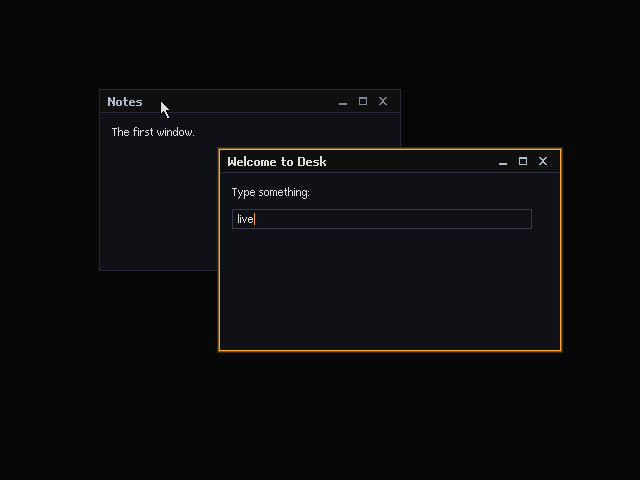
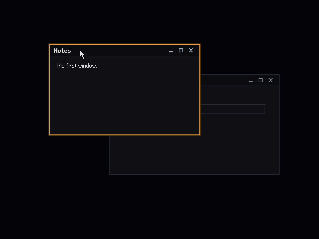
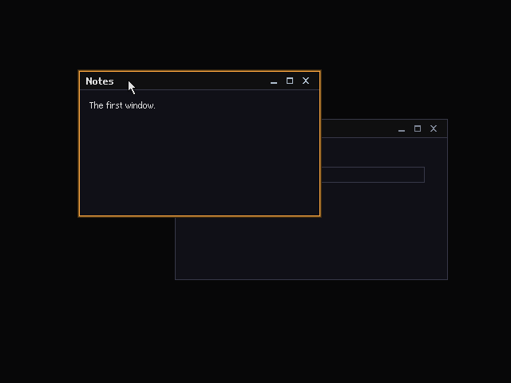
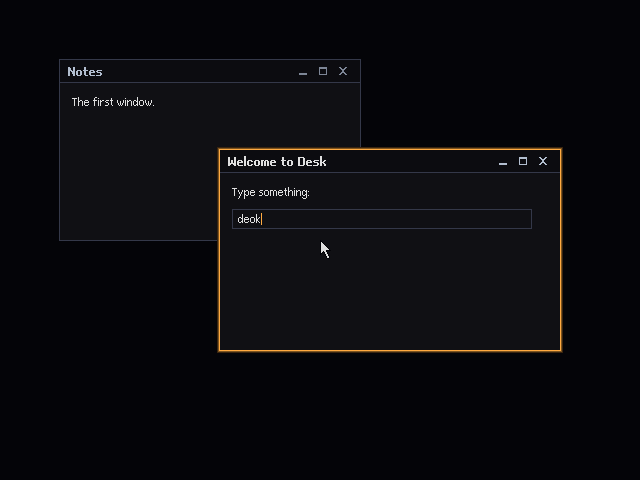

# Live input: the first window on a real keyboard and mouse

The design for driving the first window ([`FIRST-WINDOW.md`](FIRST-WINDOW.md)) with real input on both tracks: the native kernel in a QEMU window, on the PS/2 keyboard and mouse drivers of spike C ([`C-INPUT.md`](C-INPUT.md)), and `SHELL.EXE` in a DOSBox window, on the IRQ 1 handler and the INT 33h mouse of spike B ([`B-DOS-INPUT.md`](B-DOS-INPUT.md)). It covers the live loop and its timing, the cursor, keyboard focus and text entry, pointer capture in the emulators, the ways out, the launchers a person runs, and how the live paths are tested automatically against golden frames without disturbing the scripted checks. The task-by-task build plan is [`LIVE-INPUT-PLAN.md`](LIVE-INPUT-PLAN.md); it replaces T12 of [`FIRST-WINDOW-PLAN.md`](FIRST-WINDOW-PLAN.md).

> **Status.** A design, written on 2026-10-23 against `main` at `44f0265`, where the whole first-window stack is merged, and corrected as each task of [`LIVE-INPUT-PLAN.md`](LIVE-INPUT-PLAN.md) was built; the launcher task checked the options and hotkeys against QEMU 11.1.2 and the DOSBox Staging 0.83 in the CI image and says where it could not. When the code disagrees with this document, the code wins and this document is corrected in the same branch.

## Contents

- [What live input is](#what-live-input-is)
- [Decisions](#decisions)
- [What exists today](#what-exists-today)
- [Where it sits](#where-it-sits)
- [The live loop](#the-live-loop)
- [Timing, pacing and idling](#timing-pacing-and-idling)
- [The cursor at present time](#the-cursor-at-present-time)
- [The keyboard: text, focus cycling and closing](#the-keyboard-text-focus-cycling-and-closing)
- [The pointer: focus, drag and close](#the-pointer-focus-drag-and-close)
- [Ways out](#ways-out)
- [Pointer capture: the desktop's pointer and the guest's](#pointer-capture-the-desktops-pointer-and-the-guests)
- [The launchers](#the-launchers)
- [Keeping the scripted checks deterministic](#keeping-the-scripted-checks-deterministic)
- [Testing live input automatically](#testing-live-input-automatically)
- [Rules carried over](#rules-carried-over)
- [Questions for the owner](#questions-for-the-owner)
- [Risks](#risks)
- [Out of scope](#out-of-scope)
- [What changes in other documents](#what-changes-in-other-documents)
- [Result](#result)

## What live input is

A person runs one command, a window opens on their desktop, and the first window's scene is there: the Void desktop, Notes behind, Welcome in front with its field and the orange halo, the arrow at the centre. Then, on both tracks:

- **The mouse moves the arrow.** A click on a window focuses and raises it; dragging a title bar moves the window; a click on the close box closes the window.
- **The keyboard types into the field** of the focused window, Backspace removes a character, typematic repeat works because a held key's repeats arrive as further presses.
- **Keyboard focus moves without the mouse**: Alt+Tab focuses the next window, Alt+F4 closes the focused one, Tab and Shift+Tab move between the fields of a window ([`SPEC.md`](SPEC.md#input) for the keys).
- **Escape ends the session**, the screen goes back to text, and the emulator exits (QEMU) or returns to the DOS prompt (DOSBox).

The same live paths run headless in the checks, with input injected through the emulators (the QEMU monitor; DOSBox's `AUTOTYPE` and, opt-in, `xdotool` under Xvfb), and the frames they lead to must equal golden frames drawn on the host. The scripted checks of the first window keep running exactly as they do today.

## Decisions

1. **One live loop shape, two platform wirings.** The platform owns the loop, as [`FIRST-WINDOW.md`](FIRST-WINDOW.md#where-it-sits) set: drain the input source into `Shell::handle`, present with `Shell::frame` when the shell is dirty, idle. What both tracks share that is not pixels (which keys the platform keeps, the mark line, the counters) is a small pure module in `desk-shell`, `live`, tested on the host. No `Platform` trait yet.
2. **New modes beside the scripted ones, never in them.** The kernel gains a `shell-live` test mode (code 15); `SHELL.EXE` keeps its interactive mode (no `scenario`) and gains `marks`. The `shell` and `shell-corrupt` modes, `SHELL.EXE scenario`, the first window's scenario, sums, goldens and expected transcripts do not change by a byte.
3. **Escape ends a live session; F12 prints a mark.** Both are kept by the platform's loop and never reach the shell. A mark is the frame's digests on the transcript (and, on DOS with `marks`, a read-back of the screen to files): the synchronisation point that lets a check take a capture after the input before it has been handled.
4. **Live scenarios are scenarios.** A live check is written as a `.scn` file in the existing format, so the host test already renders its goldens. `tools/frames.py live` turns the steps after the scenario's first frame into injected input for each emulator, and refuses a step an emulator cannot express. The steps before the first frame are the set-up, which the platform's live mode performs itself.
5. **The pointer stays relative.** The guest reads a PS/2 mouse (native) or INT 33h mickeys (DOS) and integrates the deltas, as today. In a window that means the emulator captures the desktop's pointer on a click and releases it on a hotkey. An absolute pointer (QEMU's `vmmouse`, a USB tablet) is not built ([questions](#questions-for-the-owner)).
6. **Keyboard window management is core behaviour**, in `desk-wm`, scripted and golden-tested like the pointer: Alt+Tab (release picks, no overlay yet), Shift+Alt+Tab, Alt+F4, Tab and Shift+Tab.
7. **The cursor's damage is coalesced.** The compositor remembers where the cursor was last presented and damages only that and where it is now at the next frame, so a burst of mouse reports between two frames costs two sprite rectangles, not a trail.
8. **Native frames are paced by the PIT; DOS frames by the poll.** Natively a frame is presented when the shell is dirty and at least one tick (10 ms at 100 Hz) has passed since the last present, and the loop halts otherwise. Under DOS the loop presents after each poll that left the shell dirty (today it presents on every iteration).
9. **The DOS mouse sees quick clicks.** `desk-int33` reads the driver's press and release counters for the left button, so a click shorter than one poll still reaches the shell as a press and a release.
10. **One launcher, two tracks**: `tools/run-shell.sh native|dos`, which builds what is missing and opens a window. It uses `tools/native-run.sh --window` and `tools/dosrun.sh` with `DOS_WINDOW=1`, both new, so the headless runners stay as they are.

Alternatives considered and rejected:

- **Make the scripted `shell` mode interactive after its last frame.** One mode fewer, but the scripted mode's transcript, rendezvous and timeout would then depend on whether anyone typed, and the negative runs share it. Rejected: a live mode of its own costs one test-mode number.
- **Inject the scenario's own events into the shell inside the guest** (a scripted source behind `InputSource`). Deterministic, but it tests the scenario runner again, not the IRQ handlers, the decoder, the packet assembly, INT 33h or the emulators' input.
- **Synchronise captures by time** (sleep, then screendump). The guest may still be draining; a slow CI machine would fail at random. The mark makes the guest say when it has caught up.
- **A serial-port command channel** for marks (the host writes to the guest's COM1). Precise, but it adds a receive path to the kernel and has no counterpart under DOSBox headless. F12 travels the same keyboard path as the input before it, which is what must be in order.
- **A USB tablet in QEMU** (`-device usb-tablet`) for an absolute pointer that follows the desktop's pointer. It needs a USB host controller driver and a HID driver in the kernel. Far beyond this milestone.
- **DOSBox's seamless mouse** (`mouse_capture = seamless`): the built-in driver follows the desktop pointer's absolute position, but `SHELL.EXE` integrates mickeys, not the driver's position, so the two pointers would drift apart at the screen's edges and with any pointer speed other than one to one.

## What exists today

- **Native.** The kernel's `shell` mode (`kernel/src/shell.rs`) runs `first-window.scn` with scripted input and uses the keyboard only for the screendump rendezvous (`gfx::rendezvous`: print `shell: ready NAME`, wait for any key press, drop mouse events). The PS/2 path itself is proven by the `input` mode (`kernel/src/input.rs`, `tests/native/input.inject`), and `gfx`'s tour has a live window (`gfx::window_session`) that follows the mouse and echoes keys through `desk_vga`'s `Canvas`, not through the shell. The input loop idles with `sti; hlt` with the rings checked with interrupts off (`input::idle`). The PIT runs at 100 Hz (`pit::ticks`).
- **Hosted.** `SHELL.EXE` without `scenario` is already a live mode ([`FIRST-WINDOW.md`](FIRST-WINDOW.md#hosted-shellexe-in-dosbox)): IRQ 1 through `DosIrq` and `KbdIrq`, INT 33h through `DosInput`, the scenario's set-up steps, a loop that drains keys and the mouse, presents every iteration and ends on an Escape press or after `timeout=N` (exit status 4); `dump` writes the last screen. `shell/dos/check.sh` types `d e s k esc` with `AUTOTYPE` and compares the last screen with a digest written into the script (`dc85a936 436a5df4`). The mouse path has never run under `SHELL.EXE`; spike B's Xvfb harness ran it under `INPUT.EXE`.
- **Tools.** `tools/native-run.sh` runs QEMU with `-display none`, an optional monitor socket and `tools/native-inject.py` (`wait TEXT`, `sleep S`, monitor commands); `tools/frames.py inject` writes the scripted mode's monitor script from a scenario's frames. `tools/dosrun.sh` runs DOSBox headless (`SDL_VIDEODRIVER=dummy`, `DISPLAY` removed, a 60 second timeout) with `DOS_AUTOTYPE`, `DOS_CONF` and `DOS_X11`. Spike B's `check-xvfb.sh` and `xvfb-inner.sh` drive DOSBox's window under Xvfb with `xdotool` in the `desk-dos-xvfb:1` image.
- **The core.** `Shell::handle` takes `Event::Pointer(MouseEvent)` (deltas and the button state now), `Event::PointerTo` and `Event::Key`. `Wm::pointer` acts on changes of the left button; `Wm::key` sends every key to the focused window's focused widget, so there is no keyboard window management yet. Until the live-input stack, `Compositor::move_cursor` damaged the old and the new sprite rectangle on every move; it now only records the position (see [the cursor at present time](#the-cursor-at-present-time)).

## Where it sits

| Layer | Built here | Not built here |
|---|---|---|
| Desk core | `desk-wm`: Alt+Tab, Shift+Alt+Tab, Alt+F4, Tab, Shift+Tab; `desk-gfx`: coalesced cursor damage and `Compositor::is_dirty`; `desk-shell`: `Shell::is_dirty` and the `live` module | The switcher overlay, the focus ring, menus, caret blinking, pointer acceleration |
| HAL and drivers | `desk-int33`: the press and release counters (functions 0005h and 0006h) and the events they imply; `Int33Model` gains them | Trait changes; an absolute pointer driver |
| Native platform | `kernel/src/shell.rs`: the `shell-live` mode and its loop | A `Platform` trait |
| Hosted platform | `shell/dos/src/main.rs`: the live loop on the `live` module, `marks` | Releasing the time slice (INT 2Fh 1680h) |
| Tools | `tools/run-shell.sh`; `native-run.sh --window`; `dosrun.sh` `DOS_WINDOW=1`; `frames.py live` and `marks`; `tools/xvfb-dos.sh` | A Docker route for the windowed runs |
| Tests | `tests/shell/live.scn` and `live-keys.scn` with sums and goldens; the native live checks in `native-test.sh`; the DOS live checks in `shell/dos/check.sh` and, opt-in, `shell/dos/check-xvfb.sh` | Real hardware |

## The live loop

Both tracks, in the same order:

```text
set-up:   video mode, palette, presenter; the input source; the first window's set-up steps; mark 00
loop:
  drain the mouse source            -> Shell::handle(Event::Pointer(m))
  drain the key source              -> live::route(key):
                                         Shell  -> Shell::handle(Event::Key(k))
                                         Mark   -> remember that a mark is due
                                         End    -> remember that the session ends
                                         Swallow -> nothing (the release of Escape or F12)
  if a mark is due: drain the mouse source again (motion that arrived meanwhile belongs before the mark)
  if the shell is dirty and the pacing allows, or a mark is due: present (Shell::frame)
  if a mark is due: print it (and, on DOS with `marks`, read the screen back to files)
  if the session ends: print the summary, leave
  idle (native: hlt until the next interrupt; DOS: poll again)
```

**The set-up** applies the steps of `tests/shell/first-window.scn` up to its first `frame` line, as `SHELL.EXE`'s interactive mode does today: two windows, the label, the field and the pointer at the centre. Both platforms embed that file already, so the live scene cannot drift from the scripted one.

**The `live` module** in `desk-shell` (pure, no clocks):

```rust
pub mod live {
    /// What the platform's loop does with a key.
    #[derive(Clone, Copy, Debug, PartialEq, Eq)]
    pub enum Route { Shell, Mark, End, Swallow }
    /// Escape pressed ends the session, F12 pressed asks for a mark; their releases are `Swallow` (kept by the platform, nothing done); every other key is the shell's.
    pub fn route(e: &KeyEvent) -> Route;
    /// Counts for the summary line.
    #[derive(Clone, Copy, Debug, Default, PartialEq, Eq)]
    pub struct Tally { pub keys: u32, pub pointer: u32, pub frames: u32, pub presented: u32, pub marks: u32 }
    impl Tally { pub fn frame(&mut self, s: &FrameStats); }
    /// `shell: mark NN DEPTH WIDTHxHEIGHT INDEX COLOUR`, the line both platforms print (NN from 00 to 99, zero-padded).
    pub fn mark_line(n: u32, depth: Depth, d: &FrameDigest) -> String;
    /// `shell: live ended by Escape: K keys, P pointer reports, F frames, X pixels presented, M marks`.
    pub fn summary_line(t: &Tally) -> String;
}
```

The mark numbers are always two digits, so no mark's line starts with another's (`native-inject.py` waits by substring, and strips trailing spaces from its `wait` lines); a session refuses a 101st mark with a line that says so, and goes on. Mark 00 is printed after the set-up's first frame, before any input is read: it is the live scenario's first frame.

**Transcript lines**, the same on both tracks apart from the platform's own preamble:

```text
shell: live, depth 8
shell: mark 00 8 640x480 920263aa c310363f
shell: mark 01 8 640x480 ........ ........
shell: live ended by Escape: 14 keys, 9 pointer reports, 12 frames, 41234 pixels presented, 4 marks
```

The digests of mark 00 are the scripted `open` frame's, because the set-up is the same. Counts of keys, pointer reports, frames and pixels depend on how the emulator delivered the input and are matched with ranges in the expected transcript, never exactly.

## Timing, pacing and idling

**Native.** The PIT ticks at 100 Hz. The loop presents when `Shell::is_dirty()` is true and at least `MIN_FRAME_TICKS` (1) tick has passed since the last present, or when a mark is due; otherwise it idles with `input::idle` (interrupts off, rings checked, `sti; hlt`), which the next tick or the next input interrupt ends. So the worst latency from an event to the screen is one tick plus the time a present takes, a burst of a hundred mouse packets in one tick is one present, and an idle desktop halts the CPU between ticks. A drag repaints the union of the extents the window passed through since the last frame; on a 486 that union, not the frame rate, is what the user sees as speed, and pacing at one tick keeps the work per second bounded. There is no wait for vertical retrace: tearing is accepted for now ([questions](#questions-for-the-owner)). A session has no time limit of its own; the headless runs are ended by `native-run.sh`'s watchdog if Escape never comes.

**Hosted.** The BIOS tick is 18.2 Hz, too coarse to pace by, and `hlt` is privileged for a DPMI client, so the loop polls: one INT 33h motion call and one position call per iteration (two more with the counters of [decision 9](#decisions)), each a real-mode round trip through DPMI, then a present if the shell is dirty. The poll is the pacing: at DOSBox's `cpu_cycles = max` it is fast, and on a 486 a present that takes longer naturally lowers the poll rate and sums more motion into each event. `timeout=N` keeps its meaning (exit status 4). Releasing the time slice to a multitasking host (INT 2Fh, AX = 1680h) is left out: DOSBox does not need it, and it has not been tested under CWSDPMI ([out of scope](#out-of-scope)).

**What the core sees.** Natively, one `Event::Pointer` per PS/2 packet; under DOS, one per poll with the summed motion. The shell integrates deltas and acts on button changes, so the end state of a drag is the same either way; [`B-DOS-INPUT.md`](B-DOS-INPUT.md#the-event-contract-shared-with-the-native-kernel) already asks the core not to depend on a report's timing or count.

## The cursor at present time

The cursor is composited row by row at present time and never enters the back buffer ([`FIRST-WINDOW.md`](FIRST-WINDOW.md#decisions), decision 4); that stays. What changes is the damage a move makes. Today `move_cursor` adds the old and the new sprite rectangle on every call, so twenty packets between two frames add twenty-one rectangles, which `Damage` merges into a trail. With pacing, many moves per frame become the normal case.

`Compositor` keeps `shown: Option<Rect>`, the sprite rectangle the last present drew (`None` before the first frame and while the cursor is hidden). `move_cursor` only records the position; `frame` adds `shown` and the current rectangle to the overlay damage, presents, and sets `shown`. `set_cursor_visible(false)` adds `shown` (where the sprite is on screen, which after a move is not the current rectangle); `set_cursor_visible(true)` and `set_cursor_inks` add the current rectangle as today. A failed present leaves `shown` as it was. In every frame of the first window's scenario the cursor moves at most once, so the presented counts the expected transcripts pin (`456` and `608` among them) and every `expect-damage` line stay as they are, which is the check that the change is safe. A new host test moves the cursor fifty times between two frames and expects at most two rectangles and the area of two sprites.

`Compositor::is_dirty()` (scene or overlay damage pending, or the cursor away from `shown`) and `Shell::is_dirty()` give the native loop its condition without presenting to find out.

## The keyboard: text, focus cycling and closing

Keys reach `Shell::handle` as `KeyEvent`s with the modifiers after the event ([`C-INPUT.md`](C-INPUT.md#the-event-contracts)). What `Wm::key` does with them, in order:

| Key | Behaviour | Damage |
|---|---|---|
| Tab pressed with Alt, no Shift | Starts or continues a cycle: the target moves one window further down the stacking order, wrapping, skipping nothing. Nothing is drawn while Alt is held | None |
| Tab pressed with Alt and Shift | The same, one window back up | None |
| Alt released while cycling | Focuses and raises the target, as a click would (a drag in progress ends and an armed close box is disarmed); the cycle ends | As a focus that raises |
| Escape pressed while cycling | (Never seen in a live session: the platform keeps Escape.) Cancels the cycle | None |
| F4 pressed with Alt, not cycling | Closes the focused window, as the close box does; the typematic repeats of the same press close nothing more (the next press, after F4 comes up, does) | As close |
| Tab pressed with no Alt, Ctrl or Windows key | The focused window's next field (Shift: the previous), wrapping; labels are skipped | The two fields' carets |
| Anything else | The focused window's focused widget, as today | As today |

- **Release picks**, as [`SPEC.md`](SPEC.md#input) says for Alt+Tab. Since focus always raises, the stacking order is the most-recently-focused order, so one Alt+Tab toggles between the two most recent windows, and each further Tab goes one deeper. The overlay that shows the target while Alt is held is the switcher's task, later; until then nothing is drawn during a cycle, which is acceptable with two or three windows.
- **One field per window** is all the first window has, so Tab changes nothing visible today. The rule is still built and tested with a two-field window in a host test, because the caret must then follow `focus_widget` rather than the window's focus: `Widget::paint`'s `focused` becomes "this widget is its focused window's focused widget". The 2-pixel focus ring of [`SPEC.md`](SPEC.md#input) waits for a widget that is not a text field.
- **Text entry** stays `TextLine::key`: printable ASCII through `desk_kbd::char_for` (US layout), Backspace, chords with Ctrl, Alt or the Windows key ignored, the field's width and `max_chars` respected. Typematic repeat arrives as repeated presses and types repeatedly. Enter, the arrows and Delete do nothing in a one-line field yet.
- **What the platform keeps.** Escape and F12 (presses and releases) never reach the shell ([`live::route`](#the-live-loop)). Every other key does, including Ctrl+Alt+Delete, which the shell ignores for now.

## The pointer: focus, drag and close

Nothing new in `desk-wm`: a press of the left button focuses and raises the window under the pointer, starts a drag on its title bar and arms its close box; motion with the button held drags; a release ends the drag and closes the window if the pointer is still on the armed close box ([`FIRST-WINDOW.md`](FIRST-WINDOW.md#desk-wm-windows-focus-and-damage)). What is new is that real reports drive it:

- **Natively**, every PS/2 packet is one event, with its button state. QEMU's monitor and its display both produce button changes in packets of their own with no motion, so a press is never folded into a move; a human's press can carry motion, which `Wm::pointer` handles by dragging first and then acting on the button change.
- **Under DOS**, a poll that saw the left button go down and up (or up and down) between two polls would lose the click: the Xvfb run of spike B lost `xdotool click`. `MouseInput` therefore reads function 0005h (press information) and 0006h (release information) for the left button on every poll, and when the counts show an edge the state does not, emits the missing state first: up, down, counts 1 and 1 gives a press event then a release event, both with the summed motion on the first; down, down with a release counted gives a release then a press. More than one click inside a poll is reported as one. The right and middle buttons keep the state-only reading ([questions](#questions-for-the-owner)).
- **Pointer speed** is one count to one pixel on both tracks, with no acceleration, as spike B measured in DOSBox and spike C's monitor moves show in QEMU. A person whose desktop pointer is fast feels the guest's as slow; acceleration and a speed setting are later work.
- **The right and middle buttons** and the wheel reach the shell in `MouseEvent` and do nothing.

## Ways out

| Way | Native (`shell-live`) | Hosted (`SHELL.EXE` live) |
|---|---|---|
| Escape pressed | Summary line, back to text, `exit::success`; QEMU exits with the guest's success code and its window closes | Summary line, the clean-up list (mouse reset, IRQ 1 vector, BIOS keyboard flags, text mode), exit status 0; DOSBox returns to the prompt, and the launcher's batch file closes DOSBox |
| `timeout=N` | — (the watchdog of `native-run.sh --timeout`, exit 124) | Exit status 4, as today |
| A panic | The panic line and the failure exit, as in every mode | The runtime's report and status 3, everything restored |
| Closing the emulator's window | QEMU quits without a guest exit code; `native-run.sh` reports status 2, which the launcher reports as a note rather than an error, naming both causes, because a reset or triple fault under `-no-reboot` gives the same status | DOSBox quits; nothing is restored inside DOS, which no longer exists |
| QEMU's or DOSBox's own hotkeys | Ctrl+Alt+Q in QEMU's GTK window quits QEMU (confirmed under Xvfb: QEMU ended with no guest exit code) | Ctrl+F9 kills DOSBox (DOSBox's documented hotkey, not tried) |

Closing the last window does not end the session: the desktop stays, with nothing to focus, and Escape still ends it. Ctrl+Alt+Delete ends nothing: under DOS with the BIOS keyboard handler replaced it is a key, as spike B recorded, and the SPEC's "asks first" waits for a dialog.

## Pointer capture: the desktop's pointer and the guest's

A relative mouse cannot follow the desktop's pointer: the guest only learns how far the pointer moved, never where the person's pointer is. So in a window, the emulator **captures** the pointer: the desktop's pointer is hidden and confined to the window, every motion goes to the guest, and the Desk's arrow is the only pointer. A hotkey or a click gives the pointer back. Keyboard shortcuts the desktop would take (Alt+Tab, Alt+F4) reach the guest only while the keyboard is grabbed too.

### QEMU

- **Device.** The PS/2 mouse that the `pc` machine's 8042 always has, read by `desk-i8042`. The machine also creates a `vmmouse` behind the VMware back door (`vmport` defaults to on), which stays inert until a guest enables it, so the PS/2 path is unaffected. No `-device` flag is needed, and `-device usb-tablet` would add a device the kernel cannot read.
- **Display.** `-display gtk` by default (the toolkit most Linux desktops have), `-display sdl` as the alternative. With a relative guest mouse, a click in GTK's window grabs the pointer and the keyboard, Ctrl+Alt+G releases them, and the title bar says so; SDL's window is released by the same Ctrl+Alt+G (from QEMU's documentation; the SDL window's title bar could not be read under Xvfb, but its demo run played the whole scenario). Grab on hover (`-display gtk,grab-on-hover=on`) is left off, so moving across the window on the way somewhere else does not trap the pointer.
- **Scale.** The window shows 640 × 480 at one host pixel per guest pixel (`zoom-to-fit=off`), so a relative count is one desktop pixel. A window enlarged to twice its size on an X server with no window manager kept the guest picture at 640 × 480 and moved the arrow one pixel per count, so whether QEMU scales relative motion when it zooms a picture to fit was not measured; with `zoom-to-fit=off` it does not arise. Measured on QEMU 11.1.2's GTK display under Xvfb: a click grabs (the title bar then reads "Press Ctrl+Alt+G to release grab"), `xdotool mousemove_relative -- -200 -170` from the centre moved the arrow to (120, 70), and Ctrl+Alt+G released the grab.
- **Keyboard.** QEMU sends the guest scancodes for the physical keys pressed, so the guest's US layout applies whatever the desktop's layout is: on a French desktop the key labelled A types `q`. On Wayland, the keyboard grab needs the compositor's permission (GNOME asks once).
- **The recommended command**, which `tools/native-run.sh --window gtk` assembles from the headless arguments:

```text
qemu-system-i386 -cpu 486 -m 16 -drive if=floppy,format=raw,file=dist/native-shell-live-8.img \
  -display gtk,zoom-to-fit=off,grab-on-hover=off -serial file:SERIAL \
  -device isa-debug-exit,iobase=0xf4,iosize=0x04 -no-reboot -monitor none -vga std
```

Depth 4 uses `-vga cirrus` and an image made with `--video text`, as the scripted checks do. With `--demo`, the monitor socket that `--inject` sets up takes the place of `-monitor none`.

### DOSBox Staging

- **Device.** DOSBox's built-in INT 33h driver, as spike B used; `[mouse] builtin_dos_mouse_driver = off` gives the keyboard-only run.
- **Capture.** `mouse_capture = onclick`: a click in the window captures the pointer, Ctrl+F10 or the middle button releases it (`mouse_middle_release = true`, Staging's default; both option names exist in the Staging in `vendor/`, the release itself was not tried), and SDL then delivers relative motion, which the built-in driver turns into mickeys one for one. `mouse_raw_input = true` keeps the desktop's pointer acceleration out of the counts.
- **Keyboard.** DOSBox forwards keys to the emulated controller while its window has focus; Alt+Tab and Alt+F4 go to the desktop unless Staging captures system shortcuts (`[sdl] keyboard_capture`, an option the Staging in `vendor/` has; its effect on a real desktop was not tried). Under Xvfb with no window manager both reach DOSBox, which is how the Xvfb checks send them.
- **The recommended settings**, which `tools/dosrun.sh` with `DOS_WINDOW=1` writes (everything else as the headless runs):

```text
[sdl]
fullscreen = false
[mouse]
mouse_capture = onclick
mouse_raw_input = true
```

## The launchers

`tools/run-shell.sh`, for a person at a desktop:

```text
tools/run-shell.sh native [--depth 8|4] [--display gtk|sdl] [--demo]
tools/run-shell.sh dos    [--depth 8|4] [--nomouse] [--demo]
```

- **native** builds the kernel if it is missing or older than its sources (`tools/native-build.sh`), makes `dist/native-shell-live-DEPTH.img` with `tools/native-image.sh --test-mode shell-live --video vbe` (depth 8) or `--video text` (depth 4), and runs `tools/native-run.sh --window DISPLAY --timeout 0 --vga std|cirrus IMAGE`. The serial transcript scrolls in the terminal as it arrives. It prints the capture hotkeys before it starts.
- **dos** builds `dist/shell/SHELL.EXE` if it is missing (`shell/dos/build.sh`) and runs `DOS_WINDOW=1 DOS_TIMEOUT=0 tools/dosrun.sh dist/shell SHELL.EXE depth8|depth4`, with `builtin_dos_mouse_driver = off` for `--nomouse`. It needs DOSBox Staging in `vendor/` (`tools/setup.sh`).
- **`--demo`** plays the live scenario into the window (`frames.py live` through the monitor for native; its keys through `AUTOTYPE` for DOS), so a person can watch what the checks do.
- **Requirements.** A desktop session (`DISPLAY` or `WAYLAND_DISPLAY`) and, for native, `qemu-system-i386` on the host: the Docker route of `native-run.sh` stays headless, and the launcher says so and stops when QEMU is missing ([questions](#questions-for-the-owner)).
- **`tools/native-run.sh --window DISPLAY`** replaces `-display none` with the display named, keeps the serial file and tails it to standard output, and turns status 2 (QEMU closed without a guest code) into a note rather than an error; the note says the window was closed or the guest reset or triple-faulted, since the status cannot tell them apart, and points at the transcript's last lines. Without `--window` nothing changes.
- **`tools/dosrun.sh` with `DOS_WINDOW=1`** keeps `DISPLAY` and `WAYLAND_DISPLAY`, lets SDL choose its video driver, and writes the settings above; `DOS_TIMEOUT=0` disables the timeout (`timeout 0` waits for ever). Without it nothing changes.

## Keeping the scripted checks deterministic

- **Different modes.** `shell-live` is code 15 and `SHELL.EXE`'s live mode is the one without `scenario`, so the scripted modes' code paths do not change. The only change those paths see is in the shared crates: coalesced cursor damage (which leaves every pinned count as it is in the first window's scenario) and the new key handling (Alt+Tab, Alt+F4 and Tab are not in `first-window.scn`).
- **The pinned files are the check.** `tests/shell/first-window.scn`, `.sums`, `golden/first-window/`, `expected-dos-8.txt`, `expected-dos-4.txt` and `tests/native/expected-shell-8.txt` and `-4.txt` do not change in any task of the plan; a builder who needs to change one has found a regression.
- **New goldens come from the host.** Every live check compares against frames the host test renders from a `.scn` file through `MemoryPresent`, with no emulator in the loop, as the first window's goldens are made.
- **Live counts are ranges.** Event counts, frame counts and presented pixels depend on delivery; the expected transcripts give them as `{N:a..b}` ranges, and only digests are exact.
- **Order is forced by marks and pauses**, never by luck: the injectors wait for each mark before the next capture, and pause between a mouse burst and a key burst so the two rings cannot be drained out of order (the rule spike C found for QEMU's folding of mouse events).

## Testing live input automatically

### Live scenarios

Two new scenarios in `tests/shell/`, rendered by the existing host test (it runs every `*.scn` there) into `live.sums`, `live-keys.sums` and `golden/live/`, `golden/live-keys/`:

- **`live-keys.scn`**: keys only, so DOSBox's headless `AUTOTYPE` can play it in CI. Frames: `start` (the set-up), `typed` (`type "desk"`), `erased` (Backspace twice), `again` (`type "ok"`). A host test checks that its set-up is the first window's.
- **`live.scn`**: the pointer and the keyboard, for QEMU and the opt-in Xvfb run. Frames: `start`; `focus` (a click on Notes' title bar); `dragged` (press, move by (40, 30) in two moves, release); `switched` (Alt+Tab: Welcome on top again); `typed` (`type "live"`); `closed` (Alt+F4: Welcome closes, Notes is focused); `clicked` (Notes' close box clicked: the empty desktop); and a final `move` so the cursor is not where it started.

**The set-up rule.** The steps before a live scenario's first `frame` must equal the steps of `first-window.scn` before its first frame, line for line; `frames.py live` checks it and the host test checks it too. The set-up is performed by the platform's live mode, and the first frame is mark 00.

**What a live step may be**, after the first frame (`frames.py live` refuses anything else, with the line number):

| Step | QEMU monitor | DOSBox `AUTOTYPE` | `xdotool` under Xvfb |
|---|---|---|---|
| `move DX DY` | `mouse_move DX DY` (split into moves of at most 100), then `sleep 0.1` | refused | `mousemove_relative -- DX DY` |
| `pointer X Y` | the move from the tracked pointer, clamped as the shell clamps | refused | the same, relative |
| `press left` / `release left` | `mouse_button 1` / `mouse_button 0`, then `sleep 0.1` | refused | `mousedown 1` / `mouseup 1`, then `sleep 0.3` |
| `type "TEXT"` | `sendkey` for each character (`shift-a` for a capital) | each key by its `AUTOTYPE` name | `key` for each character |
| `key K down` then `key K up` | `sendkey K` | `K` | `key K` |
| modifiers down, a key down and up, the modifiers up in reverse order | `sendkey alt-tab` | refused (`AUTOTYPE` has no chords) | `key alt+Tab` |
| `frame NAME` | `sendkey f12`, `wait shell: mark NN`, `screendump {out}/NAME.ppm` | `f12` | `key F12`, `sleep 0.5` |
| `expect-damage` | ignored (host only) | ignored | ignored |
| `open`, `close`, `focus`, `label`, `field`, a lone `key K down` | refused | refused | refused |

Between a mouse step and a key step, either way round, the QEMU script sleeps 0.3 seconds, and before every F12 0.3 seconds, so each ring has been drained before the next device speaks. The key names are mapped from `desk_hal::KeyCode` names to each emulator's names by a table in `frames.py`, tested both ways; `AUTOTYPE`'s names are checked against `autotype -list` by the task that adds them. The `{out}` placeholder is `native-inject.py`'s.

### `frames.py live` and `frames.py marks`

```text
frames.py live SCENARIO --qemu > FILE          the monitor script for native-inject.py, starting with `wait shell: mark 00` and the first frame's screendump, ending with `sendkey esc`
frames.py live SCENARIO --autotype             the arguments for DOS_AUTOTYPE (`-w 3 -p 0.3 ... f12 ... esc`)
frames.py live SCENARIO --xdotool [--quick] > FILE    the script for xvfb-dos.sh; --quick makes each adjacent press and release one 5 ms click (`mousedown 1 sleep 0.005 mouseup 1`)
frames.py marks SUMS SCENARIO DEPTH TRANSCRIPT [--dumps DIR]
                                                the transcript's mark lines, in order, carry the digests of the scenario's frames
                                                at DEPTH (mark k is the k-th frame); with --dumps, renames DIR/Mkk.RAW and .PAL to
                                                the frame names so `frames.py check` can compare them with the goldens
```

`--autotype` takes `--wait N` and `--pace S` (the `-w` and `-p` of `AUTOTYPE`, 3 and 0.3 by default). The `--xdotool` output is a list of lines, each the arguments of one `xdotool` command (`#` lines are comments), which `tools/xvfb-dos.sh` runs in order. The key-name table in `frames.py` holds, for each `KeyCode` name, QEMU's `sendkey` name, the name `AUTOTYPE` takes (the mapper names `autotype -list` prints in DOSBox Staging 0.83) and the X keysym; a key an emulator has no name for is refused with its line. A frame after the first is `F12` and a wait for the mark, so a scenario may have at most 100 frames.

`marks` fails on a missing mark, an extra mark, a digest that differs (printing the frame's name and both digests), or a dump that is missing; exit statuses as the other commands. `tools/test_frames.py` covers each translation, each refusal, the set-up rule and each failure of `marks`.

### Native: through the QEMU monitor

A section in `tools/native-test.sh` after the scripted shell checks, at both depths (std card with `--video vbe`, Cirrus with `--video text`):

1. `frames.py live tests/shell/live.scn --qemu > $work/live.inject`.
2. `tools/native-run.sh --timeout 60 --vga CARD --inject $work/live.inject --shots dist/shell-live-native-DEPTH dist/native-shell-live-DEPTH.img`: status 0.
3. The transcript against `tests/native/expected-shell-live-DEPTH.txt` (`native-check.py`, with ranges for the counts); `frames.py marks tests/shell/live.sums tests/shell/live.scn DEPTH`; the screendumps with `frames.py check tests/shell/live.sums DEPTH dist/shell-live-native-DEPTH`.
4. `live-keys.scn` the same way at depth 8 only, so both live scenarios run on the native path.

### Hosted: `AUTOTYPE` in CI, `xdotool` opt-in

- **Always on**, in `shell/dos/check.sh`, replacing the interactive step's written-in digest: `DOS_AUTOTYPE="$(frames.py live tests/shell/live-keys.scn --autotype)" tools/dosrun.sh dist/shell SHELL.EXE depth8 marks timeout=60`; status 0; `frames.py marks --dumps` and `frames.py check` against `live-keys.sums`; the same at depth 4; and once with `builtin_dos_mouse_driver = off`, which must give the same frames (keyboard only).
- **Opt-in** (`INPUT_EXTRA=1`, with Docker), `shell/dos/check-xvfb.sh`: `tools/xvfb-dos.sh` (spike B's `xvfb-inner.sh`, generalised to any directory, program, arguments and script, in the `desk-dos-xvfb:1` image; spike B's own check now uses it, with its result unchanged) runs `SHELL.EXE depth8 marks` with `frames.py live tests/shell/live.scn --xdotool`, then `marks --dumps` and `check` against `live.sums`; then again with `--quick`, whose clicks last 5 ms; and a run with the `mousemove_relative` lines removed must fail. A press and release with no gap at all (`xdotool click`) never reaches DOSBox's driver, so the quick form uses a 5 ms gap, which does. Whether the counters matter for `SHELL.EXE` depends on how long its polls are: the Xvfb check of spike B (`INPUT.EXE slowpoll`, six 5 ms clicks) is the evidence that they work in DOSBox, and the failing-first evidence of L4. Alt+F4 under Xvfb with no window manager reaches `SHELL.EXE` and DOSBox does not act on it, so `live.scn` runs as written (no DOS variant without Alt+F4 was needed). DOSBox's built-in driver holds back a one-pixel move until the next move arrives (a `mousemove_relative -- 223 1` reported 223 and 0, and the 1 came with the next motion), so a live scenario's pointer steps must not end in a one-pixel move on an axis; `live.scn`'s close-box click is `pointer 383 100` for that reason.

`marks` on DOS: at each F12 (and at mark 00) the program reads the frame buffer and the DAC back, as `dump` does, prints the mark line and writes `M00.RAW` and `M00.PAL` and so on, then prints `shell: readback ... equal` as the scripted run does. Without `marks` F12 prints the mark line only.

### Negative checks

Each must fail, and the check says so when it does not:

| Track | What is broken | What catches it |
|---|---|---|
| Native | The live inject script with its `mouse_move` lines removed | `marks` (the `dragged` frame differs) |
| Native | The live inject script with one `sendkey` removed from `type "live"` | `marks` and `check` (`typed` differs) |
| Native | The depth 8 screendumps against the depth 4 sums | `check` |
| Native | A `live.sums` with one digest changed | `marks` |
| Native | The `alt-tab` line removed | `marks` (`switched` differs) |
| DOS | `AUTOTYPE` without one key of `type "desk"` | `marks --dumps` and `check` |
| DOS | One pixel changed in an `M` dump | `check` |
| DOS | A transcript with one mark line removed | `marks` (a missing mark) |
| DOS, opt-in | Spike B's `xdotool click` before the counters (L4's first commit) | spike B's `check-xvfb.sh` (the click is lost) |
| Tools | A live scenario whose set-up differs from the first window's | `frames.py live` and the host test |
| Tools | A live scenario with a lone `key LeftAlt down` | `frames.py live` refuses it |

The scripted checks keep their own negatives (`shell-corrupt`, `SHELL.EXE corrupt` and the rest) unchanged.

## Rules carried over

- The rules of `shell/` ([`FIRST-WINDOW.md`](FIRST-WINDOW.md#rules-carried-over)): `no_std` + `alloc`, `#![forbid(unsafe_code)]`, no float, no compare-and-swap, no external crates, and **no clocks in the core**: pacing and idling live in the platforms, and `live` only routes keys and formats lines.
- The HAL's drivers have no `unsafe` and no compare-and-swap; `desk-int33`'s new calls go through `Bios::int` like the others.
- Every hooked vector and the text mode are restored on every way out of `SHELL.EXE`, as the clean-up list does today.
- Licence headers on new files, Canadian English, no hard-wrapped markdown.

## Questions for the owner

Each has a default the plan follows unless the owner says otherwise.

1. **The key that ends a live session.** Escape, as `SHELL.EXE` does today. It conflicts with the HIG's Escape (close a menu or dialog) once menus exist, when the way out becomes the Desk menu's *Exit to DOS*. *Default:* Escape, until the Desk menu exists.
2. **The mark key.** F12, kept by the platform in live sessions and harmless when a person presses it (a line on the transcript). *Default:* F12 always on in live sessions; the alternative is a `marks` switch on both tracks so a person's F12 reaches the shell.
3. **Alt+Tab without an overlay.** Release picks, with nothing shown while Alt is held. *Default:* yes; the switcher overlay is its own later task.
4. **An absolute pointer in QEMU** (the `vmmouse` back door: the guest reads the desktop pointer's position, so no capture is needed). It needs a 32-bit `in` with four registers set, which `PortIo` cannot express, so a small platform-side driver with its own `unsafe`. *Default:* not now; relative PS/2 with capture.
5. **The DOS press and release counters for the right and middle buttons too.** Four more DPMI round trips per poll for buttons the shell does not use. *Default:* the left button only.
6. **Pacing.** One PIT tick (10 ms) between native presents, no wait for vertical retrace. *Default:* as written; retrace sync waits for a measured need.
7. **A windowed QEMU from Docker** (the X11 socket into the container, `qemu-system-gui` in the image) for people without QEMU on the host. *Default:* not built; the launcher needs host QEMU for a window, and the headless checks keep their Docker route.
8. **One launcher or two.** *Default:* one, `tools/run-shell.sh native|dos`.

## Risks

- **Mouse and key ordering across two rings.** Natively the mouse and the keys arrive in different rings, drained in a fixed order, so a key injected just after a mouse burst could be handled first if the packets were still in QEMU. The pauses between bursts and before marks, and the extra mouse drain before a mark, cover it; the negative runs show the checks would notice.
- **QEMU folding mouse events** (spike C: a press and release arriving before the guest read the previous packet came out as one). The 0.1 second pause after each mouse command is what made spike C's runs repeatable; the live script keeps it.
- **`AUTOTYPE` timing.** Keys are paced (`-p 0.3`), not synchronised with marks; a very slow CI run could still be reading the ring when F12 arrives, but the ring is in order, so F12 is handled after every key before it. Only a ring overflow (64 bytes: thirty-two plain keys, each a press and a release byte, at most in flight) could break it, and the decoder's recovery would show in the transcript.
- **Host shortcuts.** Alt+Tab and Alt+F4 go to the desktop unless the emulator holds the keyboard grab; on Wayland that depends on the compositor. The automated runs are unaffected (QEMU's monitor and Xvfb without a window manager); a person may find Alt+F4 closing QEMU.
- **GTK or SDL missing from the host's QEMU build.** Some distributions split the display modules into a separate package. The launcher tries `gtk`, then `sdl`, and says what to install, without installing it.
- **Coalesced cursor damage** is a change to a merged, tested crate. Its safety argument is the unchanged first-window transcripts; if one changes, the task stops.
- **Test-mode numbers.** 15 must not collide with another open branch's.
- **Timing on a 486.** The pacing and the polling are designed, not measured on hardware; emulated speed says nothing about a real machine.
- **Real hardware.** Nothing here has run on a real 8042, a real mouse driver or a real VGA card.

## Out of scope

- The Alt+Tab switcher overlay, the focus ring, menus, the Desk menu, *Exit to DOS*, Alt+Space, minimise, maximise, resizing and the launcher bar.
- Caret blinking, key repeat generated by the Desk, pointer acceleration and a pointer speed setting, double clicks, the right and middle buttons and the wheel doing anything.
- An absolute pointer (`vmmouse`, USB tablet), USB of any kind, LEDs for the lock keys.
- Releasing the time slice under DOS (INT 2Fh 1680h) and any DPMI host other than CWSDPMI.
- Vertical retrace synchronisation and frame timing measurements.
- A windowed run from Docker, 86Box and Bochs in a window, and the browser (js-dos) build.
- Ctrl+Alt+Delete handling in the Desk.

## What changes in other documents

Made by the tasks that change the behaviour, in the same branch:

- [`FIRST-WINDOW.md`](FIRST-WINDOW.md): the damage paragraph for the cursor (coalescing), the key table in desk-wm, the hosted program's arguments (`marks`), the native test modes (`shell-live`), and the "Not verified" items the live checks close.
- [`FIRST-WINDOW-PLAN.md`](FIRST-WINDOW-PLAN.md): T12 points here (done with this document).
- [`B-DOS-INPUT.md`](B-DOS-INPUT.md): the press and release counters move from a recommendation to built.
- [`HAL.md`](HAL.md): `desk-int33`'s counters in the driver list.
- `tools/README.md`: the launcher, `--window`, `DOS_WINDOW` and the new `frames.py` commands.
- [`DIRECTION.md`](DIRECTION.md): the first window's milestone notes that it runs live on both tracks, once the result is in.
- This document: a [Result](#result) section with what was built, measured and not verified (written).

## Result

Measured on 2026-10-23 on the tip of the live-input stack, in the `ci-dos` image (DOSBox Staging 0.83, Rust 1.98) and on the host (QEMU 11.1.2 as a 486, Docker for the Xvfb container and its `xdotool`). Not verified comes first.

### Not verified

- **A person at a real desktop.** The author's machine runs a Wayland session and no window was opened on it. The windows were run on a virtual X server (Xvfb, no window manager) with `xdotool` sending real X pointer and key events, which exercises QEMU's GTK grab and DOSBox's capture but not a compositor: a Wayland compositor that refuses the keyboard grab, a desktop that takes Alt+Tab or Alt+F4 before the emulator, a real pointer's acceleration, SDL's title bar and its release hotkey, DOSBox's release keys (Ctrl+F10, the middle button), and `keyboard_capture` were not tried.
- **Real hardware.** Nothing ran on a real 8042, a real mouse driver, a real VGA card or a 486. Pacing (one PIT tick natively, the poll under DOS) was designed, not timed; emulated speed says nothing about it.
- **Other emulators and drivers.** QEMU is the only native emulator that played the live scenarios (Bochs and 86Box did not), and DOSBox's built-in INT 33h driver is the only one tried: other drivers' answers to functions 0005h and 0006h (a missing button, saturating counts) are unknown.
- **`INPUT_EXTRA=1 tools/check.sh` in the CI image.** The image has no Docker, so the two Xvfb steps (spike B's and `shell/dos/check-xvfb.sh`) cannot run there. `INPUT_EXTRA=1 tools/check.sh` as one command passed on the host (its QEMU, its Docker, the image's DOS tools copied out under `vendor/`), and the Xvfb steps were also run five times each in a row; the rest of `tools/check.sh` ran in the image.
- **The right and middle buttons and the wheel** reach the shell and do nothing; under DOS only the left button's clicks shorter than a poll are seen.

### What was built

- **The core:** `Compositor` keeps `shown` and a burst of cursor moves between two frames presents at most two sprite rectangles (the test failed before the change, 2440 pixels against 456); `Shell::is_dirty`; `desk_shell::live` (`route`, `Tally`, `mark_line`, `summary_line`); Alt+Tab, Shift+Alt+Tab, Alt+F4, Tab and Shift+Tab in `desk-wm`, with the caret drawn only in the focused window's focused field (`tests/shell/keys.scn`, 10 frames at each depth).
- **The tools:** `tests/shell/live.scn` (8 frames) and `live-keys.scn` (4 frames), `frames.py live` for QEMU, `AUTOTYPE` and `xdotool`, `frames.py marks`, `tools/xvfb-dos.sh`.
- **The native track:** the kernel's `shell-live` mode (code 15) on the PS/2 drivers, paced by the PIT, halting when idle, F12 marks and Escape to end.
- **The hosted track:** `SHELL.EXE`'s live loop with `marks`, and the INT 33h press and release counters for the left button.
- **The launchers:** `tools/run-shell.sh native|dos`, `native-run.sh --window` and `DOS_WINDOW=1 tools/dosrun.sh`.

### What matched

Every mark of every live run equals its golden: the colour digest and, where the capture has indices, the index digest. Marks are numbered from the scenario's first frame (mark 00).

| Frame of `live.scn` | Depth 8 colour digest | Depth 4 colour digest |
|---|---|---|
| start | `c310363f` | `216c6cb6` |
| focus | `8fa785c2` | `4239a1ae` |
| dragged | `a8143a01` | `2c6aaaf5` |
| switched | `a61b635f` | `83440590` |
| typed | `c97d165b` | `ec227094` |
| closed | `64907bdb` | `c31f4c12` |
| clicked | `dea3fc34` | `dea3fc34` |
| move | `5817064b` | `5817064b` |

(`start` is the first window's `open` frame, so its digests are the scripted run's; `clicked` and `move` are the same at both depths because each is the empty desktop with the arrow.)

| Run | Marks and dumps against the host's goldens | Counts of the run (keys, pointer reports, frames presented, pixels presented) |
|---|---|---|
| Native, `live.scn`, depth 8 (QEMU std card, PS/2 mouse and keyboard) | 8 of 8 marks, 8 of 8 screendumps | 31, 14, 17, 896,096 |
| Native, `live.scn`, depth 4 (QEMU Cirrus card) | 8 of 8, 8 of 8 | 31, 14, 17, 906,424 |
| Native, `live-keys.scn`, depth 8 | 4 of 4, 4 of 4 | 23, 0, 9, 309,230 |
| DOS, `live-keys.scn` by `AUTOTYPE` through IRQ 1, depth 8 | 4 of 4 marks, 4 of 4 read-backs | 23, 0, 9, 309,230 |
| DOS, the same, depth 4 | 4 of 4, 4 of 4 | 23, 0, 9, 310,224 |
| DOS, the same, no mouse driver | 4 of 4, 4 of 4 (equal to the run with a driver) | 23, 0, 9, 309,230 |
| DOS, `live.scn` by `xdotool` through DOSBox's window and INT 33h, depth 8 | 8 of 8, 8 of 8 | 31, 11, 14, 894,728 |
| DOS, the same with 5 ms clicks (`--quick`) | 8 of 8, 8 of 8 | 31, 11, 14, 894,728 |

- Three runs in a row of the native depth 8 run gave the same mark lines (one checksum); five runs in a row of the DOS Xvfb run gave the same marks.
- **The two tracks agree.** `frames.py same` of the native depth 8 screendumps (PS/2 mouse, QEMU) and the DOS dumps (INT 33h, DOSBox) of `live.scn` reports the 8 frames equal: the arrow, the drag, Alt+Tab, the typed word and the close box come out as the same picture through two different input paths.
- **The counts vary and are only ranges** in the expected transcripts (`tests/native/expected-shell-live-*.txt`). The native pointer reports follow how the injector splits a move into monitor commands of at most 100 counts and sends the buttons; the DOS ones are fewer because a poll sums the motion since the last.
- **The negative runs failed as they should:** native — the script with its `mouse_move` lines removed, with one `sendkey` removed from typing "live", with the `alt-tab` line removed, the depth 8 dumps against the depth 4 sums, sums with one digest changed, a transcript with one mark line removed, and the live transcript as the scripted one; DOS — `AUTOTYPE` without one key of "desk", a live dump with one pixel changed, a transcript with one mark line removed, the depth 8 marks against the depth 4 sums, and the Xvfb run with its pointer motion removed; tools — a scenario whose set-up differs from the first window's, a lone `key LeftAlt down` and a mouse step for `AUTOTYPE` (each refused with its line number); the INT 33h counters — `INPUT.EXE slowpoll` against six 5 ms clicks saw none of them without the counters and all six with them.
- **The scripted checks did not change by a byte:** `first-window.scn`, its sums and goldens, `expected-dos-8.txt`, `expected-dos-4.txt` and `expected-shell-8.txt` and `-4.txt` are the files `main` has, and every scripted run passed.
- Sizes: `SHELL.EXE` 108,544 bytes, the native `kernel.bin` 179,984 bytes.

### What differs from the design

- `live::Route` has a fourth variant, `Swallow`, for the releases of Escape and F12.
- **The counters' premise was wrong, and the evidence is changed.** Spike B concluded that `xdotool click` was lost because the press and release fell inside one poll. A press and release with no gap never reach DOSBox's driver at all (X delivers both with one timestamp, and SDL or DOSBox drops the pair), so no counter holds them. A click 1 to 5 ms long does arrive, and a program that polls every few milliseconds sees it by state, so the counters matter when a poll is slower than the click: spike B's check now runs `INPUT.EXE slowpoll` against six 5 ms clicks, and `--quick` makes 5 ms clicks, not `click 1`. Reading the counters before the state keeps a click that lands between the two reads from being split.
- DOSBox's built-in driver holds back a one-pixel move until the next move, so a live scenario's pointer steps must not end in a one-pixel move; `live.scn`'s last click is `pointer 383 100`.
- Alt+F4 under Xvfb reaches `SHELL.EXE` and DOSBox does not act on it, so there is no DOS variant of `live.scn`.
- Held Alt+F4 closes one window, not one per typematic repeat, and Alt+Tab released during a drag ends the drag (both found in review; `docs/LIVE-INPUT.md`'s key table says so).
- QEMU's `sendkey` names and `mouse_move`/`mouse_button` and DOSBox's `AUTOTYPE` names (checked against `autotype -list`) needed no correction; `Ctrl+Alt+Q` in QEMU's GTK window quits QEMU (it is not a power-down). `tools/native-run.sh --window` tails the serial file and reports a closed window as a note.

### What was seen

Real captures of the first window under live input, taken from the runs' own dumps, not from a desktop: [`images/live-input/`](images/live-input/).

| Native, depth 8, `typed` (QEMU screendump) | DOS, depth 8, `dragged` (xdotool and INT 33h) |
|---|---|
|  |  |

| Native, depth 4, `dragged` | DOS, depth 4, `again` (keys by AUTOTYPE) |
|---|---|
|  |  |

- `native-8-typed.png`: the near-black desktop, "Notes" dimmed behind (it was dragged to (100, 90) and Alt+Tab put Welcome back in front), "Welcome to Desk" in front with the orange halo and "live" in its field with the caret, the arrow where the drag left it.
- `dos-8-dragged.png`: "Notes" in front with the halo, moved to (100, 90) by a drag with the mouse, Welcome dimmed behind it, the arrow on Notes' title bar; the same picture the QEMU run gives, as `frames.py same` says.
- `native-4-dragged.png` is the same scene at depth 4 and `dos-4-again.png` shows "deok" (typed "desk", two Backspaces, then "ok") in Welcome's field with the caret and the arrow at the centre.
- The windows themselves were looked at on the virtual X server: QEMU's GTK window with its menu bar and the guest's 640 × 480 picture, its title bar reading "Press Ctrl+Alt+G to release grab" after a click, and DOSBox's window with the picture scaled to fit; `xdotool`'s relative motion of (-200, -170) moved the arrow from the centre to (120, 70) exactly, and Alt+Tab, Alt+F4, typing and Escape worked in both. Those screenshots are not kept: they are of a virtual desktop.
