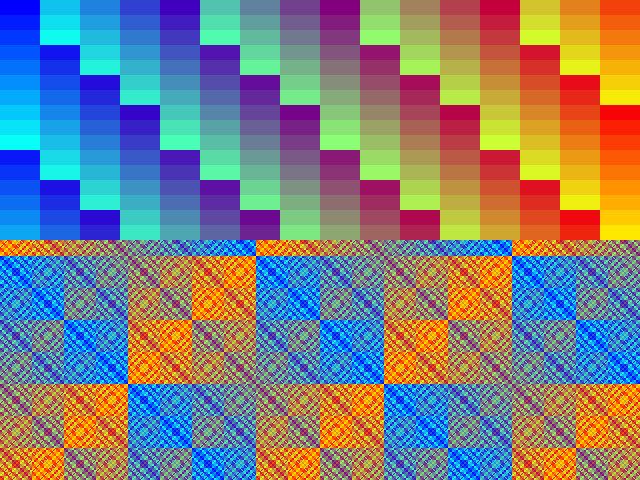

# Spike s5-jsdos: DOS programs in the browser through js-dos 8

Do Desk's DOS programs run in a browser through js-dos 8, and does the VESA linear frame buffer (LFB) work there? This is the hosted track's browser story. The code is in [`../spikes/s5-jsdos/`](../spikes/s5-jsdos/) and the evidence (screenshots, probe transcripts) in [`../spikes/s5-jsdos/evidence/`](../spikes/s5-jsdos/evidence/). Everything below was run in headless Chromium 154.0.8037.97 on Linux with js-dos 8.5.3, against a local web server, and compared with DOSBox Staging 0.83.0 running the same programs through [`../tools/dosrun.sh`](../tools/dosrun.sh).

## Contents

- [Verdict and recommendation](#verdict-and-recommendation)
- [Method and the commands that work](#method-and-the-commands-that-work)
- [Results](#results)
- [VBE and the linear frame buffer](#vbe-and-the-linear-frame-buffer)
- [Sound](#sound)
- [What differs from native DOSBox Staging](#what-differs-from-native-dosbox-staging)
- [Timings and sizes](#timings-and-sizes)
- [Recommendation for the browser build](#recommendation-for-the-browser-build)
- [Notes on the js-dos API](#notes-on-the-js-dos-api)
- [What was and was not verified](#what-was-and-was-not-verified)

## Verdict and recommendation

**Verdict: yes.** Every program the repository builds for DOS runs unchanged in js-dos 8 in the browser, with `CWSDPMI.EXE` beside it (or the self-contained `CWSDSTUB.EXE` build): the hosted skeleton's `DESK.EXE` (C layer plus Rust core), the d0 pure Rust programs `HELLO.EXE` and `HW.EXE` (the IRQ 0 hook, VGA mode 13h), and the s1 module demo (`HOST.EXE` loading DXE3 modules, including a recovered panic and a caught divide fault). Their transcripts are byte for byte the ones the native DOSBox harness expects. Mode 13h draws exactly the reference pattern (zero of 64 000 pixels differ), and **VBE 2.0 with the linear frame buffer works**: the controller reports VBE 2.0, lists 640×480×8 with the LFB attribute, `4F02h` accepts the LFB flag, DPMI function 0800h maps the frame buffer, and a pattern written there shows on the page's canvas exactly as computed (zero of 307 200 pixels differ), as does the same pattern written through the bank window. Audio can be exercised too: the OPL2, the Sound Blaster (DSP, DMA, IRQ) and the PC speaker all answer, and the pitches measured from the emulator's own sample stream are right.

**Recommendation.** The browser target is the same code path as DOSBox: VBE 2.0, 640×480×8, linear frame buffer. Mode 12h is not needed for the browser. Ship the `.jsdos` bundle from 0.1 (the condition in `OPEN-QUESTIONS.md` — "unless the spike shows the LFB working" — is met), with these rules for the code:

- **Read the frame buffer's physical address from `4F01h`, never hard-code it.** js-dos's DOSBox reports `0xC0000000` (as DOSBox Staging does); its DOSBox-X backend reports `0xE0000000`.
- **Do not rely on more than 2 MiB of video memory.** js-dos's DOSBox reports 2048 KiB (Staging reports 4096 KiB). 640×480×8 needs 300 KiB and 1024×768×8 needs 768 KiB, both fine; 24- and 32-bit modes beyond 640×480 need care.
- **Do not rely on the exact mode list.** js-dos lists 47 modes and Staging 59; only the VESA standard 8-bit numbers (`0x100`, `0x101`, `0x103`, `0x105`, `0x107`) are in both. Find a mode by its size and depth in the list, as the probe does.
- **Keep a banked path for the same mode** (`4F05h`): it works here too, and it is what a `vesa_nolfb` configuration leaves.
- Treat the browser build as DOSBox-with-CWSDPMI: DPMI is CWSDPMI, running inside the emulated DOS, so the runtime contract in `D0-RUST-DOS.md` holds as it is.

## Method and the commands that work

```bash
tools/setup.sh                              # once: DJGPP, DOSBox Staging, CWSDPMI in vendor/
spikes/s5-jsdos/fetch-jsdos.sh              # js-dos 8.5.3 from the npm registry, SHA-256 checked, into vendor/js-dos/
spikes/s5-jsdos/build.sh                    # every program and bundle, then the site in dist/s5/site/
node spikes/s5-jsdos/drive.mjs              # headless Chromium runs every scenario; screenshots in dist/s5/out/
tools/check-jsdos.sh                        # the three steps above, as one opt-in check (or JSDOS=1 tools/check.sh)
S5_BACKEND=dosboxX node spikes/s5-jsdos/drive.mjs     # the same on js-dos's DOSBox-X backend
tools/dosrun.sh dist/s5 VBE.EXE nowait      # the same probe in native DOSBox Staging, for comparison
```

- **js-dos** is pinned to 8.5.3 (published 2026-10-07, so more than two weeks old when it was chosen; Fizz DOS ships the same version). `fetch-jsdos.sh` downloads the tarball from `registry.npmjs.org`, checks it against a SHA-256 written in the script (`711f7741…8756`, the same as the registry's) and unpacks only what the page needs into `vendor/js-dos/`, which is not committed, with `LICENSE-GPL-2.0.txt` and `PROVENANCE.txt` beside it.
- **Bundles.** [`bundle.py`](../spikes/s5-jsdos/bundle.py) writes a `.jsdos` (a zip with `.jsdos/dosbox.conf`, `.jsdos/jsdos.json` and the files at the root of C:) with fixed timestamps. [`build.sh`](../spikes/s5-jsdos/build.sh) makes one bundle per scenario; each autoexec runs `S5RUN.BAT`, which echoes `S5-BEGIN`, runs the program, echoes `S5-END`, records the exit status with the same `IF ERRORLEVEL` ladder `tools/dosrun.sh` uses and writes `DONE.TXT`.
- **Probes.** [`probes/`](../spikes/s5-jsdos/probes/) is a Cargo workspace for the d0 target (it reads `dos-elf.json`, `link.ld` and the `rt` crate from `spikes/d0-rust-dos`), packed by `tools/elf2go32.py`. `VGA13.EXE` holds mode 13h with a known palette; `VBE.EXE` runs the VBE calls through DPMI 0300h and draws 640×480×8 through the LFB (mapped with DPMI 0800h) or, with `banked`, through the bank window; `TONE.EXE` plays three tones.
- **The page** ([`page/index.html`](../spikes/s5-jsdos/page/index.html), [`harness.js`](../spikes/s5-jsdos/page/harness.js)) starts a bundle with `Dos(element, { url, pathPrefix, backend, kiosk: true, noCloud: true, autoStart: true, onEvent })`, takes the command interface from the `ci-ready` event and offers `start`, `read`, `waitFile`, `key`, `shot`, `compare`, `output`, `analyseAudio` and `stop`. `?bundle=hello` runs one bundle by hand.
- **The driver** ([`drive.mjs`](../spikes/s5-jsdos/drive.mjs)) has no dependencies: a Node 22 script that serves `dist/s5/site`, starts Chromium (`/usr/bin/chromium`, or `CHROMIUM=`) with the DevTools protocol on a local port, and evaluates calls in the page. It exits non-zero if any scenario fails.
- **Comparing a screenshot.** The probes set their own 256-colour palette (`R = i/4`, `G = 7i mod 64`, `B = 63 − i/4`, in 6-bit components), so the reference image is computed in the page from the pattern formula and that palette, with no reliance on the emulator's default DAC. A pixel counts as different if any channel is off by more than 4; the worst difference seen was 0.
- **Sound** cannot go through the player: it always hands audio to an audio worklet, so the page never sees samples. The `tone` scenario starts the emulator through the layer under the player (`emulators.dosboxWorker(bundle, { audioWorklet: false })`), whose `onSoundPush` event delivers the mixed samples to the page, and measures the pitch of each tone from rising zero crossings.

## Results

Each row passed in all three of three full runs (18 scenarios, about 44 s for the suite, cold browser profile each time). Native means DOSBox Staging 0.83.0 with `tools/dosrun.sh`.

| Program | Check | js-dos 8.5.3 (DOSBox backend) | Native Staging |
|---|---|---|---|
| `HELLO.EXE` (text, d0) | Standard output equals `spikes/d0-rust-dos/expected/hello.txt` | identical, 22 lines, exit status 0 | identical |
| `HELLO.EXE` as `solo/HELLO.EXE` (`CWSDSTUB.EXE`, no `CWSDPMI.EXE`) | same | identical | identical |
| `HELLO.EXE` with `core = normal`, `cputype = 486` | same | identical | identical |
| `HELLO.EXE exit 7` | Exit status read back from the emulated disk | 7 | 7 |
| `DESK.EXE` (C layer plus Rust core) | The skeleton line on standard output and in `OUT.TXT` | identical, exit status 0 | identical |
| `HW.EXE` (IRQ 0 hook, mode 13h, d0) | Standard output equals `expected/hw.txt` | identical (ticks in range, vector restored, frame buffer checksum `0x49fd8cc5` matches) | identical |
| `VGA13.EXE` (mode 13h held on screen) | Screenshot against the computed reference | 320×200, 256 colours, 0 of 64 000 pixels differ; checksum matches | checksum `0x49fd8cc5` matches (no screenshot) |
| `VBE.EXE` (640×480×8, **linear frame buffer**) | Screenshot against the computed reference; read-back checksum | 640×480, 256 colours, 0 of 307 200 pixels differ; checksum `0x3d8bcade` matches | checksum matches |
| `VBE.EXE banked` (same mode, bank window) | same | 0 of 307 200 pixels differ; 5 bank switches, none failed | matches |
| `VBE.EXE` under `machine = vesa_nolfb` | The LFB is withheld | no mode has the LFB attribute and the physical base is 0; the probe reports it and exits with status 3 | not run |
| `HOST.EXE life`, `panic`, `fault div catch` (s1 modules) | Transcript equals `spikes/s1-dxe3/expected/` without the `mem:` lines | identical (17, 26, 16 lines); the DPMI exception path (the caught `SIGFPE`) works | identical |
| `TONE.EXE` | Pitches from the emulator's sample stream; the hardware's own answers | OPL2 440 Hz, Sound Blaster DMA 400 Hz, PC speaker 440.1 Hz; AdLib detected, DSP 2.1, DMA terminal count reached, IRQ 7 pending | not run (the native harness has sound off) |

Screenshots: [`mode 13h`](../spikes/s5-jsdos/evidence/vga13.png) and [`VBE 640×480×8`](../spikes/s5-jsdos/evidence/vbe.png).



js-dos's DOSBox-X backend (`dosbox-x-v2026.08.31-92-g48abd08ee` per js-dos's changelog) passes the same scenarios except where noted in the next sections; it takes about twice as long to start and run, so it is not the default.

## VBE and the linear frame buffer

The question the spec left open, answered by `VBE.EXE` ([`evidence/vbe-jsdos.txt`](../spikes/s5-jsdos/evidence/vbe-jsdos.txt) is its full output; [`evidence/vbe-staging.txt`](../spikes/s5-jsdos/evidence/vbe-staging.txt) is the native run).

- **The information block** (`4F00h` with the `VBE2` signature): `VESA`, version 2.0, OEM string "S3 Incorporated. Trio64", capabilities 0, **2048 KiB** of video memory, software revision 0x0200, vendor "DOSBox Development Team", product `DOSBox - The DOS Emulator`. Staging answers the same with 4096 KiB and "The DOSBox Staging Team".
- **The mode list:** 47 modes, from `0x100` (640×400×8) through `0x225` (848×480×32). 8-bit packed-pixel modes (memory model 4) with the LFB bit (`ModeAttributes` `0x009b`): `0x100` 640×400, **`0x101` 640×480**, `0x103` 800×600, `0x105` 1024×768, `0x107` 1280×1024, `0x150` 320×200, `0x151` 320×240, `0x152` 320×400, `0x153` 320×480, `0x207` 1152×864, `0x222` 848×480. 15, 16 and 32 bits per pixel exist too (no 24-bit mode, which Staging has). The 4-bit planar modes have no LFB bit (`0x001b`).
- **640×480×8 with the LFB is offered** (`0x101`, attributes `0x009b`, bit 7 set), with the physical base **`0xC0000000`** and a pitch of 640.
- **Setting it works:** `4F02h` with `BX = 0x4101` returns `0x004f`, and `4F03h` reads back `0x4101`.
- **DPMI 0800h can map the LFB** under CWSDPMI inside js-dos: the call succeeded for the 307 200-byte frame buffer and returned the same linear address (`0xC0000000`), reachable through the 4 GiB data segment `rt` builds. No special handling was needed; this is the path DJGPP programs use.
- **Drawing shows on the canvas:** the pattern written through that pointer is what `ci.screenshot()` returns, all 307 200 pixels, and the read-back checksum equals the computed one. The banked path (`4F05h`, window A at `A0000h`, 64 KiB granularity) gives the identical picture.
- **`vesa_nolfb`** (a machine setting in this DOSBox) removes the LFB bit and the base address from every mode; the probe says so and stops. **`vesa_oldvbe`** makes this DOSBox answer VBE 1.2 with 24 modes, yet its modes still carry the LFB bit and `0x4101` still works; the DOSBox-X backend honours it fully (no LFB). So a bundle that must have the LFB should not set either option, and the program should look for the LFB bit rather than assume.
- **DOSBox-X backend:** VBE 2.0, 53 modes, the LFB at `0xE0000000`, and the same pixel-exact result; mode 13h is delivered as 640×400 (double-scanned) instead of 320×200.
- **If it did not work,** the fallbacks would have been mode 12h planar, banked VBE or mode 13h only. None is needed for the browser, and `SPEC.md` keeps mode 12h as the plain-VGA fallback for real hardware.

## Sound

`TONE.EXE` ([`probes/src/bin/tone.rs`](../spikes/s5-jsdos/probes/src/bin/tone.rs)) is a TONETEST for the paths `SPEC.md` names. Audio cannot be heard here, but js-dos can hand the mixed samples to the page, and that is enough to test pitch.

| Path | What the program did | What it saw | What the page measured |
|---|---|---|---|
| AdLib (OPL2) | The standard timer-overflow detection, then a sine at F-number 580, block 4 (440 Hz) for 2 s | detected | 440 Hz, 1.99 s |
| Sound Blaster (`sbtype = sb2`) | DSP reset (answers `0xAA`), version (2.1), speaker on, eight-bit single-cycle DMA on channel 1, 20 000 bytes of a 400 Hz square wave at 20 kHz | DMA count register `0xffff` (terminal count), IRQ 7 pending in the PIC | 400 Hz, 1.1 s (window rounding of a 1 s tone) |
| PC speaker | PIT channel 2 at 1 193 182 / 440, gate bits on port 61h, for 2 s | n/a | 440.1 Hz, 1.98 s |

- The three `oplemu` settings (`fast`, `default`, `compat`) give the same measured pitches and levels for this single sine, so the check does not tell them apart. Fizz DOS found that `compat` played its music wrongly and chose `fast` (`default`, Nuked OPL, also plays it right); a pitch test cannot show that, and a music-level check (a recorded reference tune compared by envelope or spectrum) was not done.
- Fizz DOS also found that js-dos's mixer, left at its default prebuffer, over-produces samples and the page's audio ring drops them, so the speaker note measured 393.5 Hz instead of 440 Hz; with `prebuffer = 0` (set in these bundles) the stream runs at its real rate. Our measurement is taken from the emulator's output before the worklet, so it checks the emulation, not the browser's playback path.
- Not testable here: whether anything is audible, latency, and glitches in the playback path (the audio worklet) in a real browser. A person has to listen, as with Fizz DOS's `TONETEST`.

## What differs from native DOSBox Staging

js-dos 8's DOSBox backend is a DOSBox fork compiled to WebAssembly (`wdosbox.wasm`, 1.4 MB), not Staging. What was measured:

| | js-dos 8.5.3 DOSBox backend | DOSBox Staging 0.83.0 (our harness) |
|---|---|---|
| Version it reports | "DOSBox version jsdos"; DOS 5.00. It is a fork of the original DOSBox (the machine names `vesa_nolfb` and `vesa_oldvbe`, the `fast` OPL emulator and the absence of `vmemsize` point to the 0.74-3 line), but no revision is recorded in the files, so the exact one is not known | "DOSBox Staging version 0.83.0 (7b400)"; DOS 5.00 |
| Machine | `svga_s3` (also built in: `svga_et3000`, `svga_et4000`, `svga_paradise`, `vesa_nolfb`, `vesa_oldvbe`) | `svga_s3` |
| Video memory and VBE | 2048 KiB, 47 modes, LFB at `0xC0000000` | 4096 KiB, 59 modes (adds 24-bit modes and up to 1600×1200), LFB at `0xC0000000` |
| CPU | `cputype` and `core` are accepted (`auto`, `normal`, `486` all ran HELLO identically). `cycles = max`. The d0 finding that Staging's `cputype = 486` faults on `CMPXCHG` was not re-checked here | `core = normal`, `cputype = 486`, `cpu_cycles = max`, `cpu_cycles_protected = auto` |
| Memory | 632 KB conventional, 14 912 KB extended free | 634 KB conventional, 14 912 KB extended free |
| DPMI | None of its own. CWSDPMI runs inside the emulated DOS, so DPMI behaves as in the native runs; the same negative control in `HELLO.EXE` (a direct protected-mode INT 21h with a pointer does not work under CWSDPMI) shows the same result | same |
| Sound | OPL2/Sound Blaster/PC speaker present as configured in the bundle (`sbtype = sb2`, `oplemu = fast`, `prebuffer = 0` here); the native harness turns sound off | `nosound = true` |
| Time | Runs in the browser's real time with `cycles = max`; programs timed by the BIOS tick counter (as `HW.EXE` is) see 18.2 ticks a second | same |
| Frame delivery | `ci.screenshot()` returns the frame as RGBA at the mode's pixel size (320×200 for mode 13h, 640×480 for the VBE mode) | no screen in the headless harness |

js-dos's DOSBox-X backend is a different emulator again (a recent DOSBox-X): its `mem` command is missing in the shell used here, it reports VBE 1.2 under `vesa_oldvbe`, and its LFB base differs. A program's browser build should be tested on the default backend and treated as unverified on the other.

## Timings and sizes

Headless Chromium 154 with software rendering, a local server, a fresh profile for each scenario (so cold caches), three runs. They bound what the browser costs; they say nothing about a phone or a slow laptop.

| Step | Time |
|---|---|
| `Dos(...)` called to `ci-ready` (the emulator is up, the bundle is mounted) | 134 to 192 ms |
| Page navigation to `DONE.TXT` seen, `HELLO.EXE` (includes a fixed 300 ms wait in the driver and 100 to 250 ms of polling) | 1.04 to 1.20 s |
| The same for `DESK.EXE` | 0.73 s (native `tools/dosrun.sh`: 0.57 s) |
| The same for `HW.EXE` (it spends one second counting ticks) | 1.81 to 1.83 s (native: 1.67 s) |
| `HELLO.EXE` natively, from `tools/dosrun.sh` start to finish | 0.97 to 1.01 s |
| VGA mode 13h scenario, to the end including the screenshot and a 700 ms settle | 1.68 to 1.70 s |
| VBE 640×480×8 scenario, same | 1.93 to 2.05 s (banked: 2.10 to 2.34 s) |
| The whole suite of 18 scenarios | about 44 s |

| Download for a page using the DOSBox backend | Raw | Gzip |
|---|---|---|
| `js-dos.js`, `js-dos.css` | 323 688 + 118 628 bytes | 95 678 + 19 494 |
| `emulators.js`, `wdosbox.js`, `wdosbox.wasm` | 90 630 + 114 763 + 1 459 535 | 25 377 + 30 384 + 501 358 |
| `wlibzip.js`, `wlibzip.wasm` | 72 957 + 112 483 | 19 326 + 52 219 |
| **Total** | **2.29 MB** | **about 744 KB** |
| A bundle with `DESK.EXE` and `CWSDPMI.EXE` | 113 KB | (already a zip) |

The DOSBox-X backend adds `wdosbox-x.wasm` (8 MB raw, 2.8 MB gzip); the page does not need it and the fetch script keeps it only for comparison runs.

## Recommendation for the browser build

**Site structure** (what a GitHub Pages site would serve; `build.sh` stages this layout in `dist/s5/site/`, and Fizz DOS's `tools/make-site.sh`, `tools/stage-site.sh` and `.github/workflows/pages.yml` are the pattern for the release flow):

```
index.html            the page: a player element, a mute and fullscreen control, the licence notice
player.js             Dos(element, { url: 'bundles/desk.jsdos', pathPrefix: 'vendor/js-dos/emulators/', kiosk: true, noCloud: true, ... })
bundles/desk.jsdos    from the release: the bundle below
vendor/js-dos/        js-dos.js, js-dos.css, emulators/{emulators.js, wdosbox.js, wdosbox.wasm, wlibzip.js, wlibzip.wasm},
                      LICENSE-GPL-2.0.txt, PROVENANCE.txt
```

**The bundle** (a zip with the extension `.jsdos`):

```
.jsdos/dosbox.conf    machine = svga_s3, memsize = 16, cpu core/cputype auto, cycles = max, sblaster sb2 at 220/7/1 with oplmode = opl2
                      and oplemu = fast, mixer prebuffer = 0; [autoexec] mount c . / c: / DESK.EXE
.jsdos/jsdos.json     {"version":"8.xx"}
DESK.EXE              the Desk (and its data files, as the release lays them out)
CWSDPMI.EXE           the DPMI host, beside the program
CWSDPMI.DOC           its notes, which its licence asks to travel with it
```

Use the self-contained `CWSDSTUB.EXE` packing only for single-file tools; the Desk needs `CWSDPMI.EXE` anyway for the handoff.

**Licence handling.** js-dos is GPL-2.0. Desk is Apache-2.0 OR MIT. The two are separate programs: js-dos runs the Desk's bytes as data in an emulator and is never linked with or built into them.

- Do not commit js-dos. Fetch it at site-build time with the checksum-verified script (`spikes/s5-jsdos/fetch-jsdos.sh`; the Pages workflow would run it, or a release job copies the same files), and serve it from its own directory, `vendor/js-dos/`, with `LICENSE-GPL-2.0.txt` and a `PROVENANCE.txt` that names the version, the tarball's SHA-256 and the upstream source repository (https://github.com/caiiiycuk/js-dos), as Fizz DOS does.
- `NOTICE` lists js-dos as a separate GPL-2.0 program that this repository does not distribute (it is fetched at build time) and says that a site serving it keeps the licence and provenance files beside it.
- The page's footer should link to the licence and the source. The Desk's own licence is unchanged.

**CI.** The check is opt-in (`tools/check-jsdos.sh`, or `JSDOS=1 tools/check.sh`) because it needs the network (the registry) and a browser, neither of which is hermetic, and the default CI job runs in the `ci-dos` container, which is not known to carry a Chromium or a Node 22 (it carries Bun, which could run the driver with small changes). The probes' format and lints do run in the default check. To run it in CI the job would need: a Chromium (the `chromium` apt package, about 100 MB, or a Playwright image), Node 22 or Bun, and access to `registry.npmjs.org`; the run takes about 45 s plus the fetch. It is quick enough, but a flaky browser job should not block merges, so it is better as a separate, non-required workflow (on a schedule and when `spikes/s5-jsdos/`, `site/` or the bundle builder change) than a step in `ci.yml`.

## Notes on the js-dos API

What the harness learned, for the code that will drive the Desk's own page:

- `Dos(element, options)` returns a player; the `onEvent('ci-ready', ci)` callback gives the `CommandInterface`. `emu-ready`, `bnd-play` and `ci-ready` arrive in that order within about 150 ms.
- `ci.events().onStdout` delivers the DOS console text, including the DOSBox banner and the autoexec's own commands; the harness brackets the program's output with echoed markers. Output written to a redirected file is also passed through it.
- `ci.fsReadFile(name)` **never settles for a file that does not exist** and refuses a second request for the same name while one is outstanding; poll `ci.fsTree()` (a tree of `{ name, nodes, size }`) for existence and size, then read once.
- `ci.screenshot()` resolves to `ImageData` at the current mode's pixel size; `ci.sendKeyEvent(code, pressed)` takes GLFW key codes (32 is space); `ci.persist(onlyChanges)` returns a zip of the disk (it worked; the saves flow of Fizz DOS builds on it); `ci.exit()` stops the emulator and fires `onExit`.
- The player always uses an audio worklet, so `onSoundPush` gives nothing there; go through `emulators.dosboxWorker` with `{ audioWorklet: false }` to measure sound.
- A file the program writes to C: is visible to `fsReadFile`/`fsTree` as soon as DOS has closed it; the harness waits 150 ms after a file first shows so it is complete.

## What was and was not verified

Verified (headless Chromium 154 on Linux, js-dos 8.5.3, three clean runs of 18 scenarios, plus the DOSBox-X backend once):

- Transcripts of `HELLO.EXE` (CWSDPMI beside it, `CWSDSTUB.EXE` build, `core = normal` with `cputype = 486`), `HW.EXE`, `DESK.EXE` and three s1 module scenarios equal the native ones; the exit status of a program and a file it writes are read back from the emulated disk.
- Mode 13h and VBE 640×480×8 (LFB and banked) screenshots equal a computed reference exactly; the VBE information block, the mode list, `4F02h`, DPMI 0800h and `vesa_nolfb`, `vesa_oldvbe` behaviour as described.
- The OPL2, Sound Blaster (DSP, DMA, IRQ 7) and PC speaker tones, by pitch, from the emulator's sample stream.
- `ci.persist` and `ci.exit` work.

Not verified:

- **Browsers other than Chromium**: Firefox and Safari (including `OffscreenCanvas`, worker and AudioWorklet differences), and Chromium on other operating systems.
- **Hearing the audio**: nothing here is audible; the playback path (worklet, prebuffer) and the `compat` versus `fast` versus `default` OPL difference on music were not checked.
- **Mobile and touch**: no keyboard and a coarse pointer; js-dos 8's mobile support is described by its own README as work in progress.
- **Performance on slow devices**: timings are for a fast desktop with software rendering; `cycles = max` on a phone is untested, and the Desk's own frame rate in js-dos is not known because the Desk's compositor does not exist yet.
- **The Desk itself**: only the skeleton `DESK.EXE` and the spike programs ran; the Desk's mouse (INT 33h), keyboard (IRQ 1) and VBE driver code is not written, so mouse capture in the page and keyboard focus are untested.
- **Other VBE modes**: only 640×480×8 was drawn; 800×600×8 and 1024×768×8 are listed with the LFB but were not drawn, and the 15, 16 and 32-bit modes were not tried. Palette fades through the DAC were not tried in the browser.
- **js-dos's DOSBox revision** (it reports only "jsdos") and whether `cputype = 486` faults on `CMPXCHG` as Staging does.
- **The DOSBox-X backend** passed all but one scenario once; the failure (the `info` scenario after another scenario in the same browser) did not repeat and was not explained.
- A page served from a real host (Pages) rather than a local server: caching, the MIME type for `.wasm` and `.jsdos`, and cross-origin isolation (not needed here, since the worker backend ran without it).
